# 3. Análisis, diseño y especificación del sistema

## 3.1 Descripción del sistema

OneLeft es una plataforma para **planes inmediatos con plazas libres**. Un plan tiene una actividad (pádel, fútbol,
cine, un café…), un título, un punto de encuentro, una hora de inicio entre 5 minutos y 12 horas desde el momento de
publicarlo, un nivel y un número exacto de plazas. Quien organiza lo publica; las personas cercanas a las que les
interesa esa actividad lo encuentran en una lista y en un mapa, reciben un aviso en tiempo real y pueden ocupar una
plaza. El plan pasa a «completo» al llenarse, «en curso» a su hora de inicio y «terminado» tres horas después.

Alrededor de ese núcleo se han desarrollado, por prioridad, funciones de coordinación (chat del plan, «voy de camino»,
check-in en el punto de encuentro, recordatorio, añadir al calendario), de descubrimiento (alertas guardadas, «estoy
libre ahora», previsión del tiempo, sugerencias de lugares, compartir por enlace y tarjeta para Stories), de confianza
(reputación basada en eventos, insignias, kudos, perfil social, seguir a personas, bloquear y reportar) y de privacidad
(ubicación siempre aproximada, perfil privado por defecto, exportación y borrado de datos).

Los actores son:

- **Persona usuaria** (rol `user` en Keycloak): busca planes, se une, recibe avisos, chatea y valora.
- **Organizadora:** una persona usuaria que publica un plan. No es un rol distinto: cualquiera puede organizar.
- **Administración** (rol `admin`): lista los reportes abiertos y recalcula puntuaciones. El panel de administración
  completo (HU-013) está pendiente.
- **Sistemas externos:** Keycloak y Google (identidad), Open-Meteo (tiempo), Photon (lugares), el servicio de *push*
  del navegador, el proveedor del modelo de lenguaje y, al desplegar, AWS.

## 3.2 Requisitos funcionales

Los requisitos RF-01 a RF-13 proceden del anteproyecto. Los siguientes se añadieron durante el desarrollo, a medida que
se incorporaron historias al backlog; se derivan de las historias implementadas y documentadas en el diario.

*Tabla 3.1. Requisitos funcionales y su trazabilidad a historias de usuario.*

| Id | Requisito | HU | Estado |
|---|---|---|---|
| RF-01 | El sistema permitirá el registro, el inicio y el cierre de sesión | HU-001, HU-021, HU-067 | Implementado |
| RF-02 | El usuario podrá indicar sus aficiones, nivel por actividad y zona aproximada | HU-002 | Implementado |
| RF-03 | El organizador podrá publicar un plan con actividad, lugar, hora de inicio (en las próximas horas) y plazas libres | HU-003, HU-068, HU-071 | Implementado |
| RF-04 | El usuario podrá ver los planes abiertos cercanos en un mapa y en una lista, filtrando por actividad y hora | HU-004 | Implementado |
| RF-05 | El usuario podrá ocupar una plaza libre; el plan se cerrará al completarse | HU-005, HU-023, HU-069 | Implementado |
| RF-06 | El sistema notificará los planes cercanos compatibles, con límite de avisos por usuario | HU-006, HU-036 | Implementado (web y Web Push; push en Android pendiente, frontend#55) |
| RF-07 | Los planes caducarán automáticamente a su hora de inicio | HU-007, HU-039 | Implementado |
| RF-08 | Los participantes de un plan dispondrán de un chat en tiempo real | HU-008 | Implementado |
| RF-09 | Tras el plan, los participantes podrán valorarse y se registrarán las ausencias | HU-009, HU-025, HU-060 | Implementado como reputación por eventos y kudos |
| RF-10 | El organizador podrá crear un plan escribiendo o dictando una frase | HU-010 | Implementado (sin probar con la API real del proveedor) |
| RF-11 | Los planes y mensajes se moderarán automáticamente antes de publicarse | HU-011 | Pendiente |
| RF-12 | El sistema elegirá a quién notificar según su probabilidad de aceptar | HU-012 | Implementado |
| RF-13 | El administrador dispondrá de un panel de gestión y moderación | HU-013 | Pendiente (existe el listado de reportes para `admin`) |
| RF-14 | El usuario podrá elegir el idioma de la aplicación (español o inglés) | HU-022 | Implementado |
| RF-15 | Un participante podrá salir de un plan y, si estaba completo, entrar en una lista de espera | HU-023 | Implementado |
| RF-16 | Un plan podrá compartirse por enlace con vista previa, también con quien no tiene cuenta | HU-024, HU-056 | Implementado (tarjeta para Stories sin probar en Android) |
| RF-17 | El grupo podrá avisar de que va de camino o llega tarde, y hacer check-in en el punto de encuentro | HU-040, HU-025 | Implementado |
| RF-18 | Un plan podrá exigir un mínimo de participantes y cancelarse solo si no se alcanza | HU-039 | Implementado |
| RF-19 | El usuario podrá guardar alertas y declararse libre durante unas horas | HU-036, HU-035 | Implementado |
| RF-20 | El usuario podrá seguir a personas, ver su perfil social y un feed de actividad, con privacidad configurable | HU-047, HU-048, HU-051, HU-059 | Implementado |
| RF-21 | El usuario podrá subir una foto de perfil | HU-020 | Implementado |
| RF-22 | El usuario podrá bloquear y reportar a personas y planes | HU-033 | Implementado |
| RF-23 | El usuario podrá descargar sus datos y borrar su cuenta | HU-045 | Implementado |
| RF-24 | El organizador podrá elegir quién le acompaña y restringir el público del plan por género y edad | HU-069, HU-070 | Implementado |
| RF-25 | Los planes al aire libre mostrarán la previsión del tiempo y podrán añadirse al calendario | HU-026, HU-027 | Implementado |

## 3.3 Requisitos no funcionales

*Tabla 3.2. Requisitos no funcionales (del anteproyecto) y cómo se abordan en el diseño.*

| Id | Categoría | Requisito | Cómo se aborda |
|---|---|---|---|
| RNF-01 | Rendimiento | Una notificación llegará en menos de 5 segundos desde la publicación del plan | Eventos por RabbitMQ y SSE; en la prueba de HU-004 el evento llegó en unos 125 ms ([entrada 10](../proceso/10-sprint7-cercanos-idiomas-y-codigo-en-ingles.md)). No hay medición formal con carga |
| RNF-02 | Escalabilidad | Servicios sin estado en memoria, ejecutables en varias réplicas | Estado en PostgreSQL y Redis; colas anónimas por réplica para el tiempo real y duraderas compartidas para procesar una vez; bloqueo optimista entre réplicas |
| RNF-03 | Concurrencia | Nunca habrá más participantes que plazas | Bloqueo optimista con `@Version` y reintento; test con 6 hilos contra PostgreSQL real ([entrada 13](../proceso/13-seed-y-hu005-unirse.md)) |
| RNF-04 | Seguridad | Autenticación OAuth 2 / OIDC y TLS | Keycloak con Authorization Code + PKCE; validación del token en el gateway y en cada servicio; TLS con Caddy en el Compose de producción |
| RNF-05 | Privacidad | Nunca se mostrará la ubicación exacta de un usuario | Redondeo en el dispositivo, en el dominio y en la base de datos ([entrada 08](../proceso/08-sprint4-perfil.md)) |
| RNF-06 | Disponibilidad | Un fallo en un servicio no crítico no impedirá publicar ni unirse | `chat`, `social`, `reputation`, `ranker` y las integraciones externas son prescindibles; *circuit breakers* y respuestas degradadas |
| RNF-07 | Portabilidad | La misma aplicación funcionará en navegador y como app Android | Un único código Angular empaquetado con Capacitor |
| RNF-08 | Mantenibilidad | Cobertura ≥ 80 % y quality gate de SonarQube | JaCoCo y Vitest detienen el build por debajo del 80 %; reglas de arquitectura con ArchUnit |
| RNF-09 | Observabilidad | Logs centralizados y métricas en Grafana | Prometheus, Loki y Grafana aprovisionados como código |
| RNF-10 | Accesibilidad | WCAG 2.2 nivel AA [WCAG22] | Componentes con roles ARIA, foco gestionado y contraste revisado en las dos paletas |
| RNF-11 | Coste | Alertas de presupuesto en AWS | Previsto con AWS Budgets al desplegar |

> **Pendiente:** el grado de cumplimiento de RNF-01, RNF-02, RNF-10 y RNF-11 depende del despliegue en AWS (infra#5),
> de las pruebas de carga (HU-015) y de una auditoría de accesibilidad que no está documentada.

## 3.4 Historias de usuario

Cada historia se redacta como *Como… quiero… para…* con criterios de aceptación verificables, prioridad MoSCoW y
puntos. Cuando una historia toca varios repositorios, la historia vive en el principal y cada parte es una
*sub-issue* en su repositorio, con sus propios puntos ([entrada 06](../proceso/06-sprint3-login-y-observabilidad.md)).

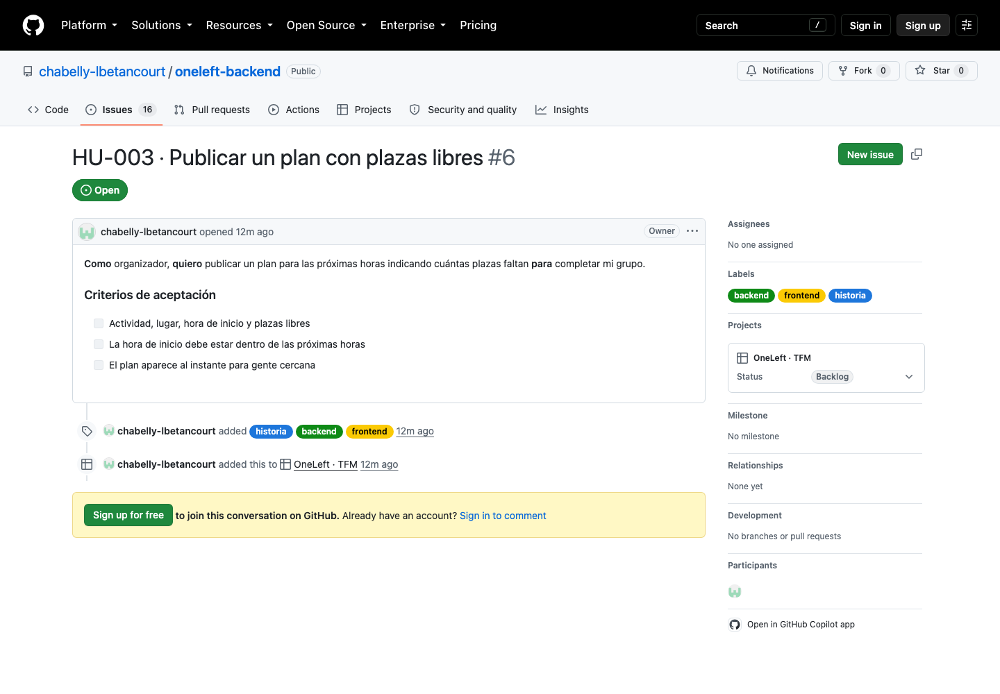

*Figura 3.1. Historia de usuario HU-003 en GitHub, con sus criterios de aceptación.*

El backlog inicial tenía 17 historias (HU-001 a HU-017) y 2 *Won't* (HU-018 y HU-019). Durante el desarrollo creció hasta
HU-073. En la tabla 3.3 se resumen las historias del MVP; el catálogo completo con su estado está en el
[anexo B](08-annexes.md#anexo-b-catálogo-completo-de-historias-de-usuario).

*Tabla 3.3. Historias principales (puntos de la historia en el tablero; las sub-issues tienen los suyos).*

| HU | Historia | MoSCoW | Puntos | Estado |
|---|---|---|---|---|
| HU-001 | Registro e inicio de sesión | Must | 5 | Hecha |
| HU-002 | Perfil con aficiones y nivel | Should | 3 | Hecha |
| HU-003 | Publicar un plan con plazas libres | Must | 5 | Hecha |
| HU-004 | Ver planes cercanos | Must | 5 | Hecha |
| HU-005 | Unirse a un plan | Must | 5 | Hecha |
| HU-006 | Notificaciones de planes cercanos | Must | 8 | Hecha |
| HU-007 | Caducidad automática de planes | Must | 3 | Hecha |
| HU-008 | Chat del plan | Should | 13 | Hecha |
| HU-009 | Reputación basada en eventos | Should | 13 | Hecha |
| HU-010 | Crear un plan en lenguaje natural | Should | 8 | Hecha |
| HU-011 | Moderación automática | Should | 8 | Pendiente |
| HU-012 | Elegir a quién notificar con IA | Should | 13 | Hecha |
| HU-013 | Panel de administración y moderación | Should | 13 | Pendiente |
| HU-014 | Agente «¿qué hago ahora?» | Could | 21 | Pendiente |
| HU-015 | Pruebas de carga y capacidad | Should | 5 | Pendiente |
| HU-016 | Memoria final del TFM | Must | 13 | En curso |
| HU-017 | Preparación de la defensa | Must | 5 | Pendiente |

## 3.5 Arquitectura del sistema

La arquitectura es de **microservicios con arquitectura hexagonal** detrás de un **API Gateway**, con comunicación
síncrona (REST a través del gateway) y asíncrona (eventos en RabbitMQ). El diagrama de componentes inicial del
anteproyecto (figura 3.2) se ha mantenido en lo esencial; la figura 3.3 muestra la arquitectura implementada y la
prevista, y la figura 3.4, la tecnología de cada pieza.

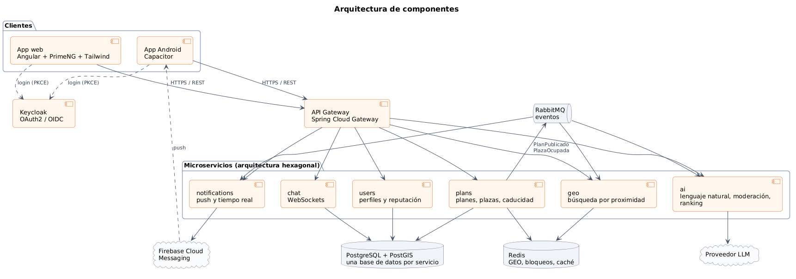

*Figura 3.2. Arquitectura de componentes prevista en el anteproyecto. Fuente:
[`02-arquitectura-componentes.puml`](../diagramas/componentes/src/02-arquitectura-componentes.puml).*

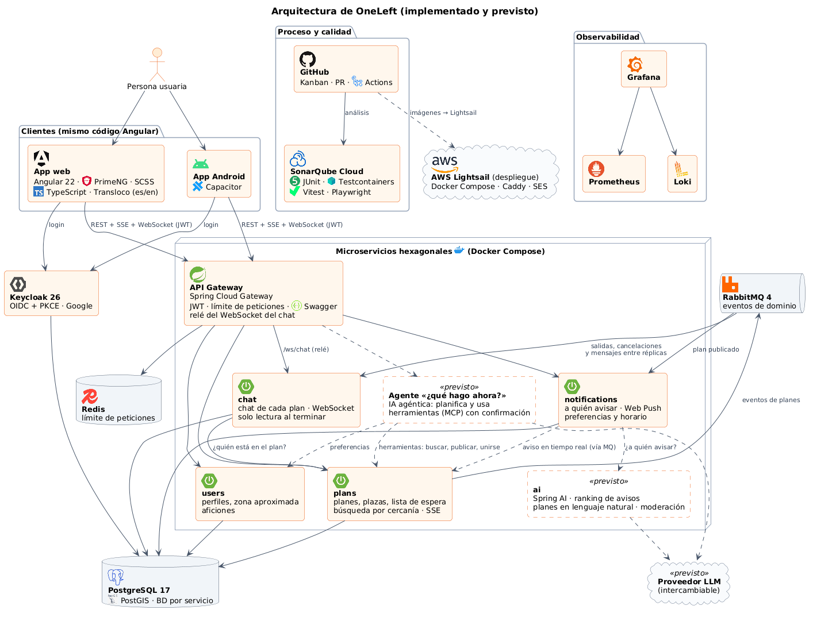

*Figura 3.3. Arquitectura implementada y prevista. Fuente:
[`30-arquitectura-implementada-y-prevista.puml`](../diagramas/componentes/src/30-arquitectura-implementada-y-prevista.puml).*

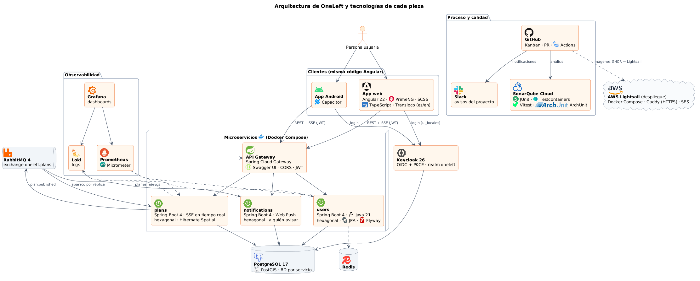

*Figura 3.4. Arquitectura con el logo de la tecnología de cada pieza. Fuente:
[`17-arquitectura-tecnologias.puml`](../diagramas/componentes/src/17-arquitectura-tecnologias.puml).*

*Tabla 3.4. Servicios del backend ([README del backend](https://github.com/chabelly-lbetancourt/oneleft-backend)).*

| Servicio | Puerto | Responsabilidad |
|---|---|---|
| `gateway` | 8080 | Entrada única: valida el token, enruta, aplica el límite de peticiones, agrupa la documentación OpenAPI y hace de relé del WebSocket del chat |
| `users` | 8081 | Perfil, aficiones, zona aproximada, foto, bio, datos demográficos, consentimiento, exportación y borrado de la cuenta |
| `plans` | 8082 | Planes, plazas, lista de espera, solicitudes, ciclo de vida, búsqueda cercana, check-in, previsión del tiempo, lugares, borrador por lenguaje natural y el flujo SSE personal |
| `notifications` | 8083 | Preferencias de avisos, alertas guardadas, a quién avisar (por tandas, con el `ranker`) y Web Push |
| `chat` | 8084 | Chat de cada plan por WebSocket |
| `social` | 8085 | Seguimientos, perfil social, feed de actividad, privacidad, bloqueos y reportes |
| `reputation` | 8086 | Libro de reputación inmutable, insignias y kudos |
| `ranker` | 8087 | Probabilidad de que cada persona se apunte a un plan (Python, FastAPI y scikit-learn) |

Decisiones de arquitectura que conviene destacar:

- **Defensa en profundidad en la autenticación.** La identidad se delega en Keycloak [KEYCLOAK] con OpenID Connect
  [OIDC-CORE] y el flujo Authorization Code con PKCE [RFC7636], el recomendado para aplicaciones sin secreto como una
  SPA o una app móvil. El gateway rechaza cualquier petición a `/api/**` sin token válido,
  y cada servicio lo vuelve a validar, de modo que un servicio no queda expuesto aunque alguien llegue a él sin pasar
  por el gateway ([entrada 06](../proceso/06-sprint3-login-y-observabilidad.md)).
- **Eventos con contrato en los campos.** Cada servicio lee el JSON de los eventos en sus propias clases; no hay una
  librería compartida de eventos. El contrato son los nombres y tipos de los campos
  ([entrada 23](../proceso/23-hu006-avisos-planes-cercanos.md)).
- **Dos tipos de colas.** Colas **duraderas compartidas** cuando un evento debe procesarse una sola vez aunque haya
  varias réplicas (avisos, reputación, feed), y colas **anónimas por réplica** cuando cada réplica tiene que reaccionar
  (los flujos en tiempo real de las personas conectadas a ella).
- **Un único canal de tiempo real por persona.** Los avisos de todos los servicios llegan a la web por el flujo SSE de
  `plans`, que los reenvía; así una persona mantiene una sola conexión ([entrada 18](../proceso/18-hu023-salir-y-lista-de-espera.md)).
- **Errores con código estable.** Las respuestas de error siguen Problem Details (RFC 9457) [RFC9457] con una propiedad
  `code` (`plan.full`, `plan.startsTooLate`…) que la web traduce al idioma de la persona.
- **Copias locales en lugar de consultas en caliente** cuando un servicio necesita datos de otro para muchas personas a
  la vez: los bloqueos se copian a `plans` y `notifications` (HU-033), y el público de cada persona a `notifications`
  ([ADR 0001](../arquitectura/adr/0001-avisos-por-publico-modelo-de-lectura.md)). Las decisiones de este tipo se
  registran como ADR [NYGARD-ADR] en [`arquitectura/adr`](../arquitectura/adr).

Cada servicio sigue la estructura hexagonal `domain` (modelo y puertos), `application` (casos de uso) e
`infrastructure` (adaptadores REST, persistencia, mensajería y configuración). Un test de ArchUnit por servicio falla si
el dominio depende de Spring o de otras capas, o si la aplicación depende de la infraestructura.

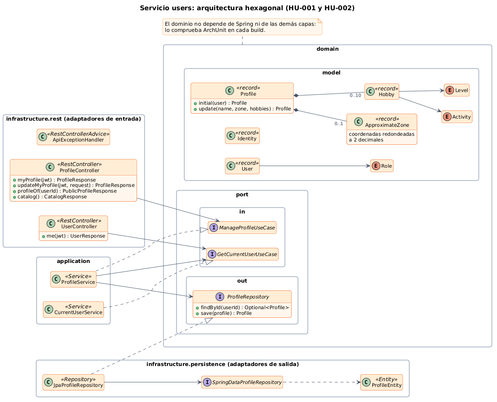

*Figura 3.5. Clases del servicio `users`: adaptadores de entrada, dominio con sus puertos, aplicación y adaptadores de
salida. Fuente: [`14-clases-users-hexagonal.puml`](../diagramas/clases/src/14-clases-users-hexagonal.puml).*

## 3.6 Diagrama de casos de uso

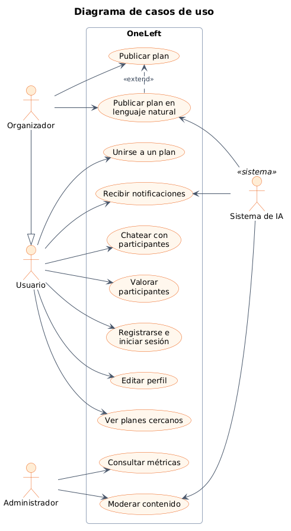

*Figura 3.6. Casos de uso, con la generalización de actores (la organizadora es una usuaria) y relaciones
`<<extend>>`. Fuente: [`01-casos-de-uso.puml`](../diagramas/casos-de-uso/src/01-casos-de-uso.puml).*

> **Pendiente:** el diagrama de casos de uso es el del anteproyecto. Conviene actualizarlo con los casos añadidos
> durante el desarrollo (lista de espera, check-in, seguir, bloquear y reportar, exportar y borrar datos).

## 3.7 Diseño detallado: clases, estados y secuencia

### Modelo de dominio del servicio de planes

`Plan` es el agregado central: contiene la organizadora, el punto de encuentro, la actividad, el nivel, las plazas, los
participantes, la lista de espera, las solicitudes, los avisos de llegada y su estado. Las reglas de negocio (unirse,
salir, pasar a la lista de espera, avanzar en el ciclo de vida) son métodos del agregado, de modo que se prueban sin
base de datos.

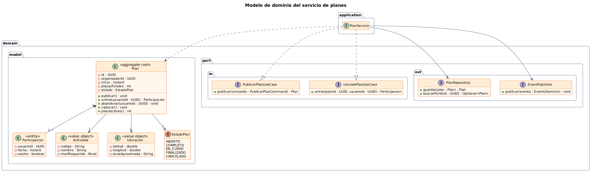

*Figura 3.7. El agregado `Plan`, los puertos de entrada y salida y el servicio de aplicación. Fuente:
[`03-clases-dominio-planes.puml`](../diagramas/clases/src/03-clases-dominio-planes.puml).*

### Ciclo de vida de un plan

Un plan está **abierto** mientras tiene plazas, **completo** al llenarse (y vuelve a abierto si alguien sale sin
lista de espera), **en curso** a su hora de inicio y **terminado** tres horas después. Puede **cancelarse** si exige un
mínimo de participantes y no lo alcanza en su hora límite (HU-039). Las tres horas de duración son una decisión
explícita: los planes no tienen hora de fin y pedirla complicaría publicar ([entrada 25](../proceso/25-hu007-caducidad-y-recordatorio.md)).

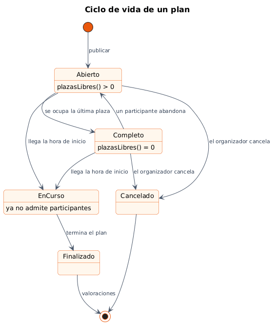

*Figura 3.8. Máquina de estados de un plan con los tiempos de HU-007 y el mínimo de HU-039. Fuente:
[`04-estados-plan.puml`](../diagramas/estados/src/04-estados-plan.puml).*

### Diagramas de secuencia

Cada historia relevante tiene su diagrama de secuencia en [`diagramas/secuencia`](../diagramas/secuencia). Se incluyen
aquí los que muestran las decisiones de diseño más importantes; el resto se referencian en el capítulo 4.

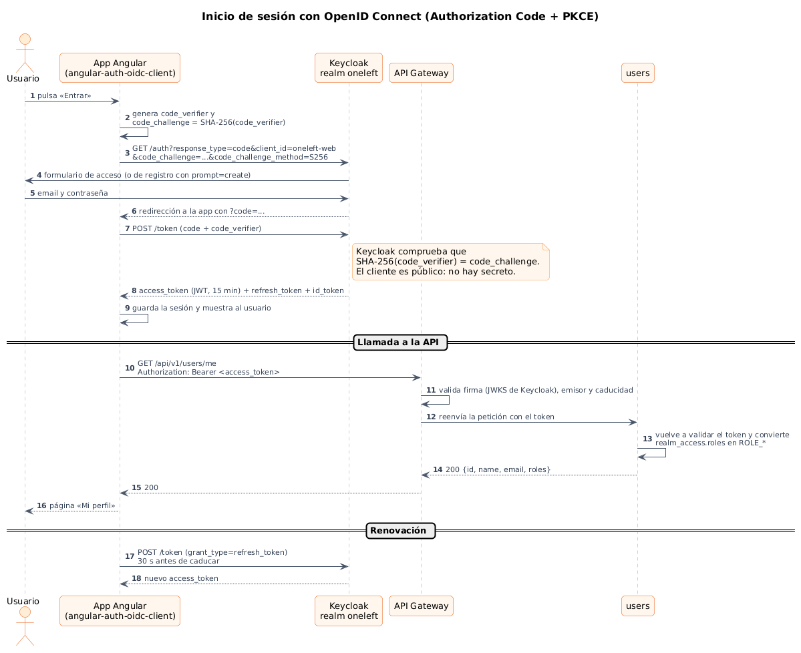

*Figura 3.9. Inicio de sesión con OIDC, Authorization Code + PKCE. Fuente:
[`11-secuencia-login-oidc.puml`](../diagramas/secuencia/src/11-secuencia-login-oidc.puml).*

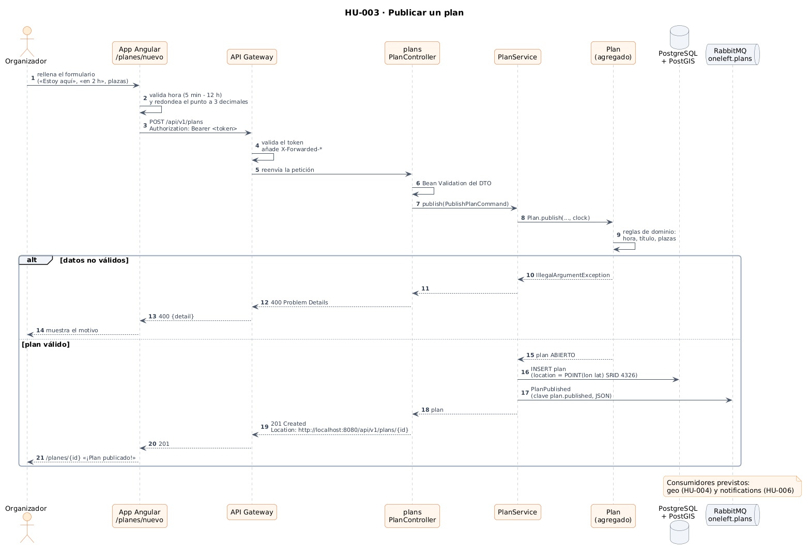

*Figura 3.10. Publicación de un plan: validación en el agregado, PostGIS y evento `plan.published`. Fuente:
[`16-secuencia-publicar-plan.puml`](../diagramas/secuencia/src/16-secuencia-publicar-plan.puml).*

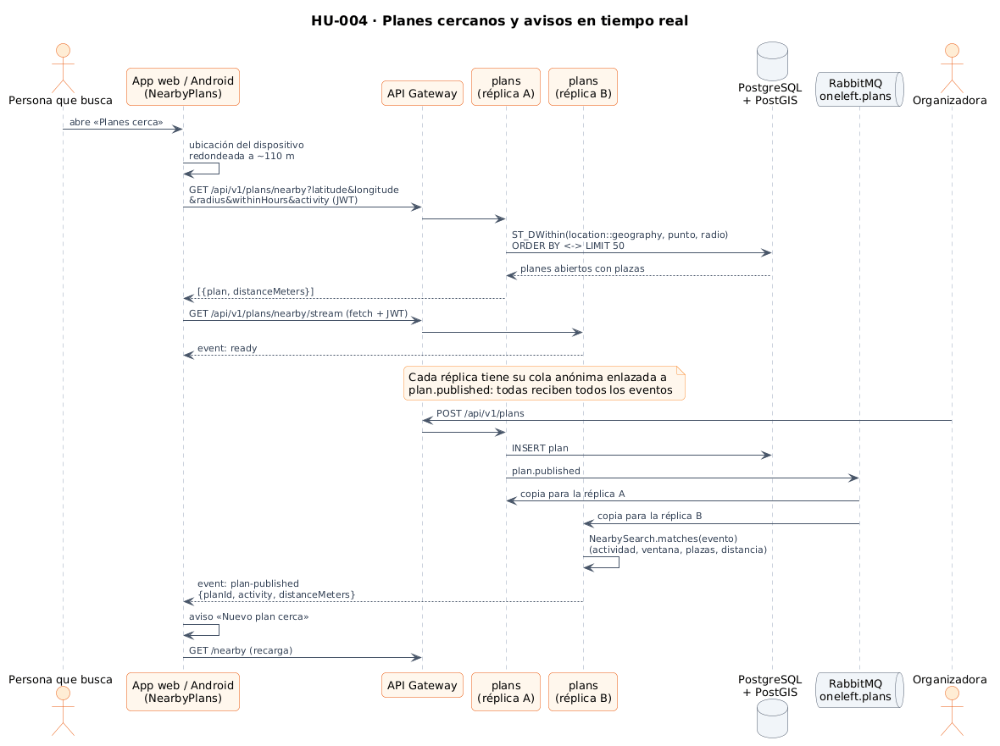

*Figura 3.11. Búsqueda y avisos en tiempo real con dos réplicas de `plans`. Fuente:
[`19-secuencia-planes-cercanos.puml`](../diagramas/secuencia/src/19-secuencia-planes-cercanos.puml).*

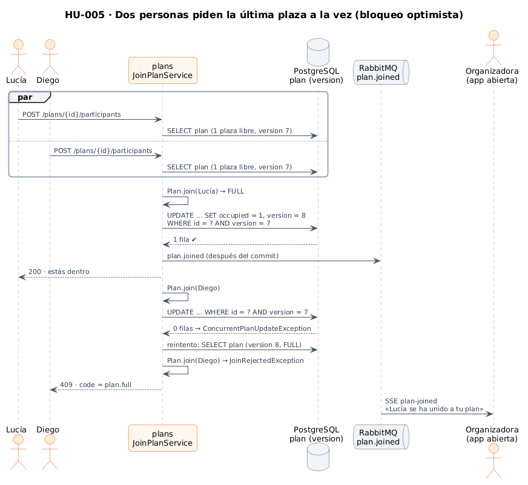

*Figura 3.12. Dos personas piden la última plaza a la vez: bloqueo optimista y reintento. Fuente:
[`20-secuencia-unirse-plan.puml`](../diagramas/secuencia/src/20-secuencia-unirse-plan.puml).*

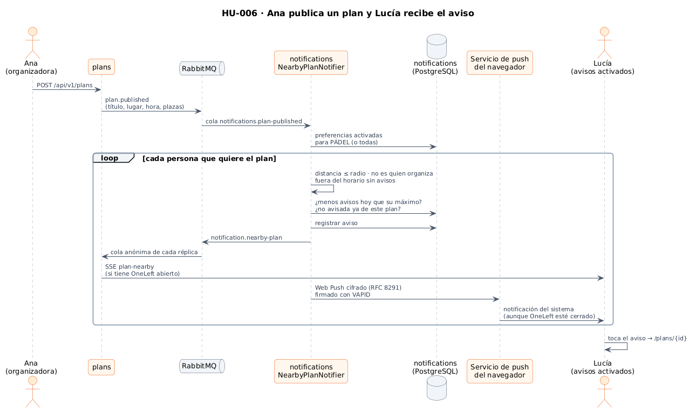

*Figura 3.13. Un plan publicado llega como aviso en la app y como notificación del sistema. Fuente:
[`29-secuencia-aviso-plan-cercano.puml`](../diagramas/secuencia/src/29-secuencia-aviso-plan-cercano.puml).*

> **Nota:** el diagrama [`05-secuencia-unirse-plan`](../diagramas/secuencia/05-secuencia-unirse-plan.png) del
> anteproyecto preveía un bloqueo distribuido además de la condición en la sentencia. La implementación usa solo
> bloqueo optimista, por los motivos explicados en 4.3; el diagrama 20 es el vigente.

## 3.8 Diagrama de despliegue y encaje en AWS

El diseño prevé tres entornos: **dev** (Docker Compose en el equipo de desarrollo), **pre** (*staging*) y **pro**, cada
uno de estos dos en su propia instancia de **AWS Lightsail** con Docker Compose y **Caddy** como única entrada con
HTTPS. La web, el API (`/api`) y Keycloak (`/auth`) se sirven en el mismo origen, lo que evita CORS en producción y
permite que la misma imagen de la web valga para cualquier dominio ([entrada 11](../proceso/11-entorno-pre-staging.md)).

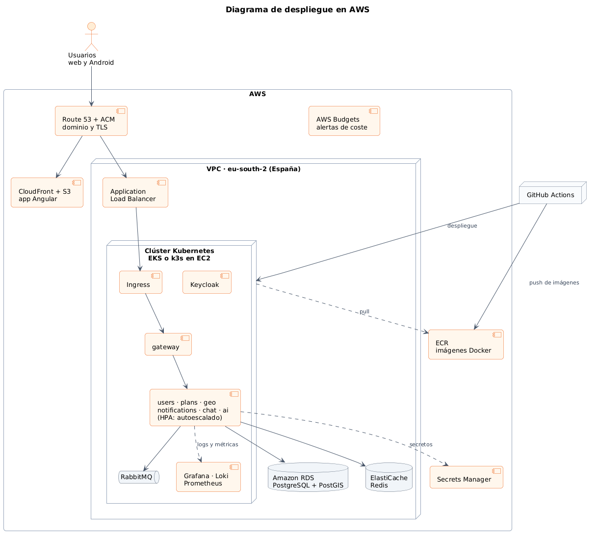

*Figura 3.14. Despliegue previsto en AWS. Fuente: [`07-despliegue-aws.puml`](../diagramas/despliegue/src/07-despliegue-aws.puml).*

*Tabla 3.5. Piezas del despliegue en AWS (diseño del anteproyecto).*

| Pieza | Papel en OneLeft |
|---|---|
| Instancia Lightsail (Linux, 2 vCPU, 8 GB, 160 GB SSD) | Ejecuta con Docker Compose todos los contenedores |
| Caddy (contenedor) | HTTPS automático con Let's Encrypt; enruta `/api` al gateway y `/auth` a Keycloak |
| IP estática y zona DNS de Lightsail | Dominio de la aplicación |
| GitHub Container Registry | Imágenes publicadas por GitHub Actions |
| *Snapshots* y almacenamiento de objetos de Lightsail | Copia de la instancia, volcados de PostgreSQL y fotos de perfil |
| Amazon SES | Correos de Keycloak |
| AWS Budgets y alarmas de Lightsail | Alertas de gasto y de uso de CPU, memoria y disco |

El entorno local se organiza por perfiles de Docker Compose:

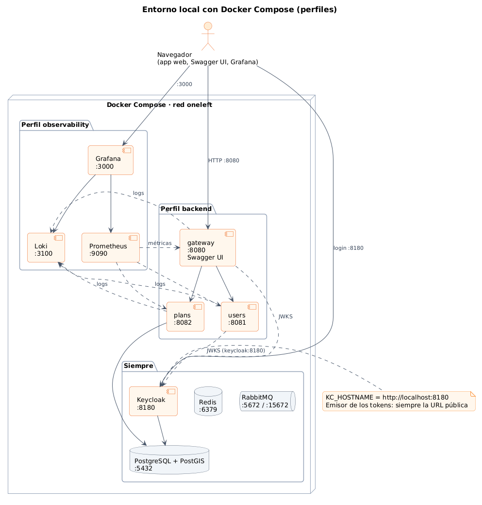

*Figura 3.15. Entorno local con Docker Compose y sus perfiles. Fuente:
[`13-despliegue-local.puml`](../diagramas/despliegue/src/13-despliegue-local.puml).*

> **Pendiente:** el despliegue real en AWS Lightsail (infra#5) no se ha realizado a fecha de este borrador. El
> Compose de producción está preparado y probado en local (apartado 4.7), pero no hay instancia, dominio, coste real ni
> alertas configuradas que documentar.

## 3.9 Modelo de datos y bases de datos

Se aplica el patrón **base de datos por servicio**: cada microservicio es dueño de su base de datos en PostgreSQL y
los demás solo acceden a sus datos a través de su API o de eventos. Las referencias a entidades de otros servicios
(una persona, un plan) se guardan como identificadores, **sin claves foráneas entre bases de datos**. Cada esquema se
gestiona con migraciones Flyway; Hibernate solo valida el esquema (`ddl-auto: validate`).

*Tabla 3.6. Bases de datos y migraciones por servicio (`src/main/resources/db/migration` de cada servicio).*

| Servicio | Almacenamiento | Datos principales | Migraciones |
|---|---|---|---|
| `users` | PostgreSQL + almacén S3 | Perfiles, aficiones, zona aproximada, foto, bio, consentimiento, datos demográficos | V1–V5 |
| `plans` | PostgreSQL + PostGIS | Planes, participantes, lista de espera, ciclo de vida, mínimo, disponibilidad, llegadas, check-in, asistencia, bloqueos, solicitudes, público | V1–V16 |
| `notifications` | PostgreSQL | Preferencias, avisos enviados, suscripciones Web Push, alertas guardadas, bloqueos, tandas, público de cada persona | V1–V5 |
| `chat` | PostgreSQL | Mensajes por plan (se borran 24 h después del fin del plan) | V1 |
| `social` | PostgreSQL + Redis | Personas, seguimientos, actividad, planes ocultos, bloqueos, reportes; primera página del feed en Redis | V1–V4 |
| `reputation` | PostgreSQL | Libro de reputación, puntuaciones, historial de asistencia, insignias, kudos | V1–V3 |
| `gateway` | Redis | Contadores del límite de peticiones | — |

Respecto al anteproyecto, el servicio `geo` con posiciones en Redis GEO no se creó (la búsqueda por proximidad y las
personas libres se resuelven con PostGIS) y el servicio `ai` se materializó como el `ranker` en Python y como un
adaptador del modelo de lenguaje dentro de `plans`.

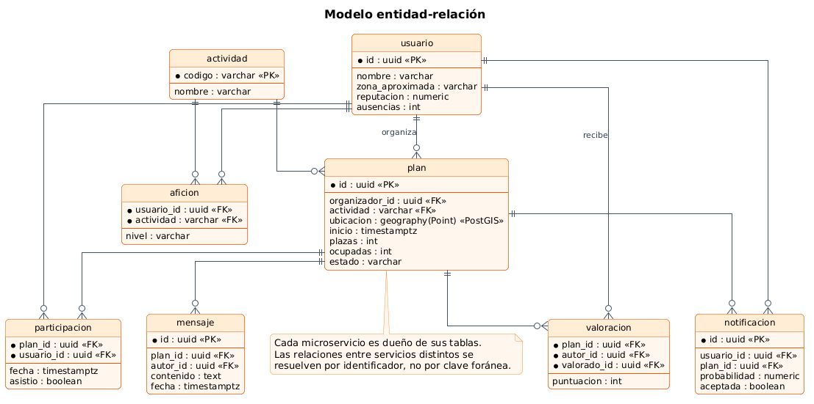

*Figura 3.16. Modelo entidad-relación inicial. Fuente:
[`06-modelo-entidad-relacion.puml`](../diagramas/datos/src/06-modelo-entidad-relacion.puml).*

A partir de HU-036, los diagramas de datos se dibujaron con draw.io, uno por historia:

| | |
|---|---|
| 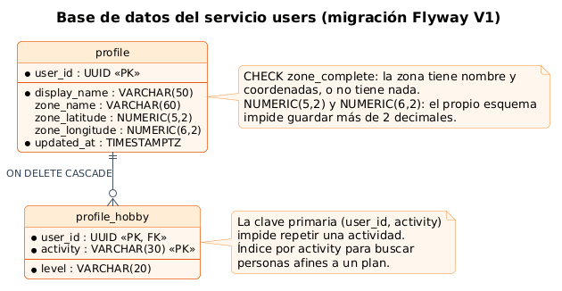 | 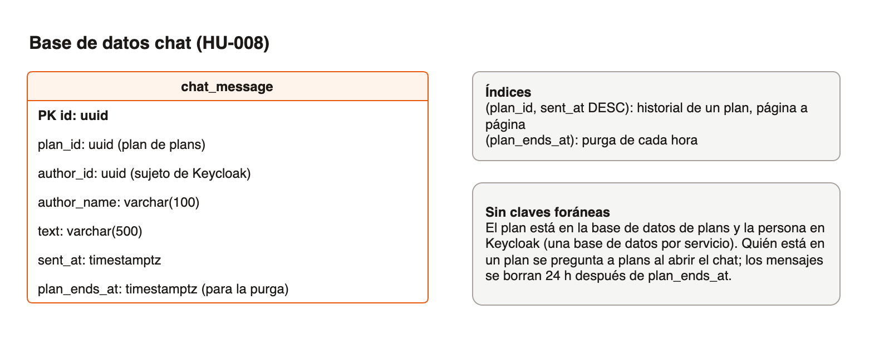 |
| *Figura 3.17. Esquema de `users` (V1)* | *Figura 3.18. Base de datos `chat`* |
| 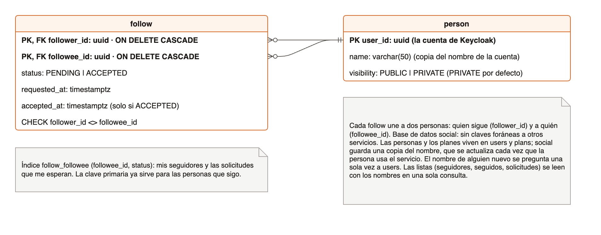 | 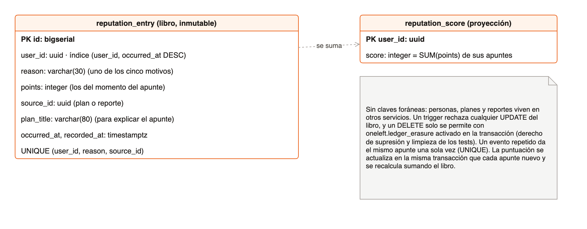 |
| *Figura 3.19. Base de datos `social`* | *Figura 3.20. Libro y proyección de `reputation`* |

Los demás diagramas de datos: [alertas](../diagramas/datos/33-modelo-alertas.png),
[disponibilidad](../diagramas/datos/34-modelo-disponibilidad.png), [check-in](../diagramas/datos/38-modelo-check-in.png),
[insignias](../diagramas/datos/44-modelo-insignias.png), [foto de perfil](../diagramas/datos/46-modelo-foto-de-perfil.png),
[feed](../diagramas/datos/50-modelo-feed.png) y [kudos](../diagramas/datos/53-modelo-kudos.png).

Decisiones del modelo de datos:

- **Punto de encuentro como `geometry(Point, 4326)`** con un índice GiST **de expresión** sobre `geography`, porque
  `ST_DWithin` sobre `geography` mide en metros y el índice sobre `geometry` no sirve para esa expresión. Un test lee el
  plan de ejecución (`EXPLAIN`) para comprobar que se usa el índice ([entrada 10](../proceso/10-sprint7-cercanos-idiomas-y-codigo-en-ingles.md)).
- **Precisión de las coordenadas como control de privacidad:** la zona del perfil con 2 decimales (≈ 1,1 km) en
  columnas `NUMERIC(5,2)` y `NUMERIC(6,2)` que no admiten más, y el punto de encuentro con 3 decimales (≈ 110 m), o con
  4 si es un lugar público elegido de las sugerencias.
- **Índices parciales** para las consultas que se ejecutan cada minuto (planes que aún se mueven, mínimos pendientes),
  de modo que los planes terminados, que serán la mayoría, quedan fuera del índice.
- **Libro de reputación inmutable:** un *trigger* rechaza cualquier cambio en `reputation_entry`; borrar solo se permite
  activando `oneleft.ledger_erasure` en la transacción (derecho de supresión y limpieza de los tests). La puntuación es
  una proyección que se recalcula sumando el libro ([entrada 38](../proceso/38-hu009-reputacion.md)).
- **Idempotencia en la base de datos:** claves primarias y restricciones `UNIQUE` con `ON CONFLICT DO NOTHING` para que
  un evento entregado dos veces (RabbitMQ entrega «al menos una vez») no duplique avisos, apuntes ni insignias.
