# 4. Implementación

Este capítulo resume cómo se ha construido OneLeft. El detalle de cada hito (decisiones, pruebas e incidencias) está
en el [diario del proceso](../proceso/README.md); aquí se recogen las decisiones que dan forma al sistema y se enlaza la
entrada correspondiente.

## 4.1 Gestión del proyecto con GitHub Projects

### Marco metodológico y tablero Kanban

El proyecto se gestiona en el tablero público [OneLeft · TFM](https://github.com/users/chabelly-lbetancourt/projects/4)
(GitHub Projects), vinculado a los cuatro repositorios ([entrada 01](../proceso/01-montaje-inicial.md)):

- **Columnas:** *Backlog* → *Sprint Backlog* → *In Progress* → *Done*.
- **Campos:** *Tipo* (Historia, Tarea, Bug, Documentación), *Prioridad (MoSCoW)*, *Puntos*, *Sprint* (iteraciones
  semanales), *Fecha inicio*, *Fecha fin* y *Tiempo invertido*. Los tres últimos se añadieron en el Sprint 7 para
  comparar lo estimado con lo realizado ([entrada 10](../proceso/10-sprint7-cercanos-idiomas-y-codigo-en-ingles.md)).
- **Vistas:** *Tablero Kanban*, *Backlog* (tabla) y *Épicas*. Una vista de *roadmap* se creó y se eliminó, porque la
  planificación temporal ya estaba en la columna *Sprint* y en el diagrama de Gantt ([entrada 02](../proceso/02-anteproyecto-priorizacion.md)).
- **Automatizaciones:** un issue añadido pasa a *Backlog*; al fusionar una PR o cerrar un issue, a *Done*; los
  sub-issues se añaden solos al tablero.
- **Etiquetas comunes** a los cuatro repositorios: de tipo (`historia`, `tarea`, `bug`, `documentación`, `hotfix`) y de
  área (`backend`, `frontend`, `android`, `infra`, `observabilidad`, `ci-cd`, `ia`, `seguridad`, `testing`,
  `accesibilidad`).
- **Épicas** `EP-01` a `EP-12` en `oneleft-docs`, de las que cuelgan las historias como sub-issues, para ver el avance
  de cada bloque con su barra de progreso.

| | |
|---|---|
| 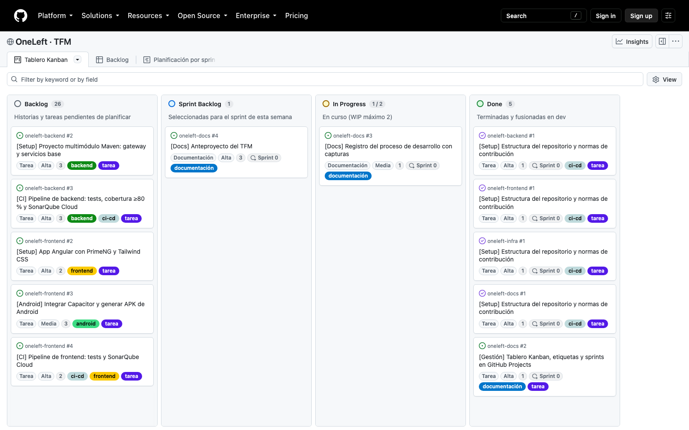 | 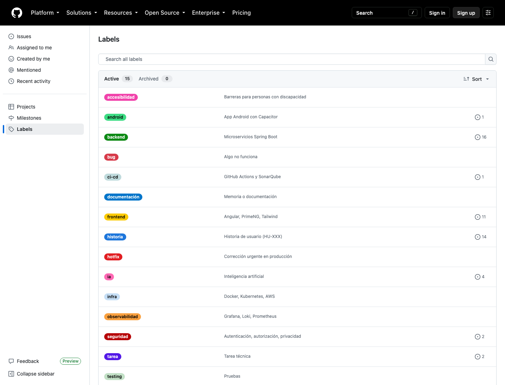 |
| *Figura 4.1. Tablero Kanban al cierre del montaje inicial* | *Figura 4.2. Etiquetas comunes a los repositorios* |

Una regla de proceso que surgió durante el desarrollo es que **una issue solo se cierra cuando está validada y
probada**. Al aplicarla en el Sprint 14 se reabrieron seis issues que se habían cerrado sin cumplirla y se volvió a
probar todo lo que estaba en curso ([entrada 45](../proceso/45-validacion-en-curso-y-bug-139.md)).

> **Pendiente:** el límite WIP. El anteproyecto y `CONTRIBUTING.md` fijan 2 tarjetas en *In Progress*; la columna del
> tablero tiene un límite de 4 y en la entrada 45 llegó a haber 5. Falta unificar el criterio y explicarlo.

### Priorización MoSCoW y estimación de tareas en cada sprint

Cada issue lleva su prioridad MoSCoW y su estimación en puntos (Fibonacci), con la tabla de referencia del anteproyecto
(1 punto: menos de 2 horas; 8 puntos: una semana; 13: se divide). Al empezar, de los 35 issues priorizados, 23 eran
*Must*, 9 *Should*, 1 *Could* y 2 *Won't* ([entrada 02](../proceso/02-anteproyecto-priorizacion.md)). A fecha de este
borrador el tablero tiene 266 tarjetas: 59 *Must*, 159 *Should*, 31 *Could*, 2 *Won't* y 15 sin prioridad; por tipo,
107 historias, 90 tareas, 35 de documentación y 19 bugs.

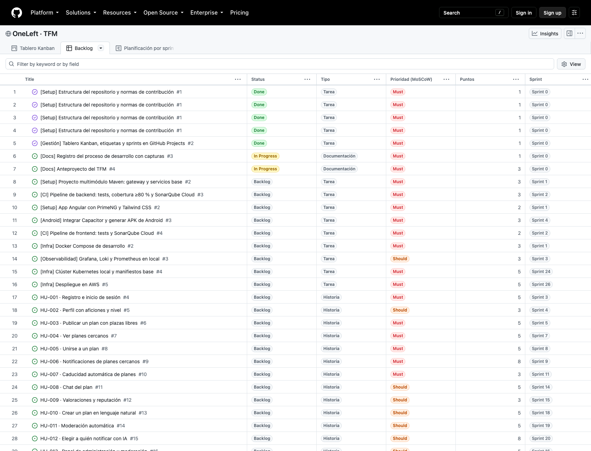

*Figura 4.3. Vista de backlog con tipo, prioridad MoSCoW, puntos y sprint previsto de cada issue.*

Dos prácticas de estimación aparecieron con la experiencia:

- **Reestimar por analogía antes de empezar.** HU-047 (seguir a personas) estaba en 5 puntos; como estrenaba servicio,
  igual que HU-008, se reestimó a 8 antes de empezar. HU-048 se reestimó de 5 a 8 porque tocaba cuatro servicios
  ([entradas 37](../proceso/37-hu047-seguir-a-personas.md) y [41](../proceso/41-hu048-perfil-social.md)).
- **Dividir por repositorio.** Una historia que toca varios repositorios se reparte en sub-issues, cada una con sus
  puntos; en el Sprint 3 esto amplió la estimación de 8 a 13 puntos ([entrada 06](../proceso/06-sprint3-login-y-observabilidad.md)).

### Planificación y ejecución de sprints

Los sprints son semanales. La tabla 4.1 resume, sprint a sprint, los puntos planificados y completados según el
tablero.

*Tabla 4.1. Puntos por sprint según el tablero (consulta del 24/11/2026). «Tiempo» es el campo* Tiempo invertido *de las
tarjetas terminadas, que se anota en la misma unidad que los puntos.*

| Sprint | Inicio | Tarjetas | Puntos planificados | Puntos completados | Tiempo |
|---|---|---|---|---|---|
| 0 | 10/07/2026 | 11 | 20,5 | 20,5 | 18 |
| 1 | 17/07/2026 | 5 | 18 | 18 | 15 |
| 2 | 24/07/2026 | 6 | 17 | 17 | 14,5 |
| 3 | 31/07/2026 | 7 | 19 | 19 | 15,5 |
| 4 | 07/08/2026 | 6 | 18 | 18 | 14,5 |
| 5 | 14/08/2026 | 7 | 18 | 18 | 14 |
| 6 | 21/08/2026 | 9 | 17 | 17 | 14,5 |
| 7 | 28/08/2026 | 9 | 21 | 21 | 18 |
| 8 | 04/09/2026 | 7 | 16 | 16 | 12,5 |
| 9 | 11/09/2026 | 8 | 19 | 19 | 15 |
| 10 | 18/09/2026 | 5 | 18 | 18 | 16 |
| 11 | 25/09/2026 | 11 | 17 | 17 | 12,5 |
| 12 | 02/10/2026 | 15 | 25 | 25 | 21 |
| 13 | 09/10/2026 | 56 | 164 | 164 | 162 |
| 14 | 16/10/2026 | 15 | 37 | 37 | 32 |
| 15 | 23/10/2026 | 14 | 31 | 25 | 25 |
| 16 | 30/10/2026 | 33 | 164 | 73 | 50 |
| 17 | 06/11/2026 | 20 | 97 | 8 | 8 |
| 18 | 13/11/2026 | 5 | 24 | 24 | 6 |
| 19 | 20/11/2026 | 2 | 14 | 0 | 0 |
| 20 | 27/11/2026 | 1 | 5 | 0 | 0 |

En total, 574,5 puntos completados con 484 unidades de tiempo anotadas.

> **Pendiente:** explicar el calendario. El anteproyecto y las primeras entradas del diario situaban el Sprint 0 el
> 28/09/2026 (por ejemplo, la entrada 10 da al Sprint 7 las fechas 16–22/11/2026), mientras que el tablero lo sitúa el
> 10/07/2026 y las entradas desde la 24 usan ese calendario (Sprint 12: 02–08/10/2026). Las entradas 01 a 23 tienen
> fecha 28–30/09/2026 y figuran como «trabajo del sprint adelantado». Falta la explicación de la autora sobre esta
> replanificación y confirmar que las cifras de los sprints 0–12 reflejan el reparto real.

Capturas del tablero al cierre de los primeros sprints:

| | | |
|---|---|---|
| 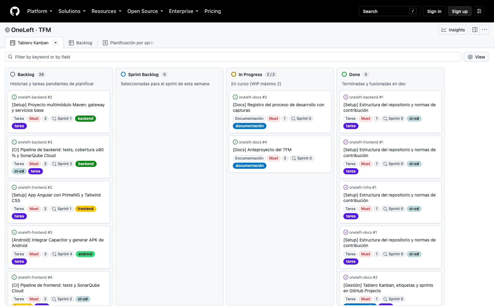 | 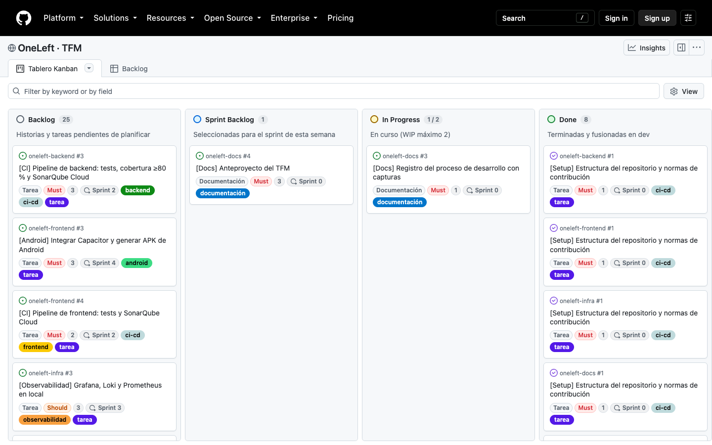 | 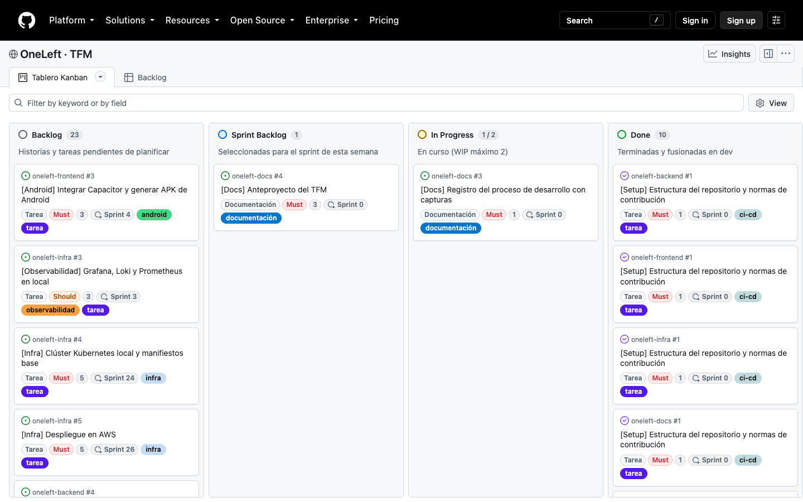 |
| *Figura 4.4. Sprint 0* | *Figura 4.5. Sprint 1* | *Figura 4.6. Sprint 2* |
| 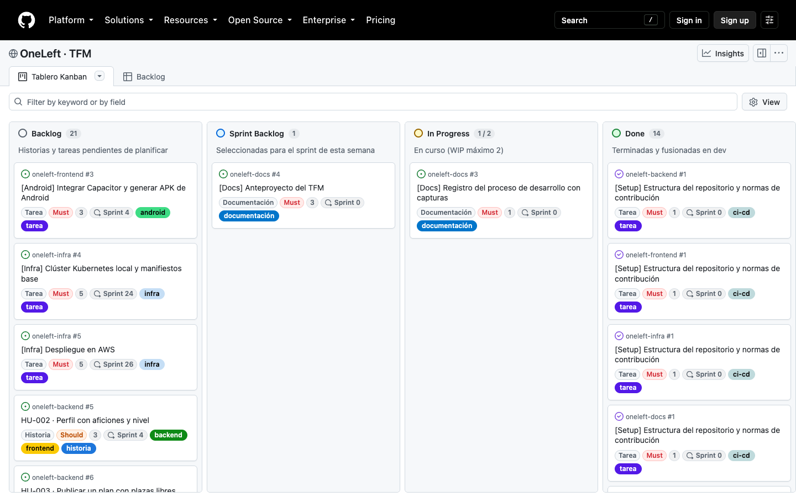 | 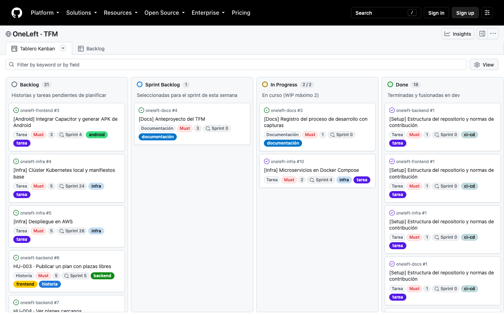 |  |
| *Figura 4.7. Sprint 3* | *Figura 4.8. Sprint 4* | *Figura 4.9. Sprint 5* |

> **Pendiente:** capturas del tablero de los sprints 6 a 18 (se hacen a mano, porque requieren sesión) y el gráfico de
> velocidad, que debe generarse a partir de la tabla 4.1.

### Análisis de velocidad y desviaciones

De la tabla 4.1 se desprenden tres fases:

1. **Sprints 0–12: ritmo estable** de 16 a 25 puntos por sprint, todo lo planificado completado. Es la fase de montaje
   (repositorios, CI, entorno) y de las historias *Must* del núcleo (HU-001 a HU-007).
2. **Sprints 13–14: pico de entrega.** El Sprint 13 concentra 56 tarjetas y 164 puntos: chat, reputación, insignias,
   foto, seguir, perfil social, check-in, mínimo de participantes, tiempo, alertas, «estoy libre» y sugerencias de
   lugares. Muchas de estas historias reaprovechan piezas ya hechas (la tarea de cada minuto de HU-007, el flujo en
   tiempo real, PostGIS), lo que abarató las siguientes.
3. **Sprints 15–17: desviación.** En los sprints 16 y 17 se planificaron 164 y 97 puntos y se completaron 73 y 8. Lo
   que quedó sin hacer es sobre todo *Should* y *Could* del bloque de comunidad y de IA (HU-011, HU-013, HU-014,
   HU-037, HU-049, HU-062–HU-066…) y las tareas de despliegue (infra#5, HU-015).

La priorización MoSCoW cumplió su función: lo que se ha quedado fuera son historias *Should* y *Could*. Las tareas
*Must* pendientes son el despliegue en AWS (infra#5), la memoria (HU-016) y la defensa (HU-017).

> **Pendiente:** valoración de la autora sobre las causas de la desviación de los sprints 16–17 (sobreplanificación,
> problemas del entorno local documentados en las entradas 36, 40 y 43, dedicación) y sobre la relación entre puntos y
> tiempo anotado.

## 4.2 Herramientas y entorno de trabajo

*Tabla 4.2. Herramientas del proyecto.*

| Ámbito | Herramienta | Uso |
|---|---|---|
| Gestión | GitHub Projects | Tablero Kanban, backlog y épicas; un script versionado ([`tools/board/board.py`](../tools/board/board.py)) agrupa las escrituras en el tablero |
| Control de versiones | Git y GitHub | Cuatro repositorios públicos con ramas `dev`, `pre`, `main`, `issue#N` y `hotfix/*` |
| IDE backend | IntelliJ IDEA | Microservicios Java |
| IDE frontend | WebStorm y Android Studio | Web Angular y proyecto Android |
| CI/CD | GitHub Actions | Workflows `lint` y `ci` en cada repositorio |
| Calidad | JaCoCo, Vitest, ArchUnit, SonarQube Cloud | Cobertura, reglas de arquitectura y análisis estático |
| Contenedores | Docker y Docker Compose | Entorno local y de producción |
| Comunicación | Slack | Canal `#oneleft` con los avisos de GitHub (issues, PR y workflows) (infra#17) |
| Diagramas | PlantUML y draw.io | UML como código (renderizado con la imagen Docker oficial de PlantUML) y modelos de datos |
| Capturas | Puppeteer y scripts propios | Recorridos reproducibles de cada historia en [`tools/`](../tools) |

Todos los diagramas UML se escriben en **PlantUML** con un estilo común (`estilo.iuml`) y se generan con
[`tools/render-plantuml.sh`](../tools/render-plantuml.sh), que usa la imagen Docker oficial y no requiere instalar Java
ni Graphviz. Se migraron desde Mermaid al principio del proyecto porque PlantUML es la notación UML estándar y genera SVG
para la memoria ([entrada 04](../proceso/04-diagramas-plantuml.md)). Los diagramas de datos se dibujan en draw.io y se
exportan con [`tools/render-drawio.mjs`](../tools/render-drawio.mjs).

Las **capturas** de la aplicación se generan con scripts (`capture-*.mjs`), uno por historia, que reproducen el recorrido
con las personas de demostración y **deshacen lo que crean** al terminar. Así las figuras se pueden repetir cuando cambia
el diseño: en la entrada 17 se rehicieron todas con la licencia de PrimeUI y el diseño final.

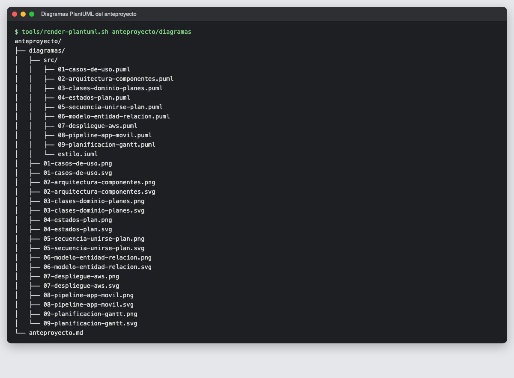

*Figura 4.10. Fuentes `.puml` en `src/` y PNG/SVG generados.*

> **Pendiente:** capturas de IntelliJ IDEA, WebStorm, SonarQube Cloud y del canal de Slack, previstas en la estructura
> de la memoria y que no están en `capturas/`.

## 4.3 Microservicios del backend

### Estructura de directorios y capas

El backend es un proyecto Maven multimódulo con **Spring Boot 4.1.1** y **Spring Cloud 2025.1.3** sobre Java 21
[SPRING-BOOT] [SPRING-CLOUD], más el servicio `ranker` en Python. Cada servicio sigue la estructura hexagonal
`domain` / `application` / `infrastructure`, comprobada con ArchUnit ([entrada 03](../proceso/03-sprint1-entorno-y-esqueletos.md)).

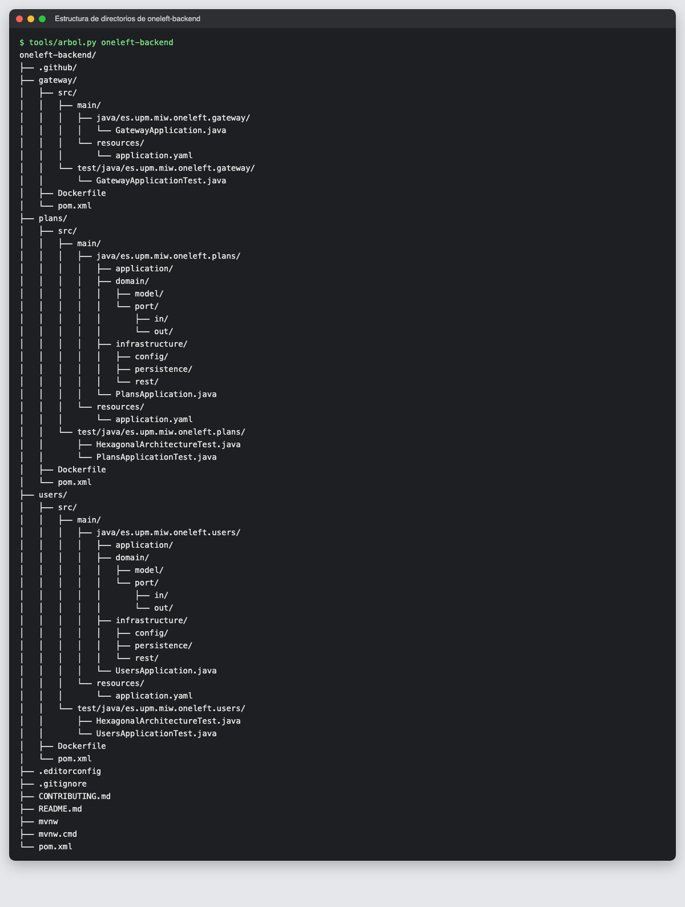

*Figura 4.11. Estructura de oneleft-backend: capas `domain`, `application` e `infrastructure` en cada servicio.*

Convenciones comunes a todos los servicios:

- **Código en inglés** (nombres, enumerados, logs, OpenAPI), decidido en el Sprint 7. Como aún no había ningún
  entorno desplegado, las migraciones se reescribieron en lugar de añadir migraciones de datos
  ([entrada 10](../proceso/10-sprint7-cercanos-idiomas-y-codigo-en-ingles.md)).
- **Reloj inyectable** (`Clock`) para probar las reglas temporales con un reloj fijo.
- **Errores** en Problem Details con `code` estable.
- **OpenAPI 3.1** con springdoc en cada servicio, agrupada en Swagger UI en el gateway, con Keycloak como esquema
  OAuth 2 para probar los endpoints protegidos ([entrada 07](../proceso/07-openapi-y-contenedores.md)).
- **Seed de demostración** (perfil `seed`) con clases Java que usan los casos de uso, porque las horas de los planes
  deben calcularse en cada arranque para caer en las próximas 12 horas. Nunca se activa con el perfil `pro`
  (`@Profile("seed & !pro")`), con un test de la expresión ([entrada 13](../proceso/13-seed-y-hu005-unirse.md)).

### Gateway

Spring Cloud Gateway (versión WebMVC) enruta cada prefijo `/api/v1/<servicio>/**` a su servicio y valida el token.
Tres decisiones relevantes:

- **Límite de peticiones** con Bucket4j (*token bucket*) y estado en Redis, para que todas las réplicas compartan el
  contador. El filtro va dentro de Spring Security, después de validar el JWT, para usar el `sub` del usuario como clave
  (cambiar de red no lo esquiva); sin sesión se usa la IP. Reglas: 5 publicaciones por hora, 30 búsquedas de lugares por
  minuto, 60 peticiones por minuto a `/share/**` y 120 peticiones por minuto en general. Responde 429 con Problem Details
  y `Retry-After`, y **falla en abierto** si Redis cae, porque un anti-spam no debe dejar la aplicación sin servicio
  ([entrada 14](../proceso/14-limite-de-peticiones.md)).
- **Pool de conexiones del proxy.** Al sustituir el cliente HTTP del JDK por Apache HttpClient, el *pool* por defecto
  admitía 5 conexiones por servicio, y con cinco flujos SSE abiertos el resto de peticiones a `plans` quedaban esperando.
  Lo detectaron los E2E en la promoción a `pre`; se configuró el *pool* y un test lo reproduce
  ([entrada 21](../proceso/21-release-pre-2.md)).
- **Relé del WebSocket del chat.** La versión WebMVC del gateway no reenvía WebSockets. En lugar de exponer el servicio
  de chat directamente (lo que duplicaría token, CORS y límites), el gateway acepta la conexión en `/ws/chat`, valida el
  token y abre otra con `chat`. Como el navegador no puede enviar `Authorization` en un WebSocket, el token viaja en el
  subprotocolo `oneleft.bearer` ([entrada 34](../proceso/34-hu008-chat-del-plan.md)).

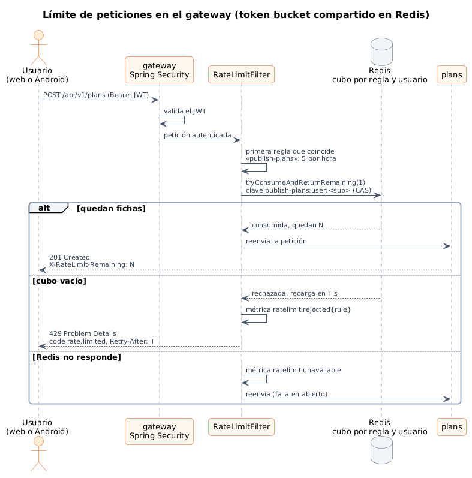

*Figura 4.12. Recorrido de una petición por el límite del gateway. Fuente:
[`21-secuencia-limite-peticiones.puml`](../diagramas/secuencia/src/21-secuencia-limite-peticiones.puml).*

### Servicio `users`

Gestiona el perfil, que se crea en el primer acceso a partir de la identidad de Keycloak. La zona habitual se protege en
tres capas: el dispositivo redondea a 2 decimales, el dominio vuelve a redondear (por si otro cliente enviara
coordenadas exactas) y las columnas no admiten más precisión; el perfil público solo incluye el nombre de la zona
([entrada 08](../proceso/08-sprint4-perfil.md)). La foto de perfil (HU-020) **no pasa por el backend**: `users` firma un
enlace que solo admite un `PUT` de ese tipo y tamaño durante 5 minutos, el navegador recorta la imagen a 512 px en WebP y
la sube al almacén compatible con S3; las fotos se ven con enlaces firmados de una hora y solo con sesión
([entrada 40](../proceso/40-hu020-foto-de-perfil.md)). También agrega la exportación de datos y coordina el borrado de la
cuenta (HU-045).

### Servicio `plans`

Es el núcleo. Sus decisiones principales:

- **Publicar** (HU-003): la regla de los 5 minutos a 12 horas vive en el agregado; el punto de encuentro se guarda en
  PostGIS y se publica `PlanPublished` en un *exchange topic* de RabbitMQ ([entrada 09](../proceso/09-sprint5-publicar-plan.md)).
- **Planes cercanos** (HU-004): `ST_DWithin` sobre `geography` con índice GiST de expresión, orden con `<->` y límite
  de 50; las reglas de la búsqueda (radio de 500 m a 25 km, ventana de 1 a 12 h) en el dominio. El tiempo real va por
  **Server-Sent Events**, que pasan por el gateway y los balanceadores sin necesidad de WebSockets, con un latido cada
  20 s ([entrada 10](../proceso/10-sprint7-cercanos-idiomas-y-codigo-en-ingles.md)).
- **Unirse sin sobreocupación** (HU-005): **bloqueo optimista** con una columna `version`. Se eligió frente a
  `SELECT … FOR UPDATE` porque unirse casi nunca compite: el bloqueo optimista no retiene filas ni conexiones y el caso
  raro de conflicto se resuelve con un reintento. El evento se publica **después del commit**, para que una unión
  revertida nunca se anuncie ([entrada 13](../proceso/13-seed-y-hu005-unirse.md)). Salir, la lista de espera y las
  solicitudes con aprobación (HU-023, HU-069) comparten el mismo mecanismo de reintento (`OptimisticPlanUpdates`)
  ([entrada 18](../proceso/18-hu023-salir-y-lista-de-espera.md)).
- **Ciclo de vida** (HU-007, HU-039): una tarea cada minuto recorre los planes con algo pendiente y los avanza uno a uno
  con bloqueo optimista, de modo que con varias réplicas solo una guarda cada cambio, sin herramientas de bloqueo
  distribuido. La misma tarea envía el recordatorio 30 minutos antes, cancela los planes que no alcanzan su mínimo y
  cierra la asistencia al acabar la ventana de check-in ([entradas 25](../proceso/25-hu007-caducidad-y-recordatorio.md)
  y [27](../proceso/27-hu039-minimo-de-participantes.md)).
- **Check-in** (HU-025): la geovalla de 150 m la responde PostGIS contra el punto del plan; la ubicación del móvil solo
  se usa para esa pregunta y **no se guarda**, cosa que comprueba un test de integración ([entrada 36](../proceso/36-hu025-check-in.md)).
- **Integraciones externas** (HU-026, HU-071): la previsión de Open-Meteo y las sugerencias de lugares de Photon pasan por
  un puerto de salida, una caché en Redis (30 minutos y 24 horas) y un *circuit breaker* de Resilience4j; si fallan, la
  función desaparece sin afectar al plan ([entradas 28](../proceso/28-hu026-prevision-del-tiempo.md) y
  [33](../proceso/33-hu071-sugerir-sitios.md)).

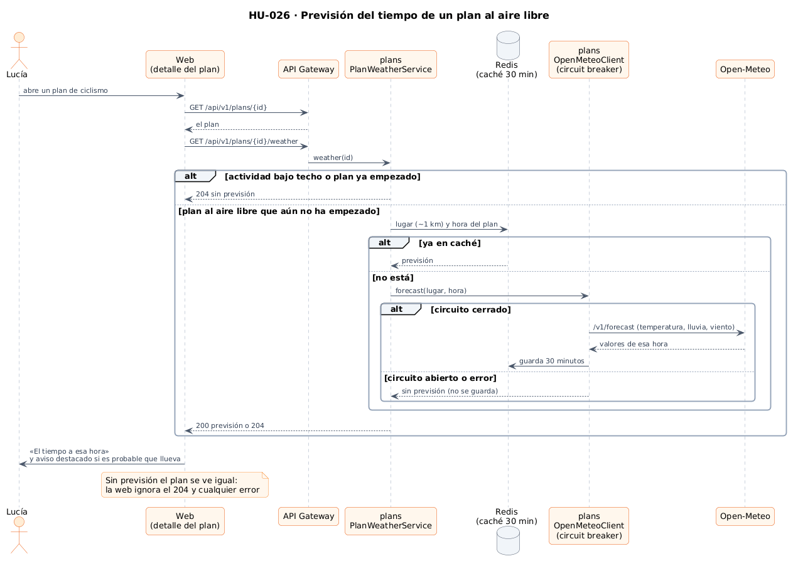

*Figura 4.13. La previsión pasa por la caché de Redis y el circuit breaker antes de llegar a Open-Meteo. Fuente:
[`32-secuencia-prevision-tiempo.puml`](../diagramas/secuencia/src/32-secuencia-prevision-tiempo.puml).*

### Servicio `notifications`

Decide a quién avisar de cada plan publicado (HU-006): distancia dentro del radio, actividades elegidas, fuera del
horario sin avisos y por debajo del máximo diario, nunca a quien organiza y **una vez por plan y persona** (clave primaria
en `sent_notice`). Los avisos están **desactivados por defecto** y el permiso del navegador se pide solo al pulsar el
botón. Lee `plan.published` de una cola duradera compartida, así que un plan publicado con el servicio parado se procesa
al volver ([entrada 23](../proceso/23-hu006-avisos-planes-cercanos.md)).

**Web Push se implementó con el JDK**, cifrado `aes128gcm` (RFC 8291) [RFC8291] y firma VAPID (RFC 8292) [RFC8292],
porque las librerías disponibles arrastraban dependencias pesadas o estaban sin mantenimiento. La implementación se
comprueba **byte a byte con el ejemplo de la propia RFC 8291**.

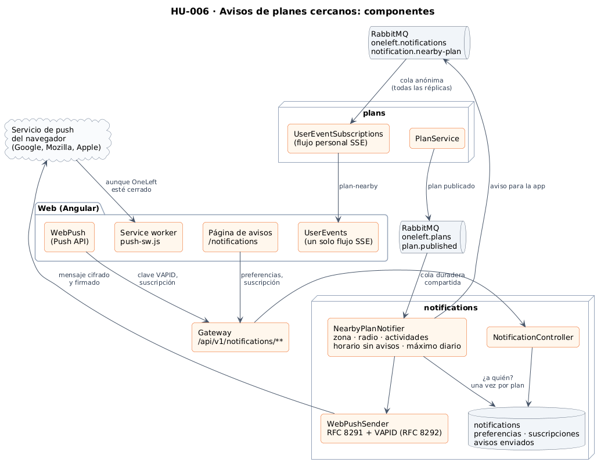

*Figura 4.14. Componentes de HU-006. Fuente: [`28-componentes-avisos.puml`](../diagramas/componentes/src/28-componentes-avisos.puml).*

### Servicios `chat`, `social` y `reputation`

- **`chat`** (HU-008) es un servicio aparte para cumplir RNF-06: si falla, se sigue publicando y uniéndose. Pregunta a
  `plans` quién está en el plan al abrir el chat, reparte los mensajes entre réplicas por un *exchange* propio, pasa a
  solo lectura al terminar el plan y borra los mensajes 24 horas después ([entrada 34](../proceso/34-hu008-chat-del-plan.md)).
- **`social`** (HU-047, HU-048, HU-051, HU-059, HU-033): seguimientos con perfil **privado por defecto**, perfil social,
  feed y bloqueos. Para el feed se comparó *fan-out* al escribir (copiar cada actividad al feed de cada seguidor) con
  *fan-out* al leer, y se eligió **leer** con la primera página en Redis, porque cada persona sigue a pocas decenas de
  personas y la privacidad cambia a menudo; al leer se aplica siempre al día ([entrada 42](../proceso/42-hu051-hu059-feed-y-privacidad.md)).
  El bloqueo es privado: para la persona bloqueada, el perfil responde 404, porque un 403 le diría que ha sido
  bloqueada ([entrada 50](../proceso/50-hu033-bloquear-y-reportar.md)).
- **`reputation`** (HU-009, HU-044, HU-060) es un servicio dirigido por eventos con un **libro inmutable** de apuntes y
  la puntuación como proyección. Las reglas evitan premiar malas prácticas: +20 al organizar solo si el plan se llena y
  se celebra, −15 por no presentarse solo si alguien del grupo hizo check-in ([entrada 38](../proceso/38-hu009-reputacion.md)).
  Las insignias y los kudos se apoyan en el mismo historial de asistencia ([entradas 39](../proceso/39-hu044-insignias.md)
  y [44](../proceso/44-hu060-kudos.md)).

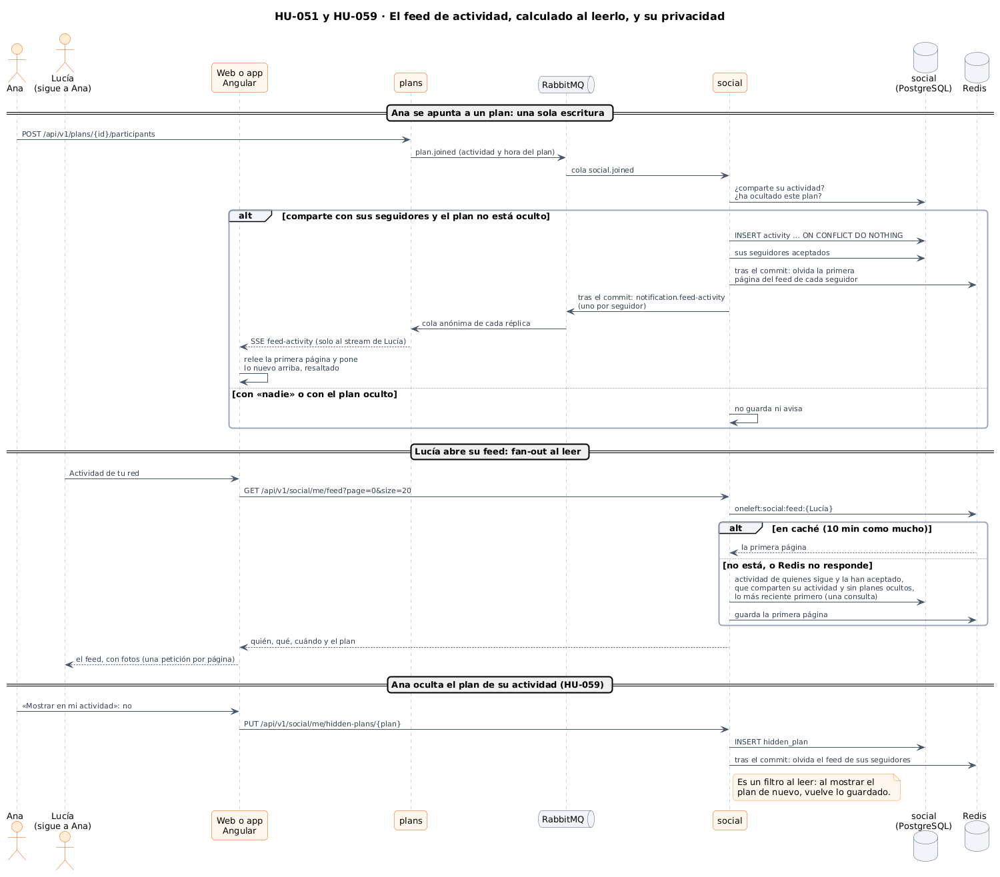

*Figura 4.15. Feed de actividad calculado al leer, con la primera página en Redis. Fuente:
[`49-secuencia-feed-de-actividad.puml`](../diagramas/secuencia/src/49-secuencia-feed-de-actividad.puml).*

### Privacidad y RGPD

HU-045 cierra los derechos de acceso, portabilidad y supresión del RGPD [RGPD]. Cada servicio publica sus datos en
`/me/data` y `users` los agrega en un único JSON; si un servicio no responde, no hay fichero (un fichero a medias
parecería completo). El borrado es un evento `user.deleted` que cada servicio recibe en su cola duradera; lo compartido
con otras personas (mensajes de chat, participación en planes celebrados) se **anonimiza** en lugar de borrarse, para no
dañar conversaciones ni reputaciones ajenas. La cuenta de Keycloak se borra con un cliente cuya cuenta de servicio solo
puede gestionar usuarios (mínimo privilegio) ([entrada 52](../proceso/52-hu045-exportar-y-borrar-mis-datos.md)).

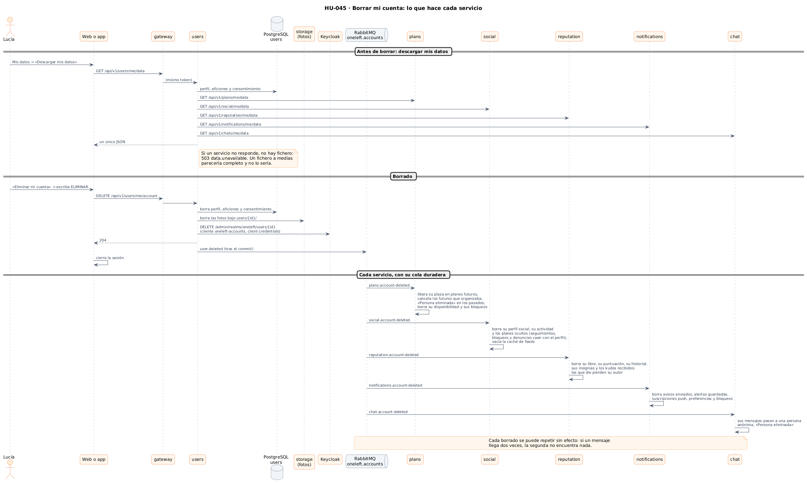

*Figura 4.16. Descargar los datos y borrar la cuenta. Fuente:
[`54-secuencia-borrar-cuenta.puml`](../diagramas/secuencia/src/54-secuencia-borrar-cuenta.puml).*

Una limitación conocida, documentada en el código y en el diario, es que **no hay patrón *outbox***: si un servicio cae
entre el commit y la publicación de un evento, el evento se pierde. Para el borrado se mitiga porque es repetible.

### Lecciones del desarrollo del backend

Algunas incidencias del diario ilustran el valor de la integración continua y de las pruebas con infraestructura real:

- Una regla `out/` del `.gitignore`, pensada para IntelliJ, ocultaba el paquete `domain/port/out` de los puertos de
  salida; en local compilaba y la CI lo detectó ([entrada 08](../proceso/08-sprint4-perfil.md)).
- PostgreSQL guarda las horas con microsegundos y las **redondea**, mientras que el reloj de Linux da nanosegundos (el de
  macOS, microsegundos). Varios tests pasaban en el Mac y fallaban en la CI ([entradas 25](../proceso/25-hu007-caducidad-y-recordatorio.md),
  [27](../proceso/27-hu039-minimo-de-participantes.md) y [36](../proceso/36-hu025-check-in.md)).
- RabbitMQ 4 ya no admite colas no exclusivas y no duraderas; las colas de prueba son duraderas y se borran al terminar.
- Dos historias en paralelo crearon la misma migración `V10` en `plans`; el orden alfabético de `ls` la escondía y Flyway
  no arrancaba en la CI ([entrada 50](../proceso/50-hu033-bloquear-y-reportar.md)).

## 4.4 Aplicación web

### Estructura de directorios

La web usa **Angular 22** sin Zone.js, con signals, **PrimeNG 22**, **Transloco** para los idiomas y
**angular-auth-oidc-client** para OIDC. La estructura separa servicios de toda la app, componentes reutilizables,
páginas por funcionalidad, layouts y utilidades, cada carpeta con un alias de importación (`@core`, `@components`,
`@features`, `@layout`, `@shared`, `@env`, `@testing`). ESLint rechaza los imports con `../` dentro de `src/app`; los
440 imports existentes se convirtieron con un script ([entrada 43](../proceso/43-navegacion-de-la-app.md)).

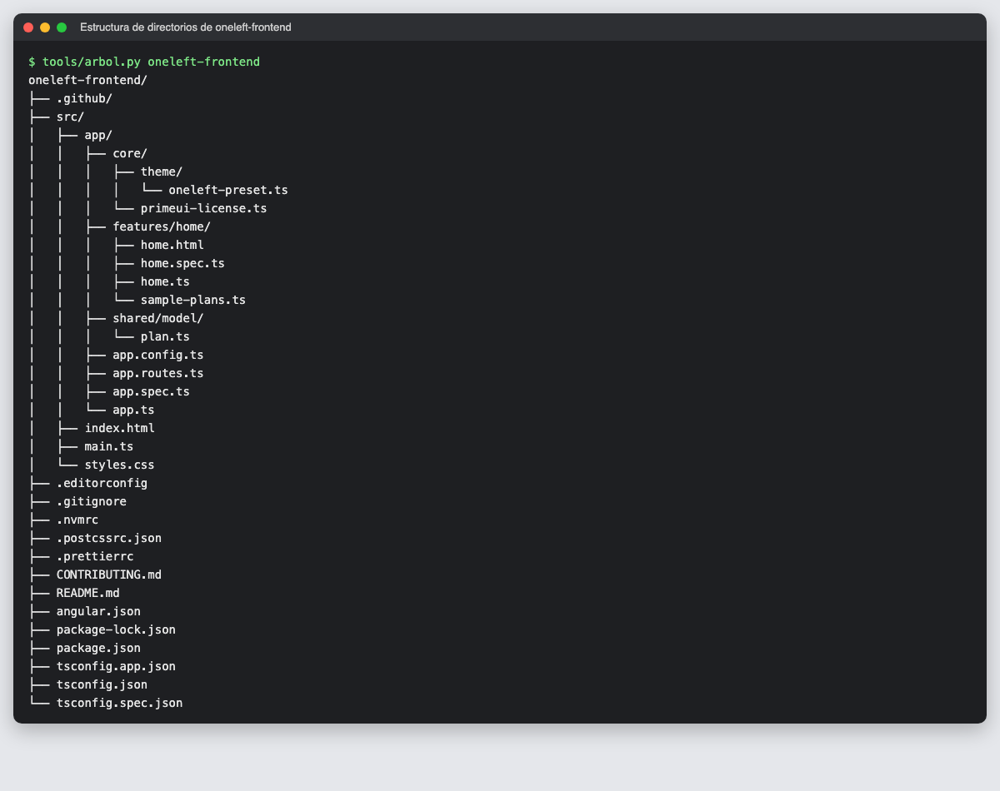

*Figura 4.17. Estructura inicial de oneleft-frontend (Sprint 1). La estructura actual está en el anexo C.*

### PrimeNG, Tailwind y sistema de diseño

PrimeNG aporta los componentes con un tema propio basado en Aura. Desde la versión 22 requiere una clave de la *PrimeUI
Community License*; se valoró volver a la versión 21 (MIT) o cambiar de librería y se optó por la licencia, que se
inyecta al compilar desde una variable de entorno o un secreto y nunca está en el repositorio
([entradas 03](../proceso/03-sprint1-entorno-y-esqueletos.md) y [17](../proceso/17-rediseno-y-paginas-de-acceso.md)).

La identidad visual pasó por dos versiones en el Sprint 7. La primera («cromo»: bordes gruesos, sombras desplazadas,
dos tipografías expresivas) se descartó por demasiado atrevida, y se sustituyó por una **identidad sobria**: una
tipografía (Plus Jakarta Sans), bordes finos y el naranja de marca solo como acento. El elemento de marca es la **plaza
libre**, un anillo discontinuo que aparece en el logo y en los huecos de cada plan ([entrada 17](../proceso/17-rediseno-y-paginas-de-acceso.md)).
Los estilos se escriben en SCSS con tokens `--ol-*` para el tema claro y el oscuro (HU-032); Tailwind queda para el
*reset* y las utilidades de accesibilidad.

### Decisiones técnicas destacadas

- **SSE leído con `fetch`** en lugar de `EventSource`, que no permite enviar la cabecera `Authorization`; poner el token
  en la URL lo dejaría en los logs del gateway. Parser incremental propio y reconexión cada 5 s
  ([entrada 12](../proceso/12-hu004-planes-cercanos-web.md)).
- **Mapa con Leaflet y OpenStreetMap** [LEAFLET] [OSM], sin clave ni coste, cargado solo en su pantalla. Los textos que
  escriben otras personas nunca se interpretan como HTML (hay un test con ``).
- **Idiomas con Transloco:** un único bundle para la web y Android, con cambio de idioma sin recargar; Keycloak recibe
  `ui_locales` para mostrar el login en el mismo idioma ([entrada 10](../proceso/10-sprint7-cercanos-idiomas-y-codigo-en-ingles.md)).
- **La contraseña solo se pide en Keycloak.** Las páginas de acceso son de OneLeft, pero pedir la contraseña en la app
  obligaría al flujo *password grant*, desaconsejado en OAuth 2.1 [OAUTH21]; Keycloak tiene un tema propio con la misma
  identidad. La vuelta a la página de origen solo acepta rutas de la propia app, para evitar redirecciones abiertas
  ([entrada 17](../proceso/17-rediseno-y-paginas-de-acceso.md)).
- **Volver a la pantalla anterior de la app**, no a la del navegador, con un servicio que sigue el historial de la
  visita; si la página se abrió directamente, vuelve a un destino por defecto y nunca sale de la app
  ([entrada 43](../proceso/43-navegacion-de-la-app.md)).
- **Accesibilidad:** combobox con roles y anuncio de resultados en las sugerencias de lugares, chat con `role="log"`,
  menú del avatar con `aria-haspopup`/`aria-expanded` y cierre con Escape, y foco gestionado al dar un kudos
  ([entradas 33](../proceso/33-hu071-sugerir-sitios.md), [34](../proceso/34-hu008-chat-del-plan.md),
  [43](../proceso/43-navegacion-de-la-app.md) y [47](../proceso/47-mejoras-del-panel-de-kudos.md)).

## 4.5 Aplicación móvil con Capacitor

La app Android **replica la web**: el mismo código Angular empaquetado con **Capacitor 8** y servido desde
`https://localhost` dentro del WebView. Lo nativo se limita a lo que el WebView no puede hacer bien
([entrada 22](../proceso/22-app-android-capacitor.md)):

- **Inicio de sesión en el navegador del sistema** (Custom Tabs), porque Google no permite iniciar sesión en un WebView
  incrustado y así la persona ve la URL real de Keycloak; la vuelta es por el *deep link* `oneleft://callback`.
- **Sesión en `localStorage`** dentro de la app, para que sobreviva al cerrarla.
- **Compartir** con `@capacitor/share` y ficheros con `@capacitor/filesystem` (tarjeta para Stories), porque el WebView no
  implementa la Web Share API.
- **Barras del sistema:** desde Android 15 la app se dibuja de borde a borde; una función `safe-area()` en los tokens
  respeta las barras con las variables que da Capacitor y vale 0 en el navegador ([entrada 32](../proceso/32-app-android-verificada.md)).
- **Menú inferior** solo en la app (HU-072), con «Publicar» en el centro.
- **Icono y pantalla de arranque generados** desde un SVG con la identidad de la app.

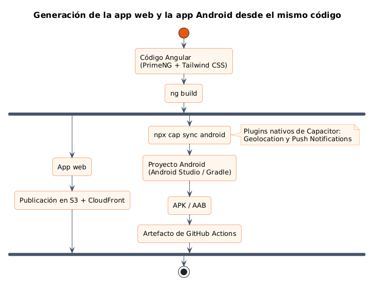

*Figura 4.18. Generación de la app web y Android a partir del mismo código. Fuente:
[`08-pipeline-app-movil.puml`](../diagramas/procesos/src/08-pipeline-app-movil.puml).*

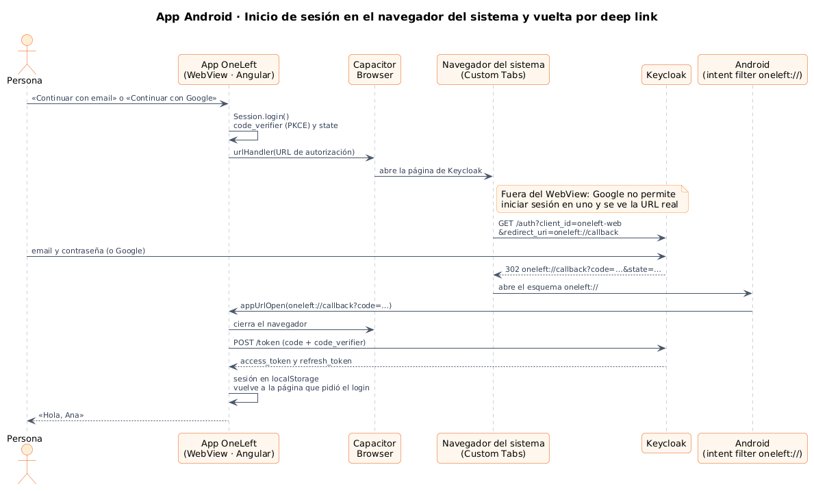

*Figura 4.19. Inicio de sesión en la app: Keycloak en el navegador del sistema y vuelta por `oneleft://callback`. Fuente:
[`27-secuencia-login-android.puml`](../diagramas/secuencia/src/27-secuencia-login-android.puml).*

El job *Android APK* de la CI compila la web con la licencia y publica el APK de depuración como artefacto. La app se ha
verificado en emuladores (Pixel 7 con API 36 y Pixel 10 Pro XL con API 37): inicio y cierre de sesión con email y con
Google, sesión al reabrir, compartir, barras del sistema, perfil social y avisos ([entradas 32](../proceso/32-app-android-verificada.md),
[46](../proceso/46-fusiones-y-pruebas-en-android.md) y [48](../proceso/48-arreglos-pendientes-y-google-en-android.md)).

> **Pendiente:** las notificaciones push con la app cerrada (frontend#55, Firebase) no están implementadas: en Android
> los avisos llegan con la app abierta. Tampoco se ha probado en Android la hoja de compartir de la tarjeta para Stories
> (HU-056) ni el dictado, que el WebView no ofrece.

## 4.6 Funcionalidades de inteligencia artificial

### HU-012: avisar primero a quien más probabilidad tiene de apuntarse

El aviso de HU-006 avisaba a todas las personas a la vez, por cercanía, lo que molesta a quien no iba a apuntarse y gasta
su límite diario. HU-012 ordena a las candidatas por la probabilidad de aceptar y avisa **por tandas**: 5 personas cada
3 minutos mientras queden plazas y falten más de 15 minutos ([entrada 53](../proceso/53-hu012-avisar-a-quien-mas-probabilidad-tiene.md)).

- El modelo vive en un **servicio aparte en Python** (`ranker`: FastAPI y scikit-learn), porque es el entorno natural
  para entrenar y evaluar un modelo. `notifications` lo llama por HTTP con tiempos cortos (1 s y 2 s) y, si falla,
  **avisa primero a las más cercanas**: los avisos no dependen del modelo.
- Se usan 11 variables que `notifications` ya conoce (distancia y distancia relativa al radio, minutos hasta el inicio,
  hora, día de la semana, interés declarado, si viene de una alerta, tasa de aceptación reciente suavizada, avisos
  recibidos y de hoy, y plazas libres).
- Cada tanda **vuelve a comprobar** las reglas de HU-006 y los bloqueos de HU-033, porque entre tandas pasan minutos.
- **Se aprende de lo que ocurre:** `plan.joined` marca el aviso como aceptado y cada aviso guarda cómo se eligió, para
  reentrenar y comparar con la regla de distancia (`NOTICES_STRATEGY=distance`).

**Evaluación.** No hay historial real antes del lanzamiento, así que el modelo (*gradient boosting*, 150 árboles de
profundidad 3) se entrena con un historial **sintético y reproducible** de 40 000 avisos con semilla fija.

*Tabla 4.3. Evaluación del modelo sobre el 20 % reservado ([entrada 53](../proceso/53-hu012-avisar-a-quien-mas-probabilidad-tiene.md)).*

| Métrica | Modelo | Solo distancia |
|---|---|---|
| AUC | 0,815 | 0,674 |
| Puntuación de Brier | 0,098 | — |
| Tasa de aceptación del historial | 13,7 % | — |

*Tabla 4.4. Simulador: 2 000 planes con 20–80 candidatas y 1–4 plazas, mismo sorteo para las dos estrategias.*

| Tanda | Estrategia | Planes completados | Minutos hasta completarlo | Aceptación | Avisos por plan |
|---|---|---|---|---|---|
| 5 cada 3 min | Distancia | 92,5 % | 3,94 | 20,8 % | 11,2 |
| 5 cada 3 min | Modelo | 92,5 % | 2,02 | 29,0 % | 8,0 |
| 3 cada 5 min | Distancia | 92,2 % | 12,44 | 20,7 % | 11,2 |
| 3 cada 5 min | Modelo | 92,4 % | 6,85 | 29,0 % | 8,0 |
| 10 cada 2 min | Distancia | 92,5 % | 0,95 | 20,8 % | 11,2 |
| 10 cada 2 min | Modelo | 92,5 % | 0,41 | 29,0 % | 8,0 |

En las tres configuraciones el modelo completa el plan en aproximadamente la mitad de tiempo y con un 28 % menos de
avisos. **Esta comparación tiene un límite importante:** el simulador usa el mismo mecanismo con el que se generó el
historial, así que demuestra que ordenar funciona cuando aceptar depende de más cosas que la distancia, **no cuánto se
ganará con personas reales**. Por eso se guardan los resultados reales y la estrategia de cada aviso, para comparar y
reentrenar tras unas semanas de uso. El primer historial sintético, con una aceptación del 4 %, se recalibró al 13,7 %
para que las cifras tuvieran sentido; la decisión figura en el código.

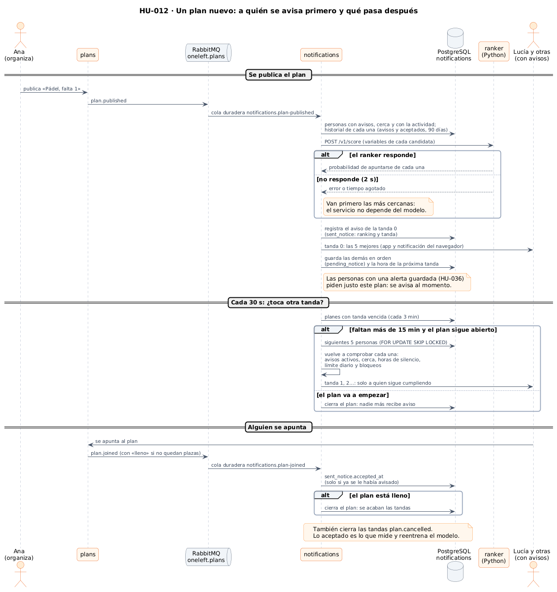

*Figura 4.20. De la publicación a las tandas y al aprendizaje. Fuente:
[`55-secuencia-avisos-por-tandas.puml`](../diagramas/secuencia/src/55-secuencia-avisos-por-tandas.puml).*

### HU-010: crear un plan con una frase

La persona escribe o dicta una frase («pádel hoy a las 7 en la Albufera, falta uno») y ve el formulario relleno
([entrada 54](../proceso/54-hu010-plan-con-una-frase.md)). Se usa un modelo de lenguaje de Anthropic con Spring AI 2.0.2
[SPRING-AI] detrás de un puerto `PlanInterpreter`, de modo que el proveedor se puede cambiar. Las decisiones de diseño
responden a los riesgos descritos en 2.10:

- **El modelo solo sugiere.** Cada campo se valida con las reglas del plan y lo que no encaja se lista como «falta».
- **Nunca se aceptan coordenadas del modelo:** el lugar se busca con la búsqueda de lugares de HU-071.
- **No se publica nada:** el borrador rellena el formulario de siempre y la persona pulsa «Publicar».
- **La frase es dato, no instrucción:** va delimitada y el sistema indica que se ignoren órdenes dentro; el modelo no
  tiene herramientas ni acceso a nada (mitigación de *prompt injection* [OWASP-LLM]).
- **Sin clave, el servicio arranca igual** y la función responde 503; la frase no se guarda y la propia tarjeta avisa de
  que se envía al proveedor.
- El dictado usa el reconocimiento de voz del navegador; donde no existe, no se muestra el botón.

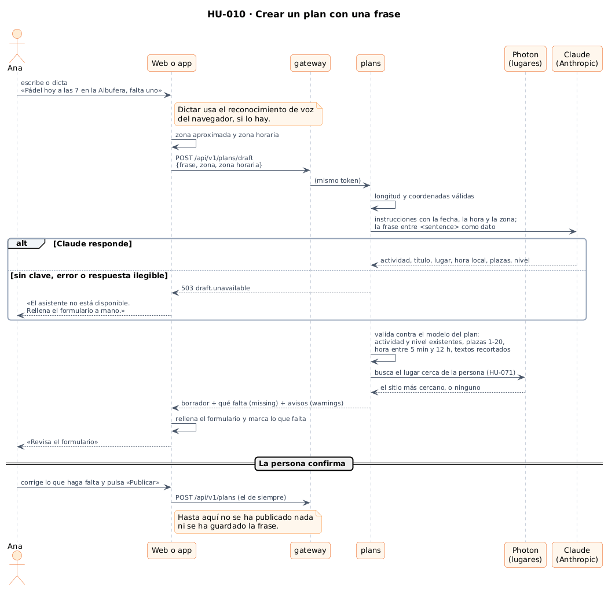

*Figura 4.21. De la frase al formulario relleno. Fuente:
[`56-secuencia-plan-con-una-frase.puml`](../diagramas/secuencia/src/56-secuencia-plan-con-una-frase.puml).*

> **Pendiente:** HU-010 no se ha probado contra la API real del proveedor, porque no hay clave en el entorno de
> desarrollo; la calidad con frases reales está sin medir. La moderación automática (HU-011) y el agente «¿qué hago
> ahora?» (HU-014) no están implementados.

## 4.7 Infraestructura y despliegue

### Estrategia de ramas y política de contribución

| Rama | Entorno | Uso |
|---|---|---|
| `dev` | dev | Rama por defecto; recibe las PR de `issue#N` |
| `pre` | pre (*staging*) | Candidata a producción; recibe `dev` por PR de promoción. Imágenes `:pre` |
| `main` | pro | Solo recibe `pre` o `hotfix/*`. Imágenes `:latest` |
| `issue#N` | — | Rama de vida corta por issue |
| `hotfix/*` | — | Corrección urgente desde `main`, que vuelve a `pre` y `dev` |

El workflow `lint` valida en cada PR el nombre de la rama, el **camino de promoción** (rechaza, por ejemplo, `dev → main`)
y que cada commit siga Conventional Commits y referencie su issue ([entradas 01](../proceso/01-montaje-inicial.md) y
[11](../proceso/11-entorno-pre-staging.md)).

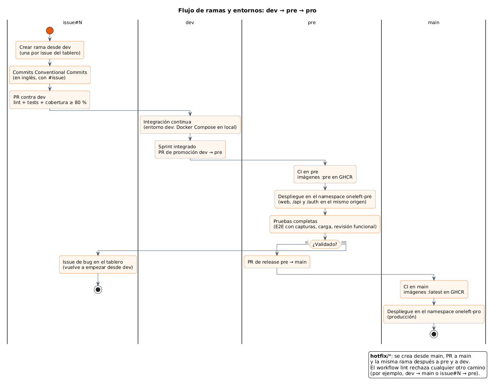

*Figura 4.22. Flujo `issue#N → dev → pre → main`. Fuente:
[`18-flujo-ramas-entornos.puml`](../diagramas/procesos/src/18-flujo-ramas-entornos.puml).*

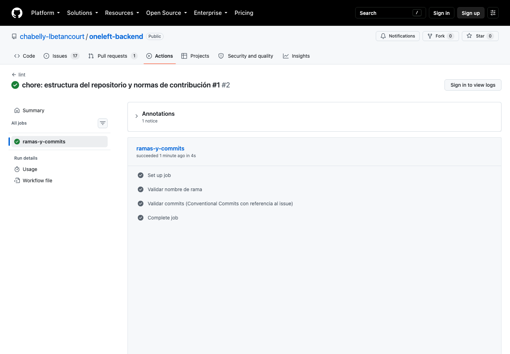

*Figura 4.23. Pasos del workflow `lint`.*

Las promociones a `pre` siguen un orden: backend e infra primero, porque la PR del frontend hacia `pre` ejecuta los E2E
contra las imágenes `:pre` del backend y el Compose de la rama `pre` de infra. Se han hecho cuatro rondas de promoción
([entradas 15](../proceso/15-release-pre.md), [21](../proceso/21-release-pre-2.md), [24](../proceso/24-release-pre-3.md)
y [35](../proceso/35-release-pre-4.md)); en la cuarta, los 34 E2E pasaron contra `pre`.

### Entorno de desarrollo con Docker Compose

`oneleft-infra/docker` levanta en local PostgreSQL con PostGIS (una base de datos por servicio), Redis, RabbitMQ y
Keycloak, y por perfiles los servicios del backend, la web y la observabilidad, con comprobaciones de salud en todos
([entradas 03](../proceso/03-sprint1-entorno-y-esqueletos.md) y [07](../proceso/07-openapi-y-contenedores.md)). El
realm de Keycloak está versionado y se importa al arrancar, con roles, un cliente público con PKCE y usuarias de prueba.

| | |
|---|---|
| 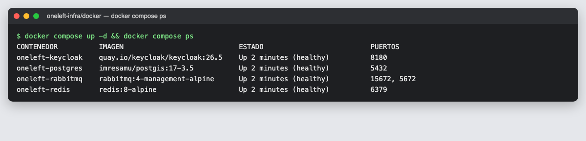 | 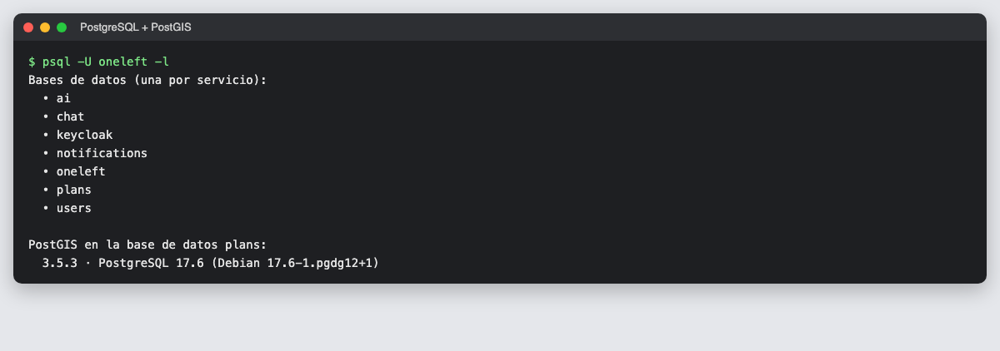 |
| *Figura 4.24. Servicios del entorno en estado healthy* | *Figura 4.25. Una base de datos por servicio* |

Un problema de diseño resuelto aquí es el **emisor de los tokens dentro de Docker**: desde el navegador Keycloak está en
`localhost:8180` y desde los contenedores en `keycloak:8180`, con lo que el `iss` no coincidía. Keycloak emite siempre
la URL pública y los servicios descargan las claves por la red interna ([entrada 07](../proceso/07-openapi-y-contenedores.md)).

El equipo de desarrollo (8 GB de memoria) ha sido una restricción constante: el stack completo roza el límite de Docker,
varios servicios se cerraron por falta de memoria y Docker Desktop llegó a reiniciarse vacío en tres ocasiones
([entradas 24](../proceso/24-release-pre-3.md), [36](../proceso/36-hu025-check-in.md), [40](../proceso/40-hu020-foto-de-perfil.md)
y [43](../proceso/43-navegacion-de-la-app.md)). De ahí salieron reglas de trabajo (no ejecutar Testcontainers en paralelo
con el stack, dejar la integración a la CI) y los límites de memoria del Compose de producción.

### Despliegue en AWS Lightsail y control de costes

El Compose de los entornos desplegados ([entrada 49](../proceso/49-compose-de-produccion.md)) está preparado y probado en
local:

- **Caddy como única entrada** (80 y 443): `/auth` a Keycloak, `/api` y `/share` al gateway, `/grafana` a Grafana y el
  resto a la web, con certificado de Let's Encrypt. Ningún otro puerto sale de la instancia.
- **Keycloak en modo producción** bajo `/auth`, con un **realm de producción generado** a partir del de desarrollo sin
  personas de prueba ni el cliente de pruebas con secreto; la CI comprueba que está al día.
- **Límites de memoria** por contenedor y `-Xmx` por JVM: 6,1 GB en total (6,4 GB con el `ranker`), dentro de una
  instancia de 8 GB.
- **Copia diaria de PostgreSQL** (`pg_dumpall`) a un bucket, con retención configurable y restauración probada.
- **Secretos** en el `.env` de la instancia, nunca en el repositorio.

La prueba en local, en `https://localhost` con la autoridad local de Caddy, arrancó 15 contenedores sanos, comprobó las
rutas, la redirección a HTTPS, el emisor de Keycloak, un inicio de sesión real y una copia restaurada en una base de
datos vacía; la memoria en reposo fue de unos 2,5 GB.

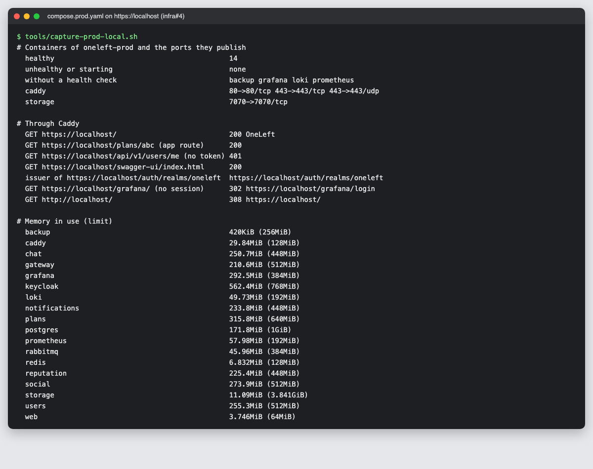

*Figura 4.26. El Compose de producción visto a través de Caddy en `https://localhost`.*

> **Pendiente:** el despliegue en AWS Lightsail (infra#5, *Must*) no está hecho. Falta documentar la instancia, el
> dominio, el certificado real, los buckets, Amazon SES, el despliegue desde GitHub Actions, el coste mensual real y las
> alertas de AWS Budgets. Hasta entonces, «pre» es la rama `pre` con sus imágenes `:pre` y el stack de E2E que levanta la
> CI, no una instancia en la nube.

### Pipeline de CI/CD y SonarQube

Cada repositorio de código tiene un workflow `ci` además de `lint` ([entrada 05](../proceso/05-sprint2-integracion-continua.md)):

- **Backend:** `./mvnw verify` con Java 21, cobertura por módulo con JaCoCo (falla por debajo del 80 % de líneas) y una
  matriz que construye la imagen Docker de cada servicio y la publica en GHCR desde `pre` y `main`.
- **Frontend:** lint (angular-eslint), tests con cobertura (umbral del 80 % en sentencias, ramas, funciones y líneas),
  build, imagen Docker, APK de Android y, en las PR hacia `pre`, los E2E con Playwright.
- **Infra:** validación de los Compose y del Caddyfile, comprobación del realm de producción y *shellcheck*
  ([entrada 49](../proceso/49-compose-de-produccion.md)).

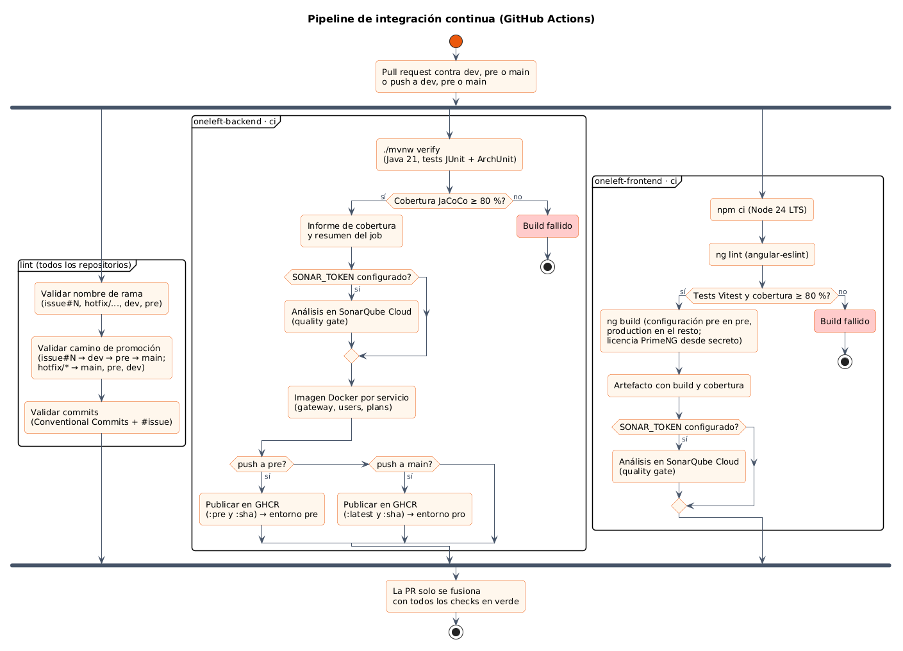

*Figura 4.27. Pipeline de integración continua. Fuente: [`10-pipeline-ci.puml`](../diagramas/procesos/src/10-pipeline-ci.puml).*

| | |
|---|---|
| 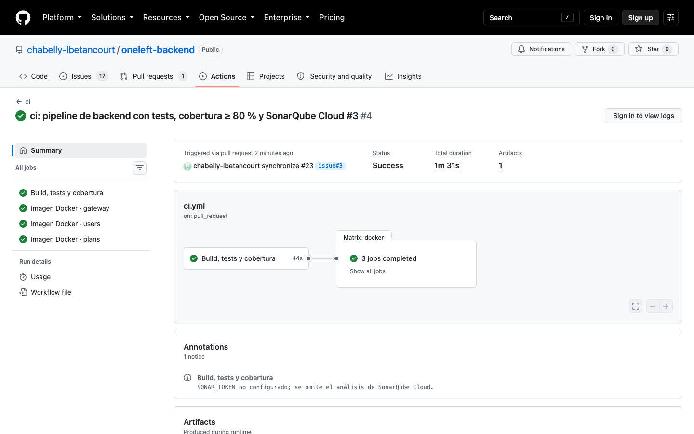 | 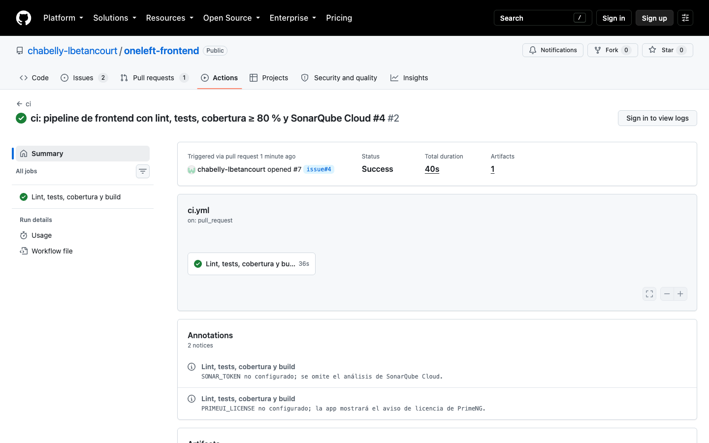 |
| *Figura 4.28. Workflow `ci` del backend* | *Figura 4.29. Workflow `ci` del frontend* |

Para comprobar que el umbral de cobertura funciona de verdad se añadió temporalmente una clase sin tests: JaCoCo detuvo
el build.

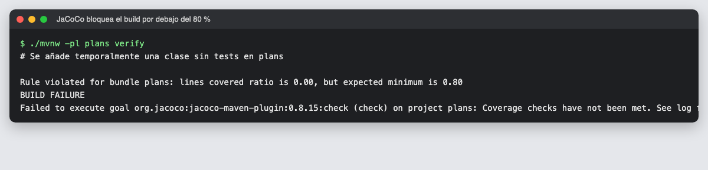

*Figura 4.30. Con una clase sin tests, el build falla.*

Otras decisiones: el *runner* se fijó a `ubuntu-24.04` para evitar cambios inesperados a mitad de proyecto, y el `push`
solo lanza la CI en las ramas de integración para no duplicar ejecuciones con la PR ([entradas 05](../proceso/05-sprint2-integracion-continua.md)
y [09](../proceso/09-sprint5-publicar-plan.md)).

> **Pendiente:** SonarQube Cloud. La configuración de los dos repositorios está preparada y el análisis se activa con el
> secreto `SONAR_TOKEN` ([entrada 05](../proceso/05-sprint2-integracion-continua.md)), pero el diario no documenta que se
> activara ni el resultado del *quality gate*. Hacen falta capturas y cifras de SonarQube antes de cerrar la memoria.

### Observabilidad

Los microservicios exponen métricas en `/actuator/prometheus` con histogramas de latencia HTTP; Prometheus las recoge
cada 10 segundos junto con Keycloak y RabbitMQ, los logs van a Loki con etiquetas de aplicación y nivel, y Grafana tiene
fuentes de datos y dashboard aprovisionados como código desde `oneleft-infra` ([entrada 06](../proceso/06-sprint3-login-y-observabilidad.md)).
Hay métricas propias para las suscripciones SSE abiertas y los rechazos del límite de peticiones.

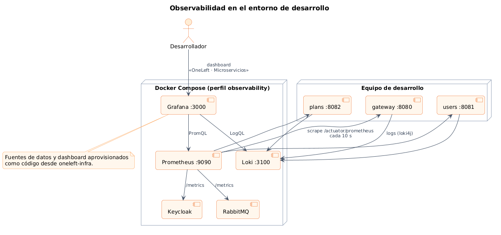

*Figura 4.31. Observabilidad en el entorno de desarrollo. Fuente:
[`12-observabilidad.puml`](../diagramas/componentes/src/12-observabilidad.puml).*

## 4.8 Pruebas

### Pruebas unitarias y de integración

La estrategia sigue la pirámide de pruebas:

- **Dominio y aplicación sin infraestructura.** Gracias a los puertos, los servicios de aplicación se prueban con
  repositorios en memoria y reloj fijo (por ejemplo, `ProfileService`, `PlanLifecycleServiceTest`, `FeedServiceTest`).
- **Integración con infraestructura real** mediante Testcontainers: PostgreSQL con PostGIS, RabbitMQ y Redis. Servicios
  externos (Open-Meteo, Photon, otros microservicios) simulados con WireMock.
- **Reglas de arquitectura** con ArchUnit en cada servicio.
- **Pruebas que reproducen el fallo antes de arreglarlo:** en la entrada 47 se comprobó que los cuatro tests nuevos
  **fallaban con el código anterior** antes de dar el arreglo por bueno.

La prueba de concurrencia de OE3 lanza **6 hilos** que piden la misma última plaza contra PostgreSQL real: entra
exactamente uno ([entrada 13](../proceso/13-seed-y-hu005-unirse.md)).

Una regla del proyecto es que **los tests que crean datos los borran al terminar**: los de integración borran lo que
crean, los E2E responden las API en el navegador o deshacen sus cambios, y tras cada recorrido se comprueba que la base de
datos local solo contiene los datos del seed (8 planes) ([entrada 44](../proceso/44-hu060-kudos.md)).

### Métricas de cobertura

*Tabla 4.5. Evolución de los tests unitarios de la web (del diario).*

| Momento | Tests | Cobertura de sentencias |
|---|---|---|
| Sprint 2 (CI) | 6 | 92,6 % |
| HU-001 | 17 | 94 % |
| HU-004 | 79 | 98,2 % |
| HU-006 | 133 | 96,8 % |
| HU-047 | 220 | — |
| HU-051 | 287 | 96,7 % |
| HU-045 | 350 | 96,9 % |
| HU-070 | 406 | — |

En el backend, la cobertura de líneas por servicio se ha mantenido por encima del umbral del 80 % que impone JaCoCo; por
ejemplo, `users` con el 100 % de líneas en HU-002, `plans` con el 100 % en HU-005 o `notifications` con el 92,5 % en
HU-006 ([entradas 08](../proceso/08-sprint4-perfil.md), [13](../proceso/13-seed-y-hu005-unirse.md) y
[23](../proceso/23-hu006-avisos-planes-cercanos.md)).

> **Pendiente:** cifras actuales de cobertura y número de tests de cada servicio del backend (los informes de JaCoCo de
> la última ejecución de la CI), y la cobertura final de la web.

### Pruebas de extremo a extremo

Los recorridos que al principio se capturaban con Puppeteer para la memoria se convirtieron en **tests E2E con
Playwright**, ejecutados contra el stack real (Keycloak, gateway con su límite de peticiones, microservicios, RabbitMQ y
SSE), en español y en inglés, y con datos creados por cada test ([entrada 16](../proceso/16-tests-e2e-playwright.md)).
La batería pasó de 10 tests (5 recorridos × 2 idiomas) a 76 en la CI de la PR #146 del frontend
([entrada 48](../proceso/48-arreglos-pendientes-y-google-en-android.md)).

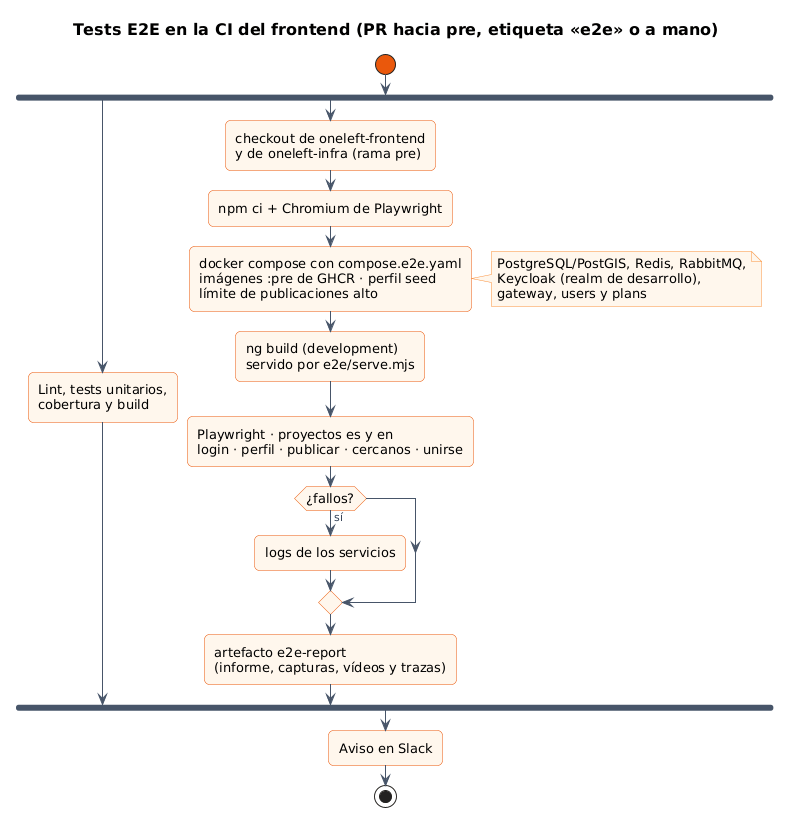

*Figura 4.32. Job `e2e` del frontend. Fuente: [`22-tests-e2e-ci.puml`](../diagramas/procesos/src/22-tests-e2e-ci.puml).*

| | |
|---|---|
| 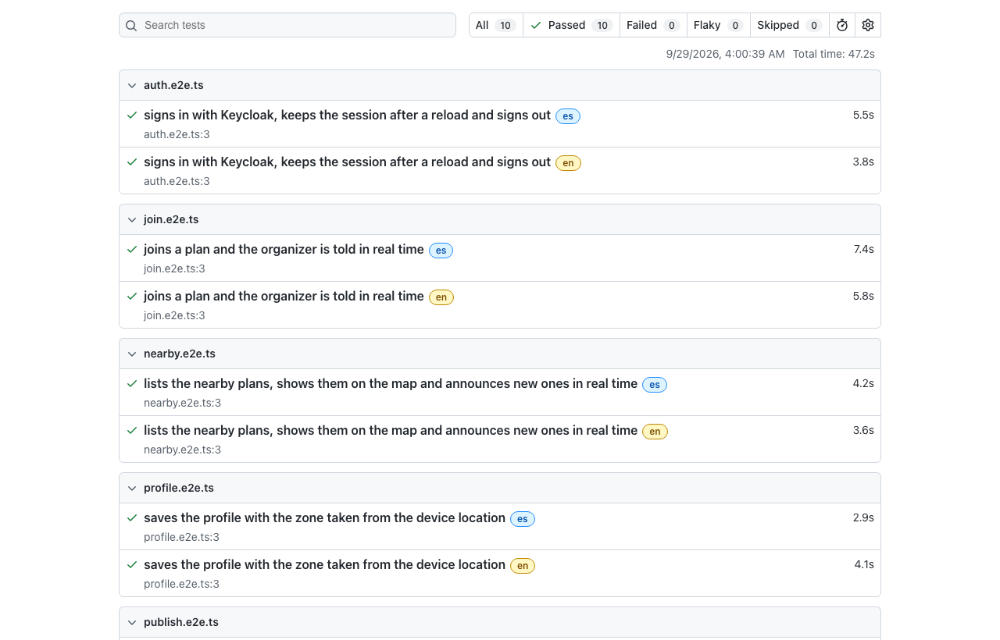 | 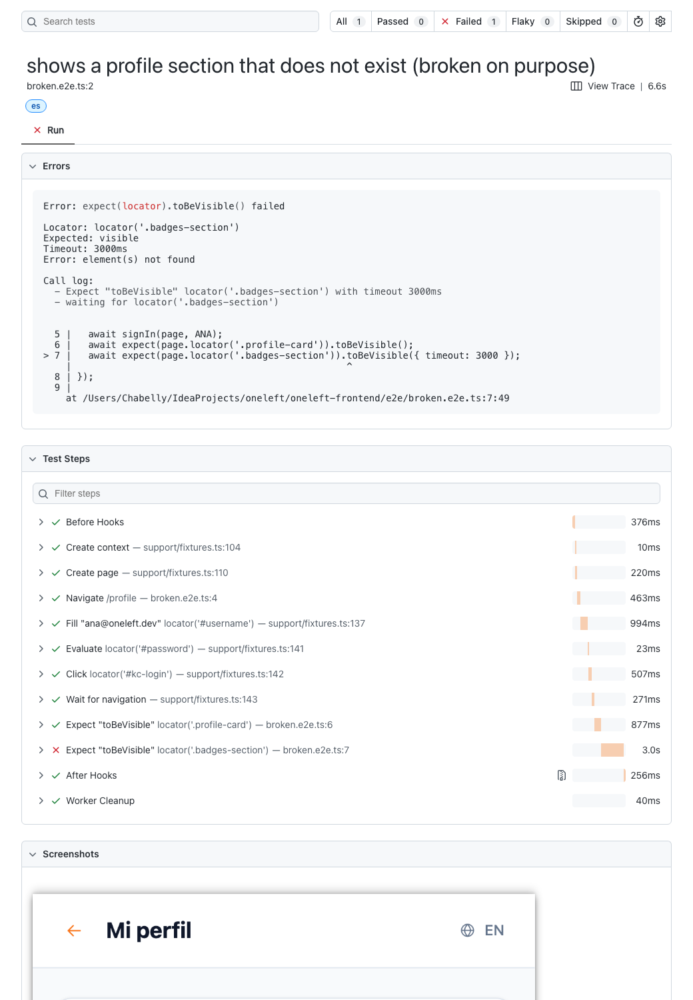 |
| *Figura 4.33. Informe HTML de Playwright* | *Figura 4.34. Un fallo con captura, traza y vídeo* |

Los E2E han detectado errores que los tests unitarios no veían: el bloqueo del *pool* del proxy con cinco flujos SSE
abiertos ([entrada 21](../proceso/21-release-pre-2.md)), la tecla Enter que recargaba el chat
([entrada 34](../proceso/34-hu008-chat-del-plan.md)) o una exportación CommonJS que solo fallaba en la compilación de
producción ([entrada 51](../proceso/51-hu056-tarjeta-para-stories.md)). Una lección registrada en la entrada 35 es que,
antes de culpar al entorno `pre` de un E2E en rojo, hay que pasar en local los recorridos que fallan: un fallo real de
HU-071 se había atribuido a las imágenes de `pre`.

### Pruebas de carga

> **Pendiente:** las pruebas de carga y capacidad (HU-015, infra#6) no se han realizado. Dependen del despliegue en AWS
> y deben medir la capacidad de la instancia, las latencias y los errores (OE6). La entrada 49 señala Keycloak como el
> contenedor más justo de memoria (561 de 768 MB en reposo), a vigilar en esas pruebas.
