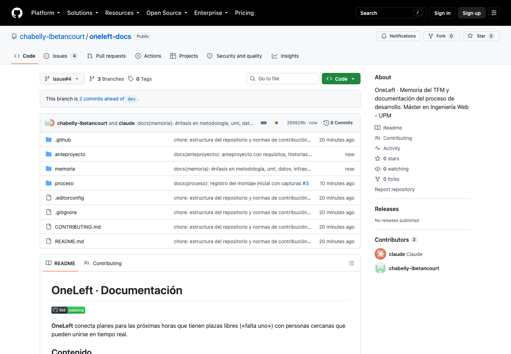

# Anexos

## Anexo A. Configuración del entorno de asistencia con IA

> **Pendiente:** anexo previsto en la estructura de la memoria. Su contenido lo decide la autora.

## Anexo B. Catálogo completo de historias de usuario

Historias de usuario del tablero, con su issue principal (las sub-issues de otros repositorios no se listan), prioridad
MoSCoW, puntos, sprint y estado según el tablero el 24/11/2026. Los criterios de aceptación de cada historia están en su
issue de GitHub.

En algunas historias los puntos del tablero no coinciden con los que figuran en el diario, porque se reestimaron
después: HU-069 tiene 8 puntos en el backend y 5 en su sub-issue del frontend, y HU-070, 5 y 3, mientras que las
entradas 56 y 57 dan 3 puntos a cada parte.

*Tabla B.1. Catálogo de historias de usuario.*

| HU | Historia | Issue | MoSCoW | Puntos | Sprint | Estado |
|---|---|---|---|---|---|---|
| HU-001 | Registro e inicio de sesión | backend#4 | Must | 5 | 1 | Hecha |
| HU-002 | Perfil con aficiones y nivel | backend#5 | Should | 3 | 2 | Hecha |
| HU-003 | Publicar un plan con plazas libres | backend#6 | Must | 5 | 2 | Hecha |
| HU-004 | Ver planes cercanos | backend#7 | Must | 5 | 3 | Hecha |
| HU-005 | Unirse a un plan | backend#8 | Must | 5 | 6 | Hecha |
| HU-006 | Notificaciones de planes cercanos | backend#9 | Must | 8 | 8 | Hecha |
| HU-007 | Caducidad automática de planes | backend#10 | Must | 3 | 12 | Hecha |
| HU-008 | Chat del plan | backend#11 | Should | 13 | 13 | Hecha |
| HU-009 | Reputación basada en eventos (libro de reputación) | backend#12 | Should | 13 | 13 | Hecha |
| HU-010 | Crear un plan en lenguaje natural | backend#13 | Should | 8 | 16 | Hecha |
| HU-011 | Moderación automática | backend#14 | Should | 8 | 16 | Backlog |
| HU-012 | Elegir a quién notificar con IA | backend#15 | Should | 13 | 16 | Hecha |
| HU-013 | Panel de administración y moderación | backend#16 | Should | 13 | 16 | Backlog |
| HU-014 | Agente «¿qué hago ahora?» | backend#17 | Could | 21 | 17 | Backlog |
| HU-015 | Pruebas de carga y capacidad | infra#6 | Should | 5 | 16 | Backlog |
| HU-016 | Memoria final del TFM | docs#5 | Must | 13 | 19 | En curso |
| HU-017 | Preparación de la defensa | docs#6 | Must | 5 | 20 | Backlog |
| HU-018 | Pagos dentro de la app | backend#19 | Won't | — | — | Backlog |
| HU-019 | Reserva de pistas y espacios integrada | backend#20 | Won't | — | — | Backlog |
| HU-020 | Foto de perfil | backend#30 | Should | 5 | 13 | Hecha |
| HU-021 | Inicio de sesión con Google | infra#16 | Should | 3 | 7 | Hecha |
| HU-022 | Elegir el idioma de la app (español / inglés) | frontend#17 | Should | 5 | 4 | Hecha |
| HU-023 | Salir de un plan y lista de espera | backend#43 | Should | 5 | 7 | Hecha |
| HU-024 | Compartir un plan por enlace | backend#44 | Should | 3 | 7 | Hecha |
| HU-025 | Check-in al llegar al punto de encuentro | backend#45 | Should | 8 | 13 | Hecha |
| HU-026 | Aviso del tiempo en planes al aire libre | backend#46 | Should | 3 | 13 | Hecha |
| HU-027 | Añadir un plan al calendario | backend#47 | Should | 2 | 12 | Hecha |
| HU-028 | Mapa de calor de la demanda (administración) | backend#48 | Could | 5 | 17 | Backlog |
| HU-029 | Métricas de negocio en Grafana | infra#27 | Could | 3 | 17 | Backlog |
| HU-030 | App web instalable (PWA) y modo sin conexión | frontend#28 | Could | 5 | 17 | Backlog |
| HU-031 | Compatibilidad por nivel y aficiones | backend#49 | Could | 5 | 17 | Backlog |
| HU-032 | Modo oscuro | frontend#29 | Could | 3 | 12 | Hecha |
| HU-033 | Bloquear y reportar usuarios | backend#50 | Should | 8 | 15 | Hecha |
| HU-034 | Compartir mi plan con un contacto de confianza | backend#51 | Could | 3 | 17 | Backlog |
| HU-035 | «Estoy libre ahora» | backend#52 | Should | 5 | 13 | Hecha |
| HU-036 | Alertas guardadas | backend#53 | Should | 3 | 13 | Hecha |
| HU-037 | Seguir a organizadores | backend#54 | Could | 3 | 16 | Backlog |
| HU-038 | Planes privados o solo por enlace | backend#55 | Could | 5 | 16 | Backlog |
| HU-039 | Mínimo de participantes | backend#56 | Should | 3 | 13 | Hecha |
| HU-040 | Recordatorio y «voy de camino / llego tarde» | backend#57 | Should | 5 | 13 | Hecha |
| HU-041 | Material y gastos del plan | backend#58 | Could | 3 | 16 | Backlog |
| HU-042 | Cómo llegar al punto de encuentro | frontend#30 | Could | 2 | 19 | En curso |
| HU-043 | Mis estadísticas | backend#59 | Could | 3 | 16 | Backlog |
| HU-044 | Insignias por hitos | backend#60 | Could | 8 | 13 | Hecha |
| HU-045 | Exportar y borrar mis datos (RGPD) | backend#61 | Should | 8 | 16 | Hecha |
| HU-046 | Planes con accesibilidad | backend#62 | Could | 2 | 16 | Backlog |
| HU-047 | Seguir a personas | backend#66 | Should | 8 | 13 | Hecha |
| HU-048 | Perfil social | backend#67 | Should | 8 | 13 | Hecha |
| HU-049 | Comunidades | backend#68 | Could | 13 | 16 | Backlog |
| HU-050 | Invitar amigos | backend#69 | Could | 3 | 17 | Backlog |
| HU-051 | Feed de actividad | backend#70 | Should | 8 | 14 | Hecha |
| HU-052 | Recuerdos del plan | backend#71 | Could | 5 | 16 | Backlog |
| HU-053 | Reacciones y comentarios | backend#72 | Could | 5 | 17 | Backlog |
| HU-054 | Menciones y hashtags | backend#73 | Could | 3 | 17 | Backlog |
| HU-055 | Mensajes directos | backend#74 | Could | 8 | 17 | Backlog |
| HU-056 | Tarjeta para Stories | frontend#32 | Should | 3 | 19 | En curso |
| HU-057 | Resumen del plan al estilo Strava | frontend#33 | Could | 3 | 19 | En curso |
| HU-058 | Sticker de enlace en Stories | frontend#34 | Could | 1 | 17 | Backlog |
| HU-059 | Privacidad social por defecto | backend#75 | Should | 3 | 14 | Hecha |
| HU-060 | Kudos entre participantes | backend#76 | Should | 3 | 14 | Hecha |
| HU-061 | Avales de nivel por actividad | backend#77 | Could | 3 | 16 | Backlog |
| HU-062 | Niveles y rachas de reputación | backend#78 | Should | 5 | 19 | Hecha |
| HU-063 | Ventajas por reputación | backend#79 | Should | 5 | 16 | Backlog |
| HU-064 | Invitar a tu plan, saludar y retos | backend#80 | Could | 8 | 17 | Backlog |
| HU-065 | Clasificación por barrio | backend#81 | Could | 3 | 17 | Backlog |
| HU-066 | Anti-trampas de reputación | backend#82 | Should | 5 | 19 | Hecha |
| HU-067 | Verificar el correo y recuperar la contraseña | infra#43 | — | — | 11 | Hecha |
| HU-068 | Más categorías de actividad | backend#98 | Should | 3 | 17 | Hecha |
| HU-069 | Elegir quién me acompaña (solicitudes con aprobación) | backend#99 | Should | 8 | 18 | Hecha |
| HU-070 | Preferencias de participantes: género y rango de edad | backend#100 | Should | 5 | 18 | Hecha |
| HU-071 | Suggest nearby places while typing the meeting point | backend#105 | Should | 5 | 13 | Hecha |
| HU-072 | Bottom menu in the Android app | frontend#131 | Should | 3 | 14 | Hecha |
| HU-073 | Settings menu in the header | frontend#135 | Should | 2 | 14 | Hecha |

De HU-042 está fusionada la ruta a pie y en bici; queda por comprobar en Android el enlace que abre la app de mapas
(frontend#30).

> **Pendiente:** ¿qué prioridad y cuántos puntos tiene HU-067? En el tablero está sin ninguno de los dos. ¿Y el
> catálogo final debe incluir los criterios de aceptación de cada historia o basta el enlace a su issue?

Las historias se agrupan en doce épicas, issues de `oneleft-docs` de los que cuelgan como sub-issues:

*Tabla B.2. Épicas del proyecto.*

| Épica | Issue |
|---|---|
| EP-01 · Cuenta, perfil e idioma | docs#58 |
| EP-02 · Publicar y gestionar planes | docs#59 |
| EP-03 · Descubrir planes cercanos | docs#60 |
| EP-04 · Unirse y asistir | docs#61 |
| EP-05 · Avisos y tiempo real | docs#62 |
| EP-06 · Comunidad y red social | docs#63 |
| EP-07 · Reputación y confianza | docs#64 |
| EP-08 · Inteligencia artificial | docs#65 |
| EP-09 · Administración y métricas | docs#66 |
| EP-10 · Experiencia de usuario y app Android | docs#67 |
| EP-11 · Plataforma, calidad y despliegue | docs#68 |
| EP-12 · Documentación y TFM | docs#69 |

## Anexo C. Estructura de directorios de los repositorios

### oneleft-backend

Proyecto Maven multimódulo (un módulo por servicio Java) más el servicio `ranker` en Python. Todos los servicios Java
siguen la misma estructura hexagonal; como ejemplo, `plans`:

```
oneleft-backend/
├── pom.xml                    POM padre: Spring Boot, Spring Cloud, JaCoCo y Sonar
├── gateway/                   Spring Cloud Gateway (8080)
├── users/                     8081
├── plans/                     8082
│   └── src/main/
│       ├── java/es/upm/miw/oneleft/plans/
│       │   ├── domain/
│       │   │   ├── model/     agregado Plan y objetos de valor
│       │   │   └── port/
│       │   │       ├── in/    casos de uso
│       │   │       └── out/   persistencia, eventos, tiempo, lugares, modelo de lenguaje…
│       │   ├── application/   servicios de aplicación (PlanService, JoinPlanService,
│       │   │                  PlanLifecycleService, OptimisticPlanUpdates…)
│       │   └── infrastructure/
│       │       ├── rest/  persistence/  messaging/  realtime/
│       │       ├── weather/  places/  ai/  social/  users/
│       │       ├── seed/      datos de demostración (perfil seed)
│       │       └── config/
│       └── resources/db/migration/   V1__plans.sql … V16__join_request_level.sql
├── notifications/             8083
├── chat/                      8084
├── social/                    8085
├── reputation/                8086
└── ranker/                    8087, Python (FastAPI + scikit-learn), con sus tests en pytest
```

### oneleft-frontend

```
oneleft-frontend/
├── src/app/
│   ├── core/          @core: api, auth, geo, i18n, navigation, photos, push, realtime,
│   │                  speech, story, theme
│   ├── components/    @components: un componente reutilizable por carpeta (plan-ticket,
│   │                  spot-slots, person-avatar, plan-check-in, plan-kudos, story-share…)
│   ├── features/      @features: account, auth, home, notifications, plans, profile,
│   │                  reputation, social
│   ├── layout/        @layout: app-header, tab-bar, bottom-bar, page-header, layouts
│   └── shared/        @shared: calendar, geo, image, model, text, time
├── src/environments/  @env: configuración de dev, pre y pro
├── src/testing/       @testing: ayudas de los tests unitarios
├── public/i18n/       es.json y en.json
├── e2e/               tests de Playwright y compose.e2e.yaml
├── android/           proyecto Android de Capacitor
├── scripts/           compilación con la licencia y generación de iconos
└── Dockerfile         compilación y nginx sin privilegios
```

### oneleft-infra

```
oneleft-infra/docker/
├── compose.yaml              entorno local por perfiles (dependencias, backend, frontend, observability)
├── compose.prod.yaml         entornos desplegados (pre y pro) con Caddy
├── compose.prod.local.yaml   prueba del Compose de producción en https://localhost
├── Caddyfile
├── PRODUCCION.md             guía de los entornos desplegados
├── keycloak/                 realm de desarrollo, realm de producción generado y scripts de sincronización
├── postgres/                 inicio (una base de datos por servicio) y reinicio de la base de un servicio
├── observability/            Prometheus, Loki y Grafana aprovisionados
├── backup/                   imagen de la copia diaria de PostgreSQL
└── generate-vapid-keys.sh    claves de Web Push
```

### oneleft-docs

```
oneleft-docs/
├── anteproyecto/       propuesta del TFM
├── memoria/            esta memoria, un fichero por capítulo
├── proceso/            diario del desarrollo (61 entradas) y su índice
├── arquitectura/adr/   registros de decisiones de arquitectura
├── diagramas/<tipo>/   PNG y SVG generados; fuentes PlantUML y draw.io en src/
├── capturas/<categoría>/  gestión, código, integración continua, infraestructura, API, pruebas, app web y Android
├── assets/logos/       logos de las tecnologías con su origen y licencia
└── tools/              scripts de capturas, diagramas, logos y del tablero
```



*Figura C.1. Estructura de oneleft-docs al inicio del proyecto.*

## Anexo D. Manual de despliegue

### Entorno local

Requisitos: Docker con Docker Compose, Java 21, Node 24 LTS (fijado en `.nvmrc`) y, para la app, Android Studio o el SDK
de Android. Los cuatro repositorios se clonan en la misma carpeta.

1. Dependencias, servicios y web con Docker Compose desde `oneleft-infra/docker` (perfiles `backend`, `frontend` y
   `observability`), con un `.env` a partir del ejemplo del repositorio (claves VAPID con `generate-vapid-keys.sh`).
2. Backend: `./mvnw verify` para compilar y probar; los servicios arrancados en local sin perfil cargan el seed.
3. Web: `npm install` y `npm start` (http://localhost:4200). La licencia de PrimeUI se lee de `PRIMEUI_LICENSE` o del
   `.env` del frontend.
4. App Android: `npm run android:local` (compilación de desarrollo, copia al proyecto Android y `adb reverse` de los
   puertos 8080, 8180 y 7070) y `npm run android:apk` para el APK de depuración.
5. Swagger UI en http://localhost:8080/swagger-ui.html.

### Entornos desplegados (pre y pro)

Según [`oneleft-infra/docker/PRODUCCION.md`](https://github.com/chabelly-lbetancourt/oneleft-infra/blob/dev/docker/PRODUCCION.md):

1. Instancia de AWS Lightsail (Linux, 2 vCPU, 8 GB) por entorno, con IP estática, el registro DNS del dominio apuntando
   a ella y los puertos 80 y 443 abiertos.
2. `.env` de la instancia a partir de `.env.prod.example`, con contraseñas largas y aleatorias; nunca en el repositorio.
3. Bucket de fotos con CORS para `PUT` desde `https://<dominio>` y URI de redirección del cliente de Google en
   `https://<dominio>/auth/realms/oneleft/broker/google/endpoint`.
4. `docker login ghcr.io` con un token que solo lea paquetes, `docker compose -f compose.prod.yaml pull` y
   `docker compose -f compose.prod.yaml up -d --wait` (con `--profile observability` para la observabilidad).
5. Copia manual: `docker compose -f compose.prod.yaml run --rm backup now`.

> **Pendiente:** cuando se despliegue en AWS (infra#5), ¿cómo serán el despliegue desde GitHub Actions, el plan de
> vuelta atrás (*rollback*) y la verificación posterior? Este anexo se completa con eso.
