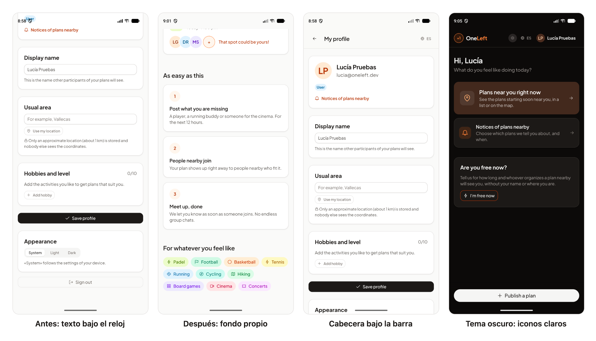
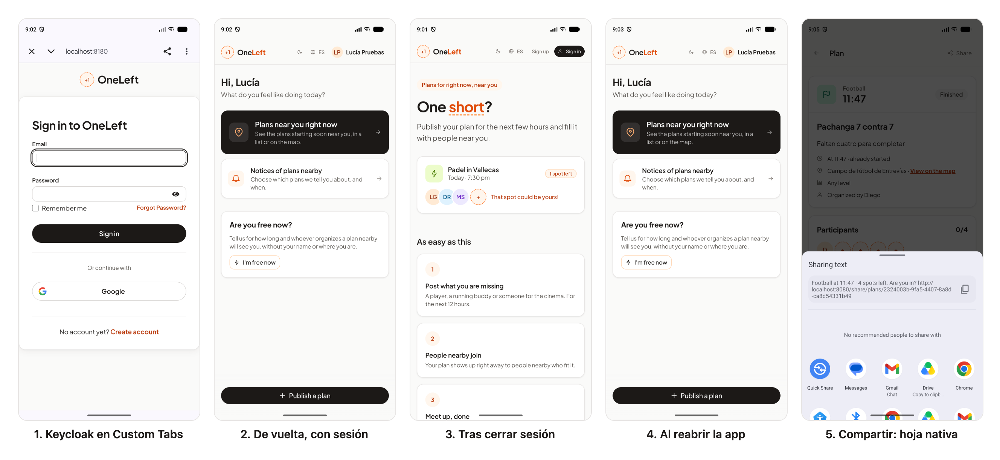

# 32 · Sprint 12: la app Android verificada en el emulador

**Fecha:** 11/10/2026 · **Sprint:** 12 (cierre de lo pendiente)

## 1. Planificación

| Issue | Tipo | MoSCoW | Puntos | Resultado |
|---|---|---|---|---|
| frontend#57 · Verificar el inicio de sesión y compartir en un dispositivo Android | Tarea | Must | 1 | esta entrada |
| frontend#80 · La cabecera queda bajo la barra de estado en Android | Bug | Must | 2 | PR #91 |
| docs#87 · Documentación (sub-issue) | Documentación | Should | 1 | esta entrada |

**Objetivo:** cerrar lo que quedó pendiente en la [entrada 22](22-app-android-capacitor.md): recorrer en un emulador el
inicio y el cierre de sesión, la sesión al reabrir la app y «Compartir». Al hacerlo apareció un fallo de Android 15:
la app se dibuja de borde a borde y la barra de estado tapaba la cabecera, así que «Sign in» no respondía.

## 2. Barras del sistema (frontend#80)

| Decisión | Motivo |
|---|---|
| Función `safe-area($side)` en los tokens: `var(--safe-area-inset-*, env(safe-area-inset-*, 0px))` | Capacitor 8 (plugin `SystemBars`) da el tamaño de las barras en variables CSS; los navegadores, en `env()`; en el resto vale 0 y nada cambia |
| La cabecera llega hasta arriba, bajo la barra de estado, con su contenido debajo | El color de la cabecera sigue hasta el borde, como en una app nativa |
| Margen de la barra de navegación en el contenido, la barra de acciones, los avisos y la barra de progreso | «Publicar un plan» y los últimos botones de cada página quedan por encima de la barra de gestos |
| Un fondo fijo bajo la barra de estado | Al hacer scroll, el texto pasaba por detrás del reloj y los iconos |
| Los iconos de las barras siguen el tema (`SystemBars.setStyle`) | En tema oscuro, iconos claros. Lo pide el servicio `Theme` a través de `NativePlatform` |

*Figura 116. Las barras del sistema en el emulador. A la izquierda, el perfil desplazado antes del fondo propio: la
etiqueta «User» pasa bajo el reloj. Después, la portada desplazada con la barra de estado limpia, la cabecera del
perfil bajo la barra y el tema oscuro con los iconos claros.*

## 3. Recorrido en el emulador (frontend#57)

| Criterio | Resultado |
|---|---|
| Iniciar sesión con email en Keycloak (Custom Tabs) vuelve por `oneleft://callback` con la sesión iniciada | Cumplido |
| Lo mismo con «Continuar con Google» | Pendiente: necesita una cuenta de Google real |
| Cerrar sesión vuelve a la app sin sesión | Cumplido |
| Al cerrar y volver a abrir la app, la sesión se mantiene | Cumplido (cierre forzado con `am force-stop`) |
| «Compartir» abre la hoja nativa de Android | Cumplido |

*Figura 117. Recorrido con Lucía en la app: Keycloak se abre en Custom Tabs (`localhost:8180`), la app vuelve con la
sesión, cerrar sesión deja la portada pública, al reabrir la app la sesión sigue y «Share» abre la hoja nativa con el
texto y el enlace del plan. Capturas con `adb exec-out screencap`, montadas con
[`tools/compose-figure.mjs`](../tools/compose-figure.mjs).*

## 4. Pruebas

- **Unitarias:** `Theme` cambia los iconos de las barras al cambiar de tema y `NativePlatform.setSystemBarsDark` no hace
  nada en el navegador. En total, 178 tests de la web, lint y build en verde, y la CI de la PR #91 en verde.
- **Emulador:** Pixel 10 Pro XL con Android API 37, en inglés, contra el stack local (`adb reverse` de 8080 y 8180).
  Tema claro y oscuro.
- **Android anterior a la 15:** sin borde a borde las barras miden 0, como en el navegador, y la página queda como
  antes. No se probó en un emulador porque no hay ninguna imagen antigua instalada.

## 5. Incidencias

- **La sesión tardaba en aparecer.** Al volver de Keycloak, la app seguía unos segundos en la página de acceso. El
  registro de Android mostró que el WebView reanudaba el JavaScript unos 4 s después de volver: Android congela la app
  en segundo plano y el emulador iba cargado. Después se canjeaba el código y aparecía la sesión; no era un fallo.
- **Bienvenida de Chrome.** Custom Tabs usa Chrome, que en un emulador nuevo enseña su bienvenida antes de Keycloak.
  Se siguió sin cuenta de Google.
- **Datos de prueba con `adb`.** Esta vez `adb shell input text` escribió bien el email y la contraseña de Lucía, que
  se leen del realm dentro del propio comando, sin mostrarlos.
- **Sin permiso de ubicación.** En el recorrido no se concedió la ubicación y la lista de planes cercanos quedó vacía.
  Para «Compartir» se abrió el detalle de un plan del seeder.
