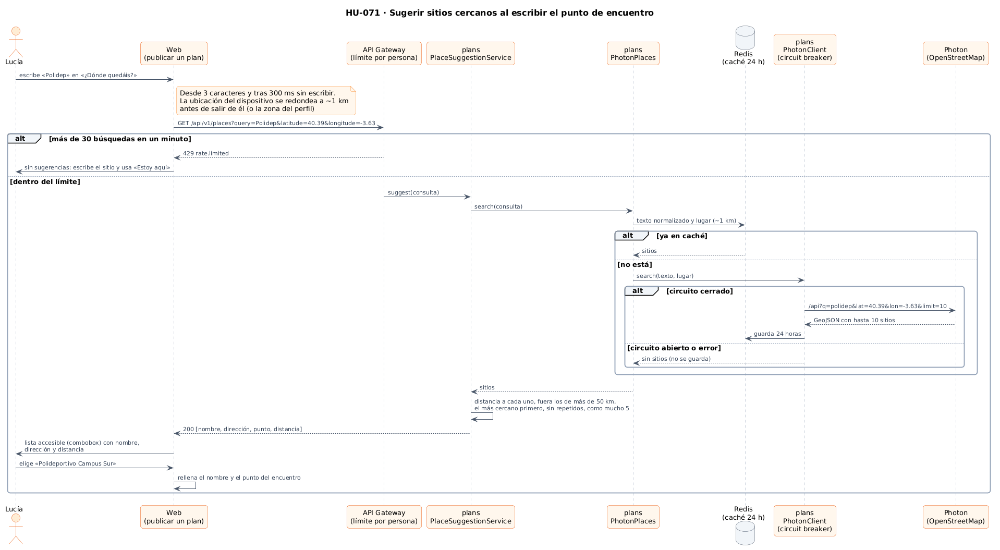
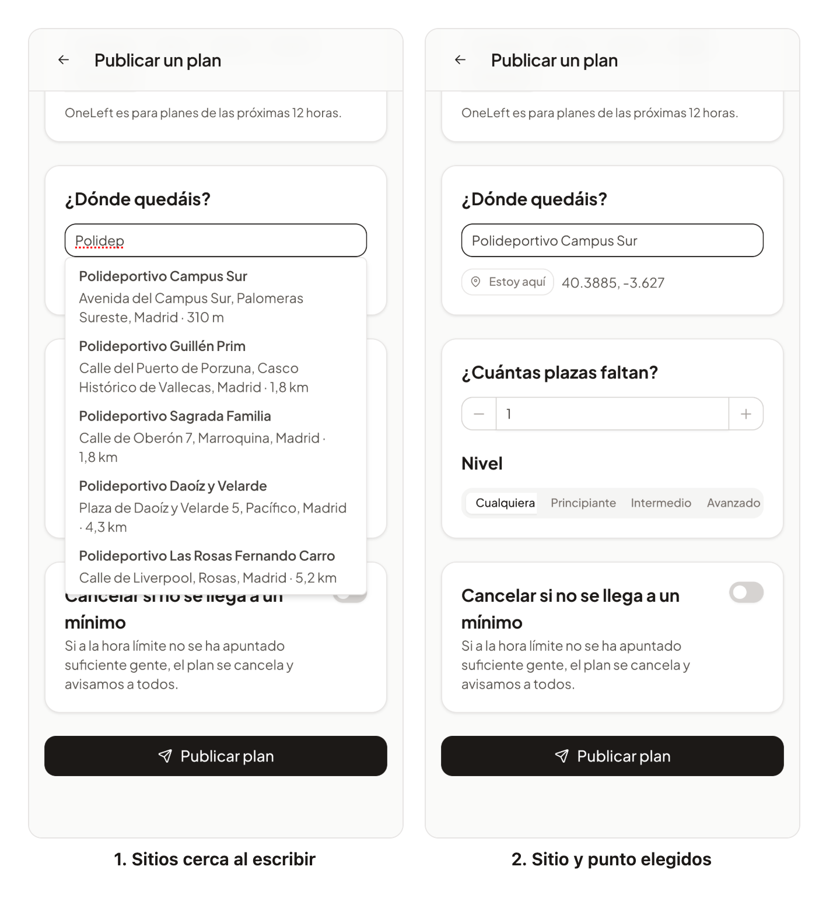

# 33 · Sprint 13: HU-071 Sugerir sitios cercanos al escribir el punto de encuentro

**Fecha:** 11/10/2026 · **Sprint:** 13 (09–15/10/2026)

## 1. Planificación

| Issue | Tipo | MoSCoW | Puntos | Resultado |
|---|---|---|---|---|
| backend#105 · HU-071 Sugerir sitios cercanos al escribir el punto de encuentro | Historia | Should | 5 | PR #113 |
| frontend#96 · Sugerencias en el campo del punto de encuentro (sub-issue) | Historia | Should | 3 | PR #97 |
| frontend#98 · La lista de sitios se salía de la pantalla en el móvil | Bug | Should | 1 | PR #99 |
| docs#89 · Documentación (sub-issue) | Documentación | Should | 1 | esta entrada |

**Objetivo:** que quien publica un plan no tenga que estar en el sitio para fijar el punto de encuentro. Al escribir
«Polidep» en «¿Dónde quedáis?» aparecen los polideportivos de alrededor con su dirección y distancia; al elegir uno se
rellenan el nombre y el punto. «Estoy aquí» sigue funcionando como antes.

## 2. Decisiones

| Decisión | Motivo |
|---|---|
| **Photon** (komoot), el geocodificador de OpenStreetMap pensado para buscar mientras se escribe | La política de uso de Nominatim prohíbe el autocompletado; Google Places pide clave, facturación y sus condiciones. Los datos de OpenStreetMap ya los usa el mapa (HU-004) |
| La búsqueda pasa por la API (`GET /api/v1/places`), no del navegador a Photon | El proveedor se puede cambiar sin tocar la app, y la caché y el límite protegen su uso justo |
| Puerto de salida `PlaceSearch` en el dominio y adaptador `PhotonPlaces` | La misma arquitectura hexagonal que el tiempo (HU-026): el dominio no sabe de Photon |
| Sesgo por la **ubicación aproximada** del dispositivo (redondeada a ~1 km en el propio móvil) o, sin ella, la zona del perfil | Basta para ordenar por cercanía y nunca sale la ubicación exacta |
| El servicio mide la distancia, descarta lo que está a más de **50 km**, ordena por cercanía, quita repetidos y deja **5** | Photon pondera la cercanía pero puede devolver un sitio con el mismo nombre en otra ciudad, y OpenStreetMap tiene a veces el mismo sitio dos veces (el edificio y su parada) |
| **Caché en Redis de 24 horas** por texto normalizado y lugar redondeado a ~1 km; **circuit breaker** y tiempos de espera cortos | Los sitios apenas cambian; la misma búsqueda en el barrio no vuelve a salir. Si Photon falla, no hay sugerencias y nada se guarda |
| Límite propio en el gateway: **30 búsquedas por minuto** y persona (`places`), antes del general | Cada pausa al escribir es una petición y cada una puede llegar a un servicio externo |
| Sin sugerencias o con error, **nada bloquea** publicar | La web ignora los errores y no muestra la lista vacía: el sitio se escribe y se usa «Estoy aquí» |
| **Combobox** de PrimeNG (`p-autocomplete`) desde 3 caracteres y 300 ms sin escribir | Funciona con teclado (flechas y Enter) y lector de pantalla (`role="combobox"`, número de resultados anunciado), en español e inglés |
| El punto de un sitio elegido se guarda con 4 decimales (~11 m) | Es un lugar público: no hace falta el redondeo de privacidad de «Estoy aquí» (3 decimales) |

*Figura 118. Una búsqueda del punto de encuentro, desde la web hasta Photon, con el límite del gateway, la caché y el
circuit breaker. Fuente: [`34-secuencia-sugerir-sitios.puml`](../diagramas/secuencia/src/34-secuencia-sugerir-sitios.puml).*

## 3. En la app

*Figura 119. Lucía, en Vallecas, escribe «Polidep» en «¿Dónde quedáis?»: los polideportivos de alrededor aparecen del
más cercano al más lejano, con su dirección y distancia (resultados reales de Photon a través del backend local). Al
elegir el primero con el teclado se rellenan el nombre y el punto. Capturas generadas con
[`tools/capture-places.mjs`](../tools/capture-places.mjs), que no publica nada.*

## 4. Pruebas

- **Dominio y aplicación** (`PlaceQueryTest`, `PlaceSuggestionServiceTest`): longitud de la búsqueda y coordenadas,
  distancia, orden por cercanía, fuera los lejanos y los repetidos, como mucho cinco.
- **Integración** (`PlaceSuggestionIntegrationTest`): Photon simulado con WireMock, Redis real y circuit breaker. La
  misma búsqueda desde otro punto del mismo kilómetro no vuelve a preguntar; un error da una lista vacía y no se
  guarda; tras cinco fallos el circuito se abre; búsquedas demasiado cortas o fuera del mundo dan 400; sin sesión, 401.
- **Gateway:** la ruta `/api/v1/places` llega a `plans` solo con sesión (`PlacesRouteTest`) y la regla `places` se
  aplica antes que la general (`RateLimitRulesTest`, con el `application.yaml` real).
- **Web:** búsqueda alrededor del dispositivo (una sola petición de ubicación), de la zona del perfil sin ubicación,
  sin búsqueda sin ninguna de las dos, elegir un sitio y la API que devuelve vacío ante un error o el límite.
- **E2E** (`places.e2e.ts`): la API de sitios se responde en el propio navegador, así que la prueba no depende de
  Photon ni crea datos. Se escribe, se elige con el teclado y se comprueban el nombre, el punto y la ubicación
  redondeada que se envía. `publish.e2e.ts` tampoco depende ya del geocodificador.
- **De punta a punta en local:** con las imágenes reconstruidas, `GET /api/v1/places` a través del gateway devuelve
  los polideportivos de Vallecas ordenados (el más cercano a unos 300 m) y la cabecera `X-RateLimit-Remaining`
  confirma la regla de 30 por minuto.

## 5. Incidencias

- **La caché no se vaciaba entre tests.** `Cache.clear()` puede ser diferido; el test de integración usa
  `invalidate()`, que deja la caché vacía en el momento.
- **La lista no se abría.** El E2E no encontraba ninguna sugerencia aunque la API respondía. El efecto de
  `p-autocomplete` que reacciona a las sugerencias también depende de su estado de carga: al empezar a buscar se
  ejecutaba con la lista todavía vacía y la cerraba, y al llegar los sitios ya no la abría. La web la abre ahora al
  recibir sitios, y además ignora una respuesta antigua que llegue después de otra búsqueda.
- **La lista se salía de la pantalla** (frontend#98). Las primeras capturas mostraron que PrimeNG deja cada opción en
  una línea, así que en el móvil la lista era más ancha que el campo y cortaba direcciones y distancias. Ahora mide lo
  mismo que el campo, parte el texto y cabe con los cinco sitios.
- **E2E de la CI en rojo, y no solo por `pre`.** El job de extremo a extremo usa el backend de `pre`, que aún no tiene
  HU-007, HU-035, HU-036, HU-039 ni HU-040, y se atribuyeron a eso sus cinco fallos. Pero `publish.e2e.ts` fallaba
  también por un error de esta historia (frontend#102, [entrada 34](34-hu008-chat-del-plan.md)): con
  `optionValue="name"`, PrimeNG leía `name` también del texto escrito, una cadena, y un sitio escrito a mano dejaba el
  campo vacío. Lo descubrieron las capturas de HU-008; corregido, `publish.e2e.ts` pasa contra el stack local.
- **Scripts de capturas.** Con las sugerencias, la lista podía tapar «Estoy aquí» en los recorridos que escriben el
  sitio a mano: `tools/lib/publish.mjs` tiene ahora `typePlace`, que la cierra antes, y lo usan `capture-plan.mjs`,
  `capture-rate-limit.mjs` y `publishPlan`.
