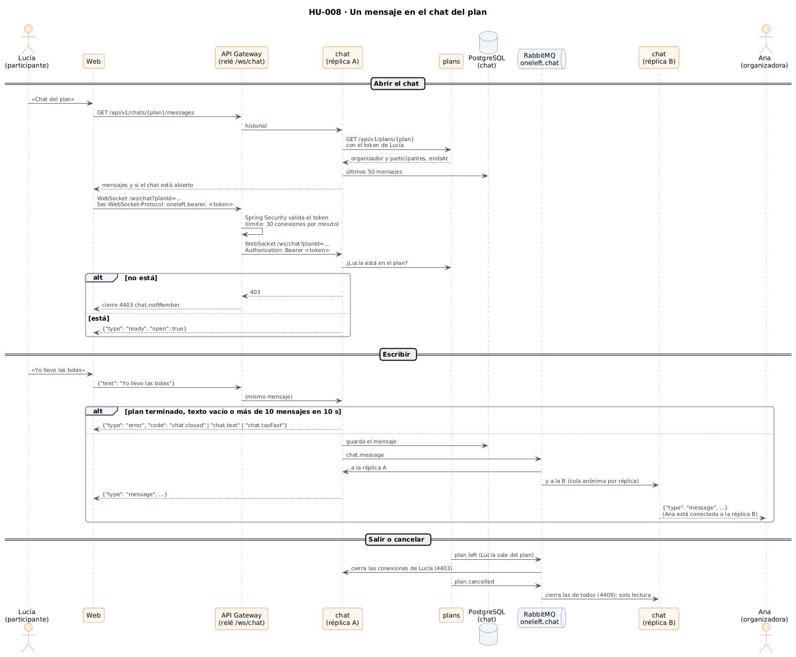
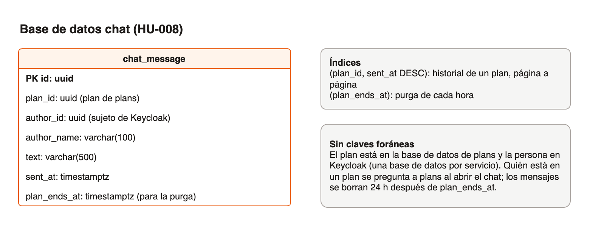
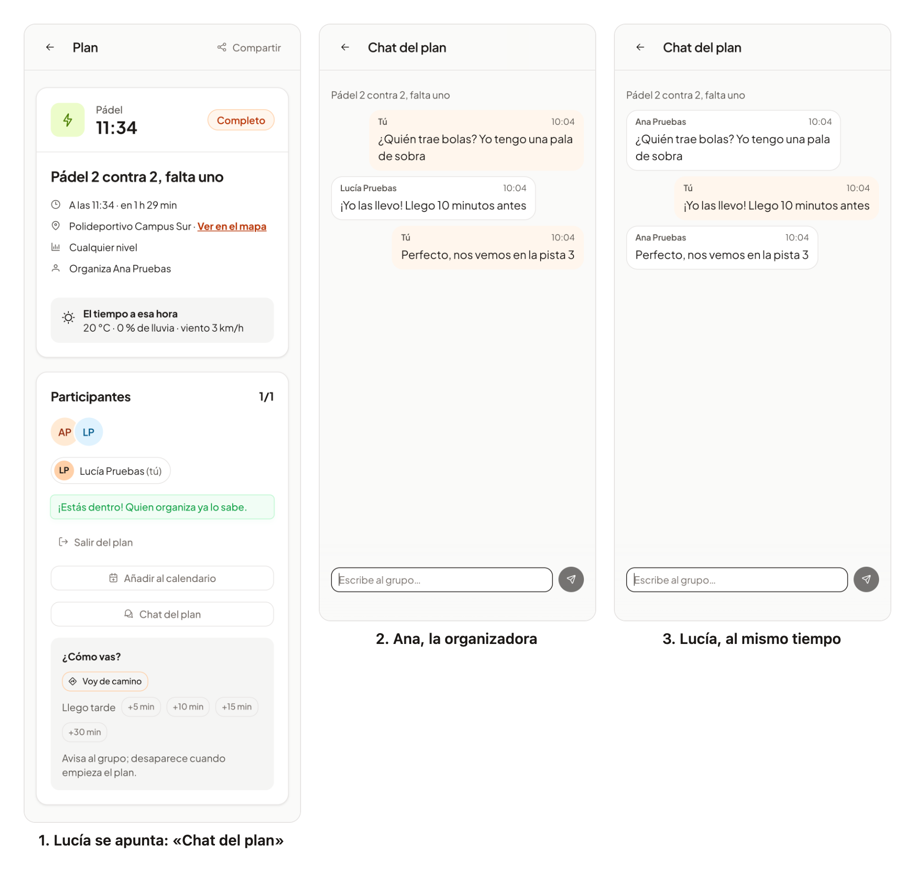

# 34 · Sprint 13: HU-008 Chat del plan

**Fecha:** 12/10/2026 · **Sprint:** 13 (09–15/10/2026)

## 1. Planificación

| Issue | Tipo | MoSCoW | Puntos | Resultado |
|---|---|---|---|---|
| backend#11 · HU-008 Chat del plan | Historia | Should | 13 | PR #114 |
| infra#56 · El servicio chat en Docker Compose (sub-issue) | Tarea | Should | 1 | PR #57 |
| frontend#100 · Chat del plan en la web y la app (sub-issue) | Historia | Should | 5 | PR #101 |
| frontend#102 · Un punto de encuentro escrito a mano no se podía publicar | Bug | Must | 1 | PR #103 |
| docs#91 · Documentación (sub-issue) | Documentación | Should | 1 | esta entrada |

**Objetivo:** que quienes van a un plan se coordinen sin salir de la app («¿quién trae bolas?», «llego por la otra
puerta»). Solo el organizador y los participantes ven el chat, en tiempo real con WebSockets, y se cierra cuando el
plan termina.

## 2. Decisiones

| Decisión | Motivo |
|---|---|
| Un **microservicio `chat`** con su base de datos, como preveía el anteproyecto | Si el chat falla, se sigue publicando y uniéndose a planes (RNF-06): no es una dependencia del gateway |
| **El gateway hace de relé del WebSocket** (`/ws/chat`) | Spring Cloud Gateway en su versión WebMVC no reenvía WebSockets. Las alternativas eran SSE + REST (no cumplía el criterio) o conectar el navegador directamente al chat (rompía la entrada única: token, CORS y límites por duplicado). El gateway acepta la conexión, valida el token como cualquier petición y abre otra con el chat |
| El token viaja en el **subprotocolo** (`Sec-WebSocket-Protocol: oneleft.bearer, <token>`) | El navegador no puede poner `Authorization` en un WebSocket, y en la URL acabaría en logs. El gateway responde solo `oneleft.bearer` |
| **Quién está en el plan se pregunta a `plans`** al abrir el chat, con el token de la persona | Siempre es el grupo real, también en los planes publicados antes de que existiera el chat; sin copiar la lista de participantes en otra base de datos |
| Mientras se está conectado, `plan.left` y `plan.cancelled` llegan por **RabbitMQ** | Quien sale del plan pierde la conexión (código 4403) y un plan cancelado deja el chat en solo lectura (4409) |
| Los mensajes llegan a **todas las réplicas** por el exchange `oneleft.chat` (una cola anónima por réplica) | Ana puede estar conectada a una réplica y Lucía a otra |
| **Solo lectura** desde `endsAt` (inicio + 3 h, HU-007); los mensajes se **borran 24 h después** | «Se cierra tras la caducidad del plan»; el anteproyecto preveía purgar los mensajes. `plans` expone ahora `endsAt` para no repetir la regla |
| Mensajes de 1 a 500 caracteres y como mucho **10 cada 10 s** por conexión | El límite del gateway solo ve la conexión, no los mensajes que viajan por ella |
| La web reconecta sola con esperas crecientes (de 1 s a 30 s), salvo cuando el chat cierra para siempre | Una caída de red no deja el chat muerto, y quien ya no está en el plan no reintenta |
| Los mensajes, en una lista con `role="log"` | El lector de pantalla los anuncia según llegan |

*Figura 120. Abrir el chat, escribir y salir del plan: el relé del gateway, la consulta a `plans`, la base de datos
del chat y el reparto entre réplicas. Fuente:
[`35-secuencia-chat-plan.puml`](../diagramas/secuencia/src/35-secuencia-chat-plan.puml).*

*Figura 121. La base de datos `chat`: una tabla de mensajes sin claves foráneas, porque el plan y la persona viven en
otros servicios. Fuente: [`36-modelo-chat.drawio`](../diagramas/datos/src/36-modelo-chat.drawio).*

*Figura 122. La arquitectura implementada, ya con el servicio `chat` y el relé del WebSocket en el gateway. Fuente:
[`30-arquitectura-implementada-y-prevista.puml`](../diagramas/componentes/src/30-arquitectura-implementada-y-prevista.puml).*

## 3. En la app

*Figura 123. Ana publica un pádel y Lucía se apunta: el detalle le ofrece «Chat del plan». Las dos lo abren y cada
mensaje aparece al momento en la otra pantalla, a través del gateway, el servicio de chat y RabbitMQ, en el stack local
real. Capturas generadas con [`tools/capture-chat.mjs`](../tools/capture-chat.mjs).*

## 4. Pruebas

- **Dominio y aplicación** (`PlanChatTest`, `ChatServiceTest`): miembros, solo lectura al terminar o cancelar,
  longitud del texto, historial por páginas y purga.
- **Integración del chat** (`ChatIntegrationTest`): conexiones WebSocket reales, PostgreSQL y RabbitMQ en contenedores
  y `plans` simulado con WireMock. Dos personas hablan en tiempo real; quien no está en el plan no conecta (403) ni lee;
  plan inexistente (404) y `plans` caído (503); chat de solo lectura; mensajes vacíos o en ráfaga; salida y cancelación
  por RabbitMQ; purga a las 24 h. Los tests borran sus mensajes al terminar.
- **Gateway:** el token se toma del subprotocolo solo en `/ws/chat` (`ChatBearerTokenResolverTest`); el relé pasa los
  mensajes y los cierres en los dos sentidos y traduce un handshake rechazado a 4403, 4404, 4409 o 4503
  (`ChatRelayHandlerTest`); sin token válido el handshake no pasa de Spring Security (`ChatRelaySecurityTest`).
- **Web:** página (historial, tiempo real sin duplicados, envío con Enter sin recargar, sin conexión, errores, solo
  lectura, cancelado, mensajes anteriores), socket (URL, subprotocolo, reconexión y cierres definitivos) y botón en el
  detalle. **E2E** (`chat.e2e.ts`, es y en): el plan, el historial y el WebSocket se responden en el navegador
  (`routeWebSocket`), así que no necesita el servicio ni crea datos.
- **De punta a punta en local:** con el stack reconstruido, Ana y Lucía se escriben a través del gateway (figura 123).

## 5. Incidencias

- **Enter recargaba la página.** El formulario del chat no tenía `[formGroup]`: con solo `ReactiveFormsModule`, Enter
  hacía el envío nativo del navegador. Los tests unitarios llamaban al método directamente y no lo vieron; lo encontró
  el E2E, y ahora hay un test que envía el formulario.
- **El token de prueba no era un token.** En los tests de integración, `test:<id>:Lucía` no es un Bearer válido
  (RFC 6750 no admite `:` ni tildes) y Spring respondía 401. El nombre viaja ahora en Base64URL.
- **Un punto de encuentro escrito a mano no se podía publicar** (frontend#102). Al preparar estas capturas, publicar
  escribiendo el sitio daba «Revisa los campos marcados». Con `optionValue="name"`, PrimeNG leía `name` también del
  texto escrito, una cadena, y dejaba el campo vacío: un error de HU-071 que el E2E de la CI ya mostraba y se atribuyó a
  las imágenes de `pre` ([entrada 33](33-hu071-sugerir-sitios.md)). El valor es ahora el texto escrito o el nombre de
  la sugerencia, con un test que escribe en el campo real.
- **El E2E de la CI y `pre`.** El recorrido del chat no depende de `pre` porque simula el WebSocket, pero el stack de
  extremo a extremo de la CI aún no levanta el servicio: al promocionar `dev` a `pre` habrá que añadir `chat` a
  `e2e/compose.e2e.yaml`.
