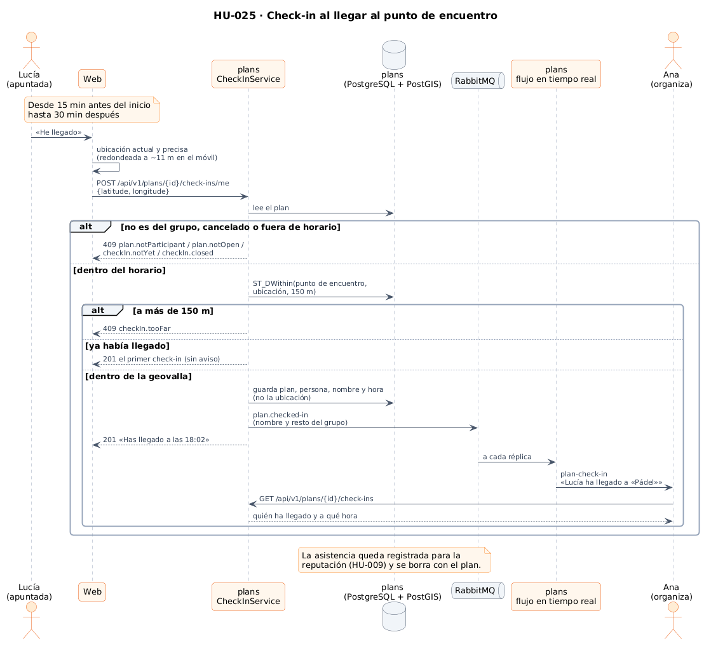
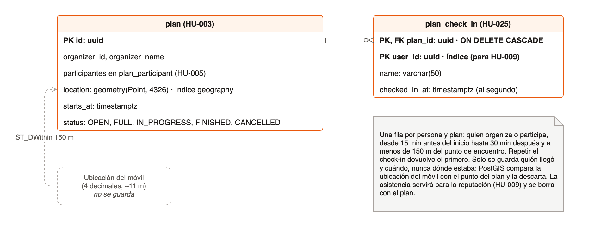
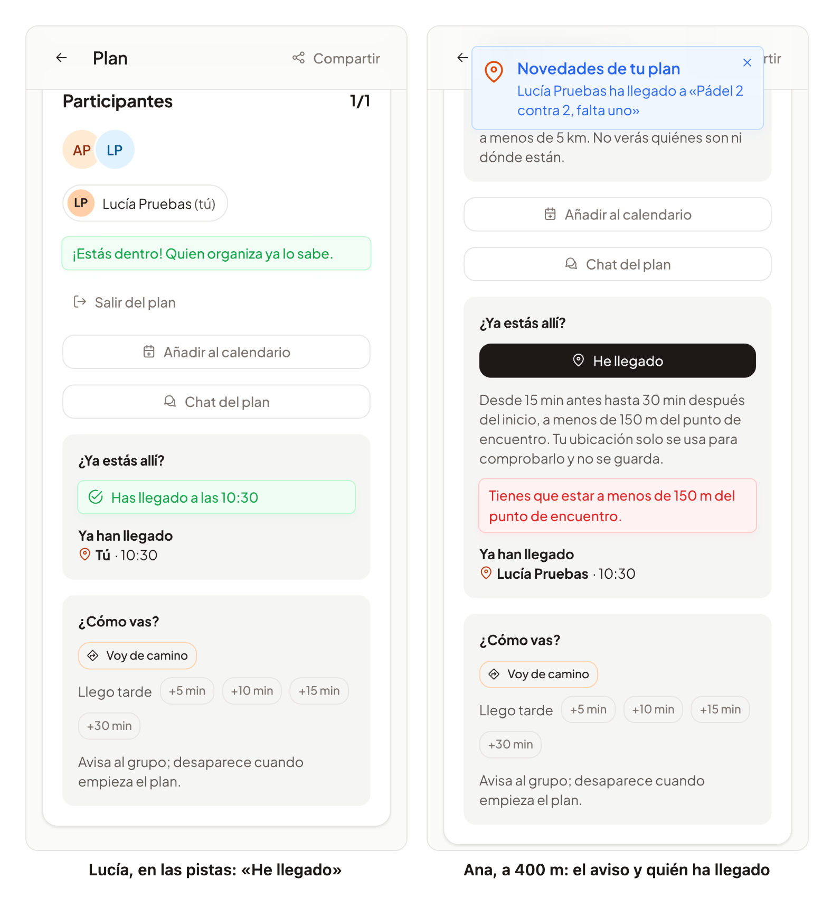

# 36 · Sprint 13: HU-025 Check-in al llegar al punto de encuentro

**Fecha:** 13/10/2026 · **Sprint:** 13 (09–15/10/2026)

## 1. Planificación

| Issue | Tipo | MoSCoW | Puntos | Resultado |
|---|---|---|---|---|
| backend#45 · HU-025 Check-in al llegar al punto de encuentro | Historia | Should | 8 | PR #116 |
| frontend#107 · «He llegado» en el detalle del plan (sub-issue) | Historia | Should | 3 | PR #108 |
| frontend#109 · El icono tocaba el nombre y la confirmación parecía un aviso | Bug | Should | 1 | PR #110 |
| docs#96 · Documentación (sub-issue) | Documentación | Should | 1 | esta entrada |

**Objetivo:** saber quién ha llegado de verdad al punto de encuentro. Quien organiza o participa pulsa «He llegado»
desde 15 minutos antes del inicio hasta 30 minutos después; solo cuenta si está a menos de 150 m del punto, el resto
del grupo lo ve al momento y la asistencia queda guardada para la reputación (HU-009). Dónde estaba el móvil no se
guarda.

## 2. Decisiones

| Decisión | Motivo |
|---|---|
| La **geovalla la responde PostGIS** (`ST_DWithin` sobre `geography`) contra el punto guardado con el plan | Es la misma base de datos y el mismo índice que la búsqueda de planes cercanos (HU-004); un puerto de salida `MeetingPointGeofence` deja el dominio sin saber de PostGIS |
| Primero las reglas del plan (del grupo, no cancelado, dentro del horario) y después la geovalla | Si el check-in no está abierto, ni siquiera se pregunta dónde está el móvil |
| La ubicación **solo se usa para esa pregunta**: no se guarda ni se escribe en los logs | Criterio de la historia. La tabla `plan_check_in` solo tiene plan, persona, nombre y hora, y un test de integración lo comprueba |
| Una lectura **fresca y precisa** solo al pulsar el botón (alta precisión, como mucho de hace 30 s), redondeada en el móvil a 4 decimales (~11 m) | La ubicación aproximada de HU-004 (1 km, hasta 10 min de antigüedad) no sirve para 150 m; 11 m sobran y no se envía la posición exacta |
| **Un check-in por persona y plan**; repetirlo devuelve el primero sin volver a avisar | Pulsar dos veces o recargar no duplica la asistencia ni el aviso |
| La hora se guarda **al segundo** | Es lo que muestra la app, y así la respuesta coincide con lo guardado en cualquier base de datos (ver incidencias) |
| Evento `plan.checked-in` en `oneleft.plans` y aviso `plan-check-in` en el flujo personal, como «voy de camino» (HU-040) | Quien organiza ve quién llega en tiempo real, esté conectado a la réplica que esté |
| La sección se abre y se cierra sola con la página abierta (revisa la hora cada 30 s) | Quien espera en el sitio no tiene que recargar para que aparezca el botón |

*Figura 124. Un check-in desde la web: las reglas del plan, la geovalla de PostGIS, el registro sin la ubicación y el
aviso al resto del grupo por RabbitMQ. Fuente:
[`37-secuencia-check-in.puml`](../diagramas/secuencia/src/37-secuencia-check-in.puml).*

*Figura 125. La tabla `plan_check_in` (migración V9) junto al plan: la ubicación del móvil se compara con el punto
del plan y se descarta. Fuente: [`38-modelo-check-in.drawio`](../diagramas/datos/src/38-modelo-check-in.drawio).*

## 3. En la app

*Figura 126. Ana publica un pádel que empieza en unos minutos y Lucía se apunta. A la izquierda, Lucía, en las pistas,
pulsa «He llegado». A la derecha, Ana, todavía a unos 400 m, recibe el aviso al momento, ve a Lucía en «Ya han
llegado» y su propio check-in se rechaza por la distancia. Stack local real; capturas generadas con
[`tools/capture-check-in.mjs`](../tools/capture-check-in.mjs).*

## 4. Pruebas

- **Dominio** (`PlanCheckInTest`): los límites exactos de la ventana (15 min antes y 30 min después, un segundo fuera
  ya no), quien organiza también puede, solo el grupo, nada en un plan cancelado, el evento al resto del grupo y la
  hora al segundo.
- **Aplicación** (`CheckInServiceTest`): la geovalla se pregunta después de las reglas del plan y con 150 m; lejos no
  se guarda ni se avisa; repetir devuelve el primero y avisa una sola vez; solo el grupo ve la lista.
- **Integración** (`CheckInControllerTest`, PostGIS real): un móvil a unos 145 m del punto entra y uno a unos 155 m
  no; repetir, la lista solo para el grupo, el horario, coordenadas inválidas (400), plan inexistente (404) y las
  columnas de `plan_check_in`, sin ubicación. Los planes que crea se borran al terminar (y con ellos sus check-ins).
  Además, RabbitMQ real lleva `plan.checked-in` hasta el flujo de cada persona (`RabbitPlanEventPublisherTest`).
- **Web:** ventana (también que se abre sola), lista, check-in con la ubicación fresca, los errores traducidos
  (demasiado lejos y sin ubicación) y el refresco en tiempo real (`plan-check-in.spec.ts`), además del detalle, los avisos,
  el flujo de eventos, la API y la lectura precisa de la ubicación. **E2E** (`check-in.e2e.ts`, es y en): el plan y los
  check-ins se responden en el navegador, así que no crea datos; comprueba la ubicación enviada y el mensaje de
  demasiado lejos.
- **De punta a punta en local:** figura 126, con el backend reconstruido.
- **App Android** (emulador): la sección aparece en el detalle del plan dentro de la ventana y, con el permiso de
  ubicación denegado en el dispositivo, no envía nada y explica que no se pudo obtener la ubicación.

## 5. Incidencias

- **Un test que pasaba en el Mac y fallaba en la CI.** El segundo check-in debía devolver el primero, pero la CI
  respondía con otra hora: el reloj de Linux da nanosegundos, PostgreSQL guarda microsegundos y el check-in leído de
  la base de datos ya no era igual al de la primera respuesta (en macOS el reloj solo da microsegundos). La hora se
  guarda ahora al segundo, con un test que lo fija.
- **Docker se cayó y se restableció de fábrica.** Con el stack local en marcha, el `verify` completo del backend
  (Testcontainers) y la batería del frontend a la vez, `dockerd` falló (*panic*) y los contenedores de los tests no
  arrancaron. Desde el diálogo de error de Docker Desktop se ejecutó después un restablecimiento de fábrica, que borró
  imágenes, contenedores y volúmenes. Se reconstruyeron las imágenes del backend, se levantó de nuevo el stack con
  sus seeders y se repitieron el E2E y las capturas. La regla que queda: no ejecutar Testcontainers en paralelo con
  el stack y la batería completa del frontend en un equipo de 8 GB.
- **Cinco tests del frontend fallaron por tiempo** en esa misma ejecución con carga; aislados pasan los 54 y la CI
  quedó en verde.
- **Dos defectos visuales en las capturas** (frontend#109): el icono de «Ya han llegado» tocaba el nombre y «Has
  llegado a las…» usaba el naranja de la marca, el mismo de los avisos. Ahora es un mensaje de éxito, como «¡Estás
  dentro!», comprobado también en modo oscuro.
