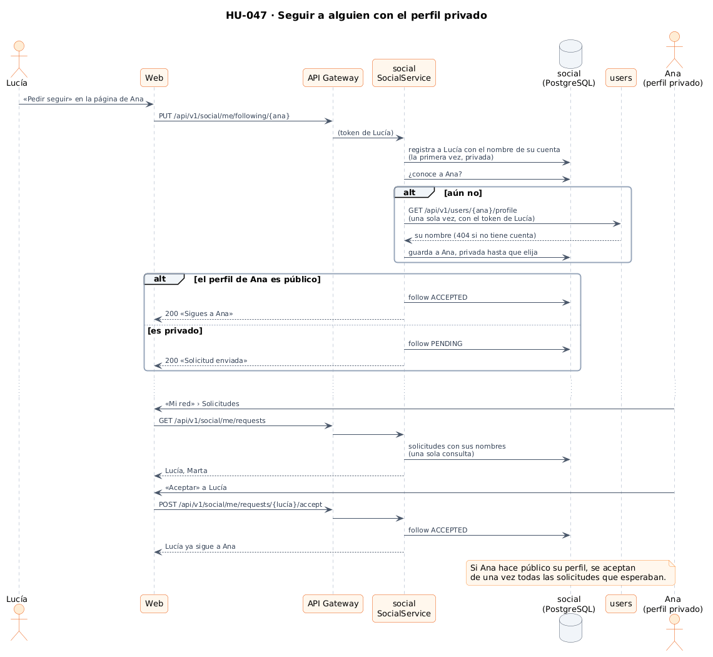
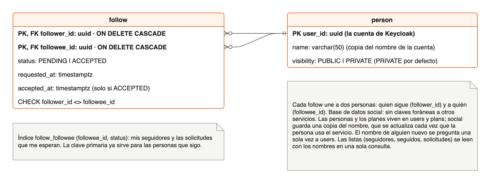
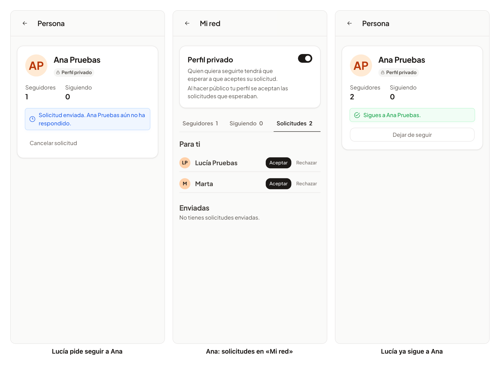

# 37 · Sprint 13: HU-047 Seguir a personas

**Fecha:** 13/10/2026 · **Sprint:** 13 (09–15/10/2026)

## 1. Planificación

| Issue | Tipo | MoSCoW | Puntos | Resultado |
|---|---|---|---|---|
| backend#66 · HU-047 Seguir a personas | Historia | Should | 8 | PR #117 |
| infra#60 · El servicio social en Docker Compose (sub-issue) | Tarea | Should | 1 | PR #61 |
| frontend#111 · Seguir a personas en la web y la app (sub-issue) | Historia | Should | 5 | PR #112 |
| docs#98 · Documentación (sub-issue) | Documentación | Should | 1 | esta entrada |

La historia estaba estimada en 5 puntos. Por analogía con HU-008, que también estrenó un servicio (13 puntos de
backend), se reestimó a 8 antes de empezar, con sus tres sub-issues aparte.

**Objetivo:** seguir a otras personas para estar al tanto de sus planes. Se sigue y se deja de seguir; cada persona ve
sus seguidores y a quién sigue; un perfil puede ser público (se sigue al momento) o privado (cada solicitud se acepta
o se rechaza). Es el primer paso de la épica de comunidad: el perfil social (HU-048), el feed (HU-051) y la privacidad
del feed (HU-059) se apoyan en él.

## 2. Decisiones

| Decisión | Motivo |
|---|---|
| Un **microservicio `social`** con su base de datos, como pide la historia | La red de seguimientos crecerá con el perfil social, las comunidades y el feed; si `social` falla, se siguen publicando planes y usando el chat |
| **Privado por defecto** (decidido al planificar la historia) | La app junta a desconocidos por cercanía: nadie te sigue sin permiso hasta que abras tu perfil. Encaja con HU-059, «valores por defecto respetuosos con la privacidad». El valor se aplica en el caso de uso, no en la base de datos ni en el DTO |
| `social` guarda **una copia del nombre** de cada persona, que se actualiza cada vez que usa el servicio | Las listas salen de su propia base de datos, con los nombres en una sola consulta (sin N+1) y sin depender de `users` para leerlas. Es lo mismo que hace `plans` con los nombres del organizador y los participantes |
| El nombre de alguien a quien `social` aún no conoce se pregunta **una sola vez** a `users`, con el token de quien le sigue | Una única llamada a otro servicio por caso de uso, y solo la primera vez; sin cuenta da `person.notFound` (404) y con `users` caído, `social.unavailable` (503) |
| Seguir es **idempotente** (`PUT /me/following/{id}`); deshacer es un `DELETE` que también retira la solicitud | Pulsar dos veces o reintentar no duplica nada |
| Abrir un perfil privado **acepta las solicitudes que esperaban**; cerrarlo conserva los seguidores | Quien lo abre acepta que le sigan sin preguntar; quien lo cierra no echa a nadie (para eso está «Quitar» seguidor) |
| Cuatro listas: seguidores, seguidos, solicitudes recibidas y enviadas, **paginadas** (hasta 50) y de la más reciente a la más antigua | Las cuentas de seguidores y seguidos solo cuentan lo aceptado; las solicitudes van aparte para que las cifras no engañen |
| Desde el detalle de un plan, quien organiza y quienes participan **enlazan a su página** (solo con sesión) | Es donde se conoce a la gente con la que se queda; la página es la base del perfil social de HU-048 |
| Las iniciales de los avatares salen de una sola función compartida | Ya había dos copias y la página de persona habría sido la tercera |

*Figura 127. Lucía pide seguir a Ana, que tiene el perfil privado, y Ana acepta: la única pregunta a `users`, la
solicitud y la aceptación. Fuente:
[`39-secuencia-seguir-perfil-privado.puml`](../diagramas/secuencia/src/39-secuencia-seguir-perfil-privado.puml).*

*Figura 128. La base de datos `social`: personas y seguimientos, sin claves foráneas a otros servicios. Fuente:
[`40-modelo-social.drawio`](../diagramas/datos/src/40-modelo-social.drawio).*

*Figura 129. La arquitectura implementada, ya con el servicio `social`. Fuente:
[`30-arquitectura-implementada-y-prevista.puml`](../diagramas/componentes/src/30-arquitectura-implementada-y-prevista.puml).*

## 3. En la app

*Figura 130. Lucía abre la página de Ana, cuyo perfil es privado, y pide seguirla. Ana ve la solicitud en «Mi red»,
junto a la de Marta (datos de demostración), y la acepta; Lucía ya sigue a Ana. Stack local real; capturas generadas
con [`tools/capture-social.mjs`](../tools/capture-social.mjs), que deja de seguir a Ana al terminar.*

## 4. Pruebas

- **Dominio** (`PersonTest`, `FollowTest`): el nombre se recorta, un perfil público se sigue al momento y uno privado
  recibe una solicitud, nadie se sigue a sí mismo, solo un seguimiento aceptado tiene hora de aceptación y las páginas
  van de 1 a 50.
- **Aplicación** (`SocialServiceTest`, con dobles en memoria): una persona nueva es privada y con el nombre de su
  cuenta, sin guardar de nuevo si no cambia; solicitud y aceptación; seguir de nuevo no cambia nada; abrir y cerrar el
  perfil; retirar, rechazar y quitar seguidores sin tocar lo que no toca; alguien sin cuenta no se sigue; y la página
  propia no pregunta a `users`.
- **Integración** (`SocialIntegrationTest`): la API REST con PostgreSQL real y `users` simulado con WireMock, que se
  consulta una sola vez y con el token de quien sigue; las listas, las cuentas y la aceptación en bloque; y todos los
  errores con su código. Borra las personas y seguimientos que crea. Además, `HexagonalArchitectureTest`,
  `DemoSocialSeederTest` y, en el gateway, `SocialRouteTest` (solo con sesión) y `SwaggerUiTest`.
- **Web:** la página de una persona (perfil privado, pedir seguir y cancelar, seguir y dejar de seguir, la propia,
  errores), «Mi red» (interruptor, pestañas, aceptar, rechazar, quitar, cancelar, «Ver más»), la API y los enlaces del
  detalle: 220 tests. **E2E** (`social.e2e.ts`, es y en): el plan y el servicio social se responden en el navegador,
  así que no crea datos.
- **De punta a punta en local:** con el servicio reconstruido, una solicitud de Lucía a Ana a través del gateway
  aparece entre las de Ana junto a la de Marta y se deshace; después, la figura 130.

## 5. Incidencias

- **Un test que montaba mal su propia ruta.** La CI falló en dos casos del test de integración: la ruta de la
  visibilidad se construía como `/me/me/visibility` (la constante ya incluía `/me`) y respondía 404. El servicio
  estaba bien; se corrigió el test.
- **«Mi red» en un móvil.** Las primeras capturas mostraron tres fallos antes de fusionar: el interruptor se encogía
  hasta un círculo dentro de la fila, las tres pestañas no cabían y PrimeNG añadía flechas de desplazamiento que
  cortaban «Seguidores», y el contenedor de los paneles quedaba por encima del principio del texto. Se ajustaron los
  tokens de diseño de las pestañas de PrimeNG (relleno, fondo transparente) y el interruptor ya no se encoge;
  comprobado también en modo oscuro.
- **Un clic perdido en el E2E.** En la ejecución en español, el enlace a «Mi red» se pulsaba durante la transición de
  entrada del perfil y no llevaba a ninguna parte. El E2E repite el clic hasta que la dirección cambia.
- **Un formato que no tocaba.** Al formatear los ficheros cambiados se reformateó también `profile.spec.ts`, que no
  cambiaba; se devolvió a su formato en un commit aparte.
- **Pendiente para la próxima promoción a `pre`.** Como pasó con el chat ([entrada 35](35-release-pre-4.md)), el stack
  de los E2E de la CI todavía no levanta `social`, y la base de datos `social` habrá que crearla a mano en el volumen
  de `pre`, que ya existía (el script de inicio solo se ejecuta con el volumen vacío).
