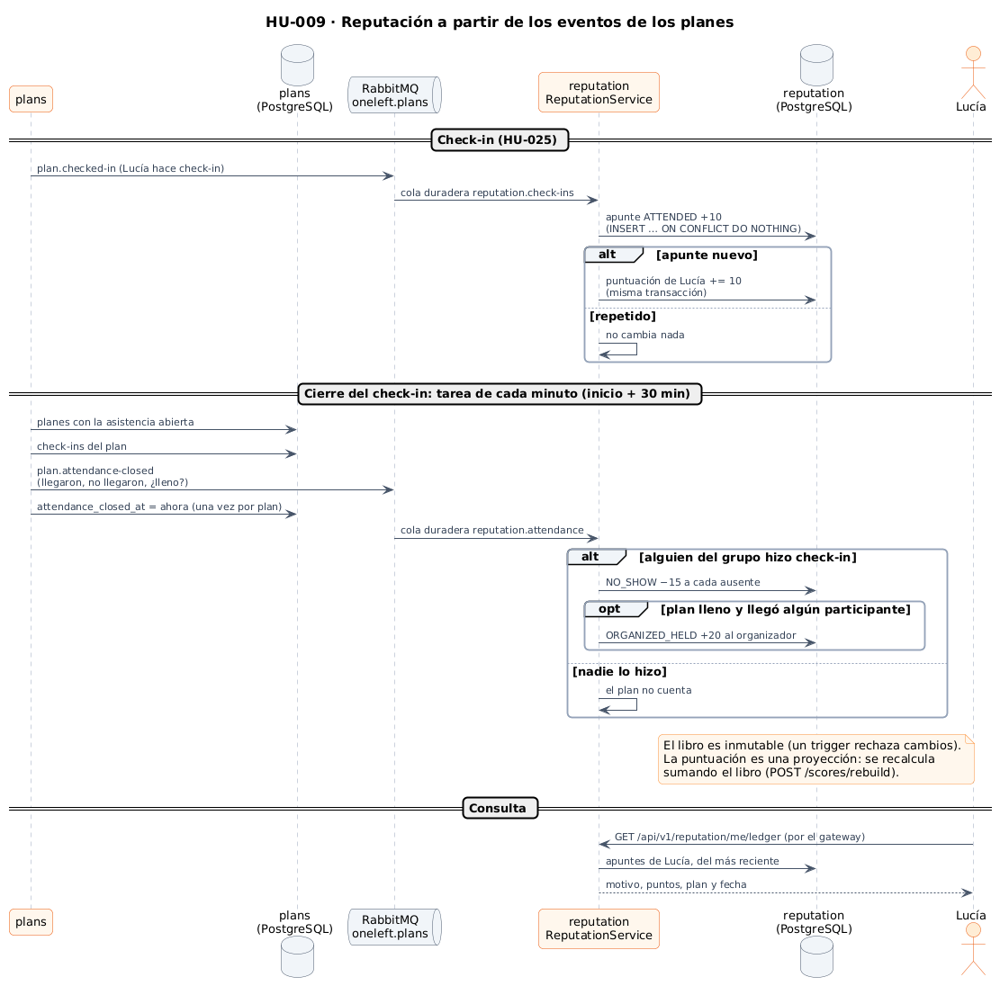
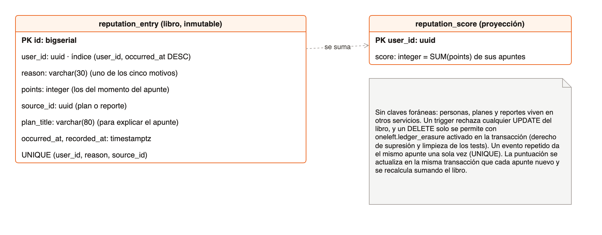
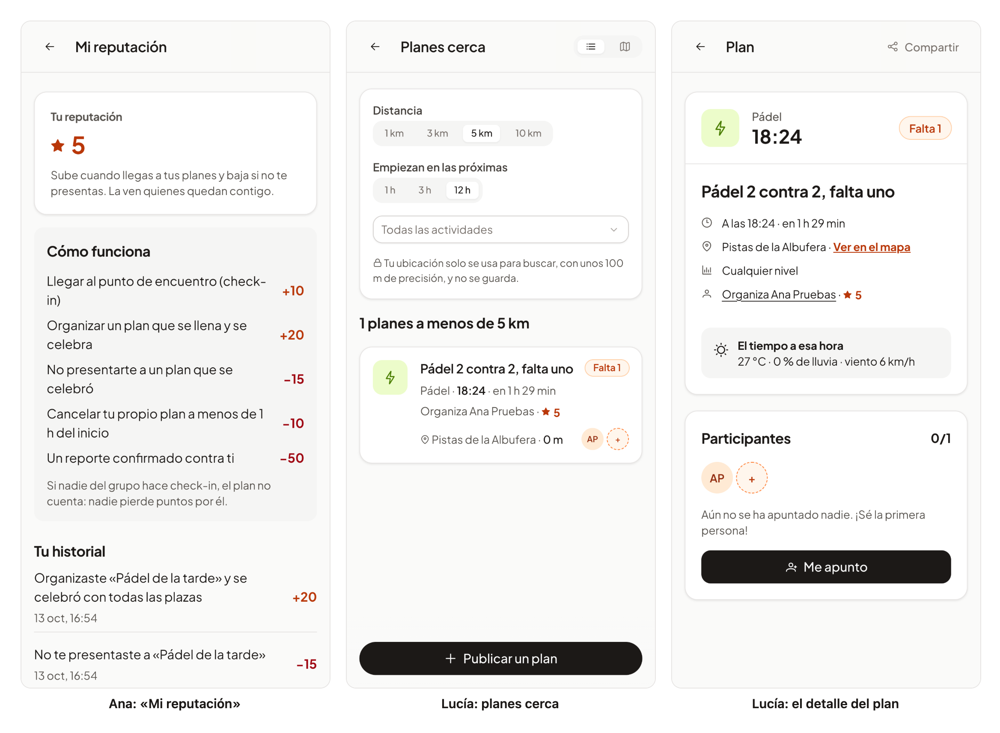

# 38 · Sprint 13: HU-009 Reputación basada en eventos

**Fecha:** 13/10/2026 · **Sprint:** 13 (09–15/10/2026)

## 1. Planificación

| Issue | Tipo | MoSCoW | Puntos | Resultado |
|---|---|---|---|---|
| backend#12 · HU-009 Reputación basada en eventos (libro de reputación) | Historia | Should | 13 | PR #118 |
| infra#62 · El servicio reputation en Docker Compose (sub-issue) | Tarea | Should | 1 | PR #63 |
| frontend#113 · La reputación en la web y la app (sub-issue) | Historia | Should | 5 | PR #114 |
| docs#100 · Documentación (sub-issue) | Documentación | Should | 1 | esta entrada |

**Por qué ahora:** el perfil social (HU-048) pide la foto (HU-020), las insignias (HU-044) y la reputación, y ninguna
estaba hecha. Se decidió hacer antes las dependencias, empezando por la reputación, que es la base del resto de
historias de confianza (kudos, avales, niveles, anti-trampas).

**Objetivo:** una reputación que refleje cómo es cada persona como compañera de plan. Sube al llegar a los planes y
baja al no presentarse; cada cambio queda apuntado con su motivo y se puede consultar.

## 2. Decisiones

| Decisión | Motivo |
|---|---|
| Un **microservicio `reputation`** dirigido por eventos, con su base de datos | Lo pide la historia, y así la reputación no frena a `plans`: escucha sus eventos en colas duraderas compartidas por las réplicas y, si está caída, los procesa al volver |
| **Libro inmutable** (`reputation_entry`) y **puntuación como proyección** (`reputation_score`) | Cada apunte guarda motivo, puntos, plan o reporte de origen y fecha. Un trigger rechaza cualquier cambio; borrar solo se permite activando `oneleft.ledger_erasure` en la transacción (derecho de supresión y limpieza de los tests). La puntuación se actualiza en la misma transacción que cada apunte nuevo y se recalcula sumando el libro (`POST /scores/rebuild`, solo administradores) |
| Cada apunte guarda **sus puntos** | Si una regla cambia, el pasado no se reescribe |
| Un evento repetido **cuenta una vez** (único persona + motivo + origen, `ON CONFLICT DO NOTHING`) | RabbitMQ entrega «al menos una vez» |
| **+20 al organizar** solo si el plan **se llena y se celebra**: todas las plazas ocupadas y, al cerrar el check-in, al menos un participante llegó (decidido al planificar) | No se gana con un plan de una plaza para alguien que no va |
| **−15 por no presentarse** solo si **alguien del grupo hizo check-in**, organizador incluido (decidido al planificar) | Así consta que el plan se celebró y que se usó el check-in; si nadie lo hizo, nadie pierde puntos |
| `plans` publica **`plan.attendance-closed`** al cerrarse el check-in (inicio + 30 min), una vez por plan: quién llegó, quién no y si estaba lleno | La regla de los ausentes necesita saber cuándo acaba la ventana. Lo hace la tarea de cada minuto (HU-007) con una columna `attendance_closed_at`; los planes ya celebrados al desplegar cuentan como cerrados, así que nadie es juzgado por planes de antes del check-in |
| **−10 y −50 implementadas ya** aunque aún no tienen origen (decidido al planificar) | Quien organiza todavía no puede cancelar su plan y los reportes llegan con HU-033. Las reglas, las colas y sus pruebas están listas: `plan.cancelled` lleva ya `organizerId`, y basta con que llegue el motivo `ORGANIZER` o el evento `report.confirmed` en `oneleft.reports` |
| Un evento que falla tres veces va a **`reputation.dead-letters`** | Un mensaje roto no vuelve una y otra vez a la cola |
| La reputación **junto al organizador**: en el detalle, en la lista de planes cercanos (**una sola petición por lista**, `GET /scores?ids=…`) y en la página de cada persona | Es donde se decide con quién quedar. Si el servicio no responde, todo se ve como antes, sin la cifra |

*Figura 131. Del check-in y del cierre de la asistencia en `plans` al libro y a la puntuación en `reputation`.
Fuente: [`41-secuencia-reputacion.puml`](../diagramas/secuencia/src/41-secuencia-reputacion.puml).*

*Figura 132. La base de datos `reputation`: el libro inmutable y la proyección de las puntuaciones. Fuente:
[`42-modelo-reputacion.drawio`](../diagramas/datos/src/42-modelo-reputacion.drawio).*

*Figura 133. La arquitectura implementada, ya con el servicio `reputation` y los eventos que escucha. Fuente:
[`30-arquitectura-implementada-y-prevista.puml`](../diagramas/componentes/src/30-arquitectura-implementada-y-prevista.puml).*

## 3. En la app

*Figura 134. A la izquierda, Ana en «Mi reputación»: su puntuación, cómo funciona y su historial. Organizó un plan de
una plaza, Lucía se apuntó e hizo check-in, y al cerrarse el check-in Ana sumó +20 por organizarlo y perdió 15 por no
hacer check-in. En el centro y a la derecha, Lucía ve la reputación de Ana en la lista de planes cercanos y en el
detalle de un plan suyo. Stack local real; capturas generadas con
[`tools/capture-reputation.mjs`](../tools/capture-reputation.mjs).*

## 4. Pruebas

- **Dominio** (`ReputationRulesTest`): cada regla con sus casos límite (el plan que nadie celebró, el lleno sin
  participantes que lleguen, la cancelación a menos y a más de 1 h, la del mínimo de participantes) y los datos
  obligatorios de un apunte. En `plans`, `PlanAttendanceTest`: quién llegó y quién no, sin contar a quien ya no está
  en el grupo.
- **Aplicación** (`ReputationServiceTest`, `AttendanceServiceTest`): un evento repetido cuenta una vez, la puntuación
  es la suma del libro y se recalcula desde él, las puntuaciones de varias personas en el orden pedido, y la
  asistencia se publica una vez, justo cuando cierra el check-in.
- **Integración** con RabbitMQ y PostgreSQL reales: en `reputation` (`ReputationIntegrationTest`), los eventos como los
  publica `plans` (JSON sin clases compartidas), repetidos, la cancelación tardía, el evento ilegible en las cartas
  muertas, el libro que rechaza cambios, el recálculo de un administrador y la API; borra lo que escribe con el
  permiso de supresión. En `plans` (`AttendanceIntegrationTest`), un plan cuyo check-in cerró publica su asistencia una
  vez y uno futuro espera; borra sus planes. Además, `HexagonalArchitectureTest` y, en el gateway,
  `ReputationRouteTest` y `SwaggerUiTest`.
- **Web:** «Mi reputación», la insignia, la API, y la reputación en el detalle, en la lista de cercanos (una
  petición por lista, y la lista igual si falla), en la página de una persona y en el perfil: 231 tests. **E2E**
  (`reputation.e2e.ts`, es y en): el servicio se responde en el navegador, así que no crea datos.
- **De punta a punta en local:** el check-in de Lucía le sumó 10 al momento a través de RabbitMQ; tras adelantar el
  inicio de ese plan en la base de datos local, la tarea de cada minuto cerró su asistencia y Ana recibió −15 y +20, una
  vez cada uno.

## 5. Incidencias

- **La cola de un test desaparecía.** `AttendanceIntegrationTest` fallaba en la CI porque su cola anónima, exclusiva
  de una conexión, ya no existía al leerla. Con una cola con nombre, no exclusiva, se descubrió además que RabbitMQ 4
  ya no admite colas no exclusivas y no duraderas (`transient_nonexcl_queues`); la cola del test es duradera y se
  borra al terminar.
- **El stack local no cabe en 4 GB.** Al levantar `reputation`, el kernel de la máquina virtual de Docker mató `plans`
  por falta de memoria (código 137). Para las pruebas y las capturas se pararon `chat` y `notifications`, que no hacían
  falta, y se volvieron a levantar al terminar. Con los doce contenedores el stack ronda los 3,3 GB de 3,8: los
  siguientes servicios necesitarán más memoria para Docker o arrancar solo los que se usen.
