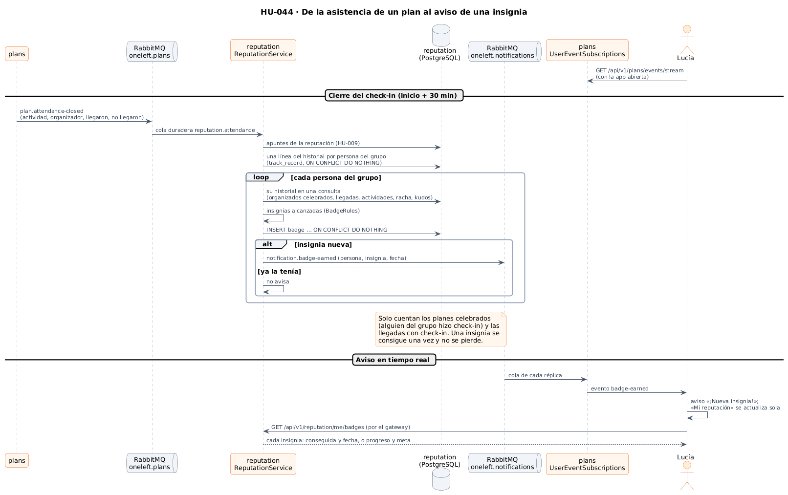
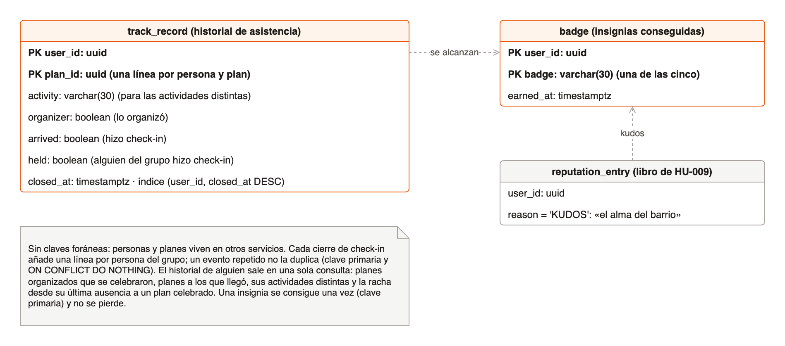
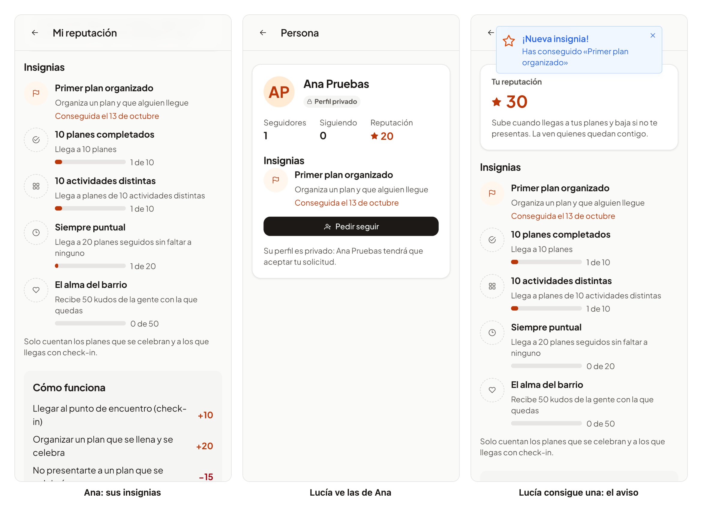

# 39 · Sprint 13: HU-044 Insignias por hitos

**Fecha:** 13/10/2026 · **Sprint:** 13 (09–15/10/2026)

## 1. Planificación

| Issue | Tipo | MoSCoW | Puntos | Resultado |
|---|---|---|---|---|
| backend#60 · HU-044 Insignias por hitos | Historia | Could | 8 | PR #119 |
| frontend#117 · Las insignias en la web y la app (sub-issue) | Historia | Could | 3 | PR #118 |
| docs#102 · Documentación (sub-issue) | Documentación | Could | 1 | esta entrada |

**Por qué ahora:** es la segunda dependencia del perfil social (HU-048), después de la reputación
([entrada 38](38-hu009-reputacion.md)), y se apoya en lo que esta ya escucha: el cierre de la asistencia de cada plan.

**Objetivo:** reconocer los hitos de cada persona con cinco insignias: primer plan organizado, 10 planes completados,
10 actividades distintas, «siempre puntual» (20 llegadas seguidas) y «el alma del barrio» (50 kudos). Se avisa al
conseguir una y se ven en la página de cada persona. No deben premiar malas prácticas.

## 2. Decisiones

| Decisión | Motivo |
|---|---|
| Las insignias viven en el servicio **`reputation`**, sin servicio nuevo | Ya escucha `plan.attendance-closed` de cada plan; las insignias salen de los mismos hechos que la reputación |
| Un **historial de asistencia** (`track_record`): una línea por persona y plan al cerrarse el check-in, con la actividad, si lo organizó, si llegó y si se celebró | Las cinco metas salen de él **en una sola consulta**. Un evento repetido no duplica la línea (clave primaria y `ON CONFLICT DO NOTHING`) |
| **Solo cuentan los planes celebrados** (alguien del grupo hizo check-in) **y las llegadas con check-in** | Lo pide la historia: un plan que nadie celebró no da nada, así que no se gana con planes de una plaza a los que nadie va |
| «Siempre puntual» es la **racha** de llegadas desde la última ausencia a un plan celebrado | Coherente con el −15 de HU-009: no presentarse rompe la racha; un plan que nadie celebró, no |
| «El alma del barrio» cuenta los **apuntes `KUDOS` del libro** | Queda lista para HU-060: cuando existan los kudos, contarán sin cambiar las insignias |
| Una insignia se consigue **una vez y no se pierde** (`INSERT … ON CONFLICT DO NOTHING`) | RabbitMQ entrega «al menos una vez»: solo la primera vez hay insignia y aviso |
| `plan.attendance-closed` lleva ya la **actividad** del plan | `reputation` cuenta las actividades distintas sin preguntar a `plans` |
| El aviso sale por **`oneleft.notifications`** (`notification.badge-earned`) y `plans` lo reenvía por el flujo en tiempo real de la persona como `badge-earned` | Es el camino de los avisos de planes cercanos (HU-006): una cola por réplica y ningún canal nuevo |
| En «Mi reputación», **las cinco** con su progreso («1 de 10»); en la página de otra persona, **solo las conseguidas** | El progreso es cosa de cada uno; lo conseguido es lo que interesa a los demás y la base del perfil social (HU-048) |
| El aviso **abre «Mi reputación»**, y la página, si está abierta, **se actualiza sola** | Se ve al momento la insignia nueva, la puntuación y el historial, sin recargar |

*Figura 135. Del cierre del check-in de un plan al aviso de una insignia nueva: el historial, las insignias alcanzadas
y el aviso en tiempo real. Fuente:
[`43-secuencia-insignias.puml`](../diagramas/secuencia/src/43-secuencia-insignias.puml).*

*Figura 136. Las tablas nuevas de la base de datos `reputation`: el historial de asistencia y las insignias
conseguidas, junto a los kudos del libro. Fuente:
[`44-modelo-insignias.drawio`](../diagramas/datos/src/44-modelo-insignias.drawio).*

La arquitectura no cambia: la figura 133 de la [entrada 38](38-hu009-reputacion.md) ya muestra el servicio
`reputation`, los eventos que escucha y los avisos que reenvía `plans`.

## 3. En la app

*Figura 137. A la izquierda, Ana en «Mi reputación»: ha conseguido «Primer plan organizado» y ve cuánto le falta para
las demás. En el centro, Lucía ve esa insignia en la página de Ana. A la derecha, Lucía tiene abierta «Mi reputación»
cuando se cierra el check-in de un plan suyo al que Ana llegó: le llega el aviso «¡Nueva insignia!» y la página ya
muestra la insignia y la puntuación nueva. Stack local real; capturas generadas con
[`tools/capture-badges.mjs`](../tools/capture-badges.mjs).*

## 4. Pruebas

- **Dominio** (`BadgeRulesTest`): una línea del historial por persona del grupo, con si llegó y si el plan se
  celebró; un plan al que nadie llegó no cuenta como celebrado, y cada insignia se alcanza en su meta, donde se detiene
  el progreso. En `plans`, `PlanAttendanceTest` comprueba que la asistencia lleva la actividad.
- **Aplicación** (`ReputationServiceTest`): cada insignia se concede una vez y con un aviso, un plan al que nadie llegó
  no da nada y una ausencia rompe la racha.
- **Integración** con RabbitMQ y PostgreSQL reales (`ReputationIntegrationTest`): diez planes de diez actividades y una
  ausencia, publicados como lo hace `plans`; las insignias, una vez cada una; la racha rota; la API, y los tres avisos
  en `oneleft.notifications`. Borra lo que escribe. En `plans`, `RabbitPlanEventPublisherTest` comprueba que el
  aviso llega al flujo en tiempo real de la persona, y `UserEventSubscriptionsTest`, que solo a quien la consiguió.
- **Web:** la lista de insignias, la sección de «Mi reputación» (también la recarga al llegar una insignia), la página
  de una persona, el evento del flujo y el aviso que abre «Mi reputación»: 236 tests. **E2E** (`reputation.e2e.ts`, es
  y en): el servicio y el flujo de eventos se responden en el navegador, así que no crea datos.
- **De punta a punta en local:** Lucía organizó un plan, Ana se apuntó e hizo check-in y, tras adelantar su inicio en
  la base de datos local, la tarea de cada minuto cerró la asistencia: Lucía consiguió «Primer plan organizado» una
  sola vez y el aviso le llegó con la página abierta, en la web (figura 137) y en la app Android del emulador.

## 5. Incidencias

- **Las barras de progreso, grises, y una página que no se enteraba.** Las primeras capturas mostraron las barras con
  el estilo del navegador, sin los colores de la app, y «Mi reputación» seguía igual tras el aviso de una insignia
  nueva. Antes de fusionar se dieron estilo a las barras con las variables del sistema de diseño y la página se recarga
  al llegar el aviso, con su test.
- **Una captura con el aviso equivocado.** El script esperaba cualquier aviso y se quedó con el de un check-in; ahora
  espera el de la insignia. Como Lucía ya tenía la insignia de la prueba anterior, se borró esa fila en la base de
  datos local para que la volviera a conseguir con la página abierta.
- **Un E2E contra una compilación vieja.** Sin `ng serve` arrancado, el E2E sirve `dist/`, que era de antes del
  cambio; se volvió a compilar.
- **Formato que no tocaba.** Al formatear se reformatearon dos specs que no cambiaban; se dejaron como estaban.
- **Memoria del stack.** Como en la entrada 38, para las pruebas y las capturas se pararon `chat` y `notifications`,
  que no hacían falta, y se volvieron a levantar al terminar.
