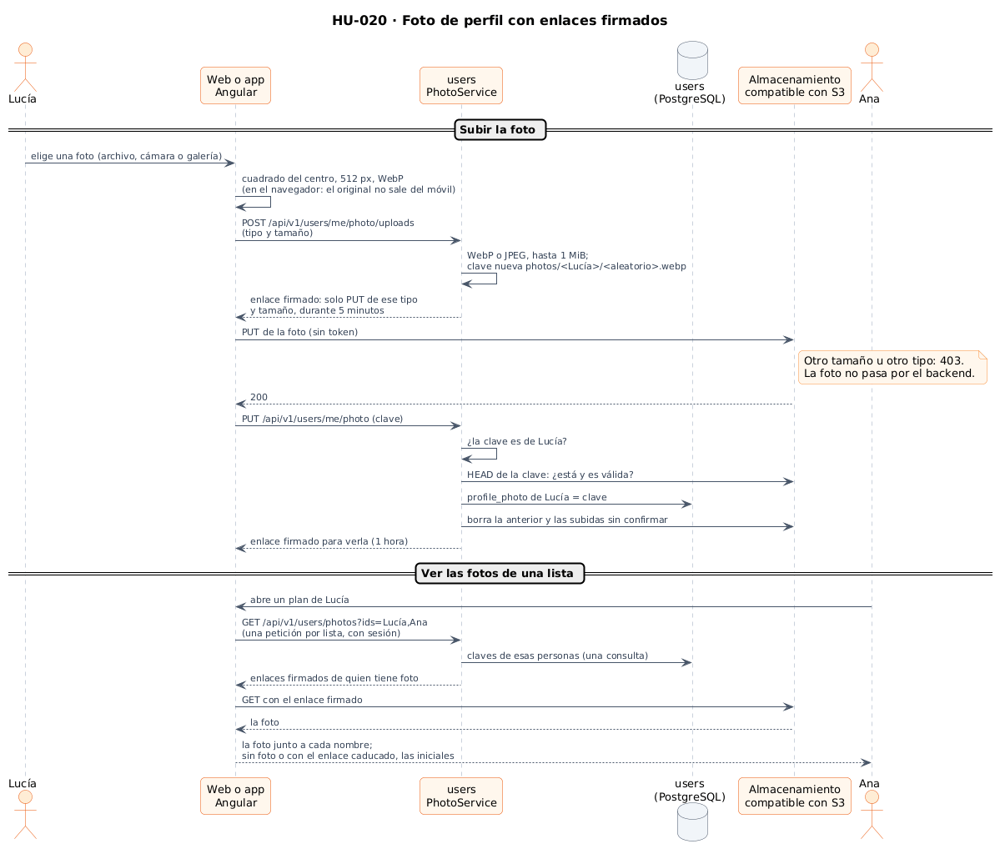
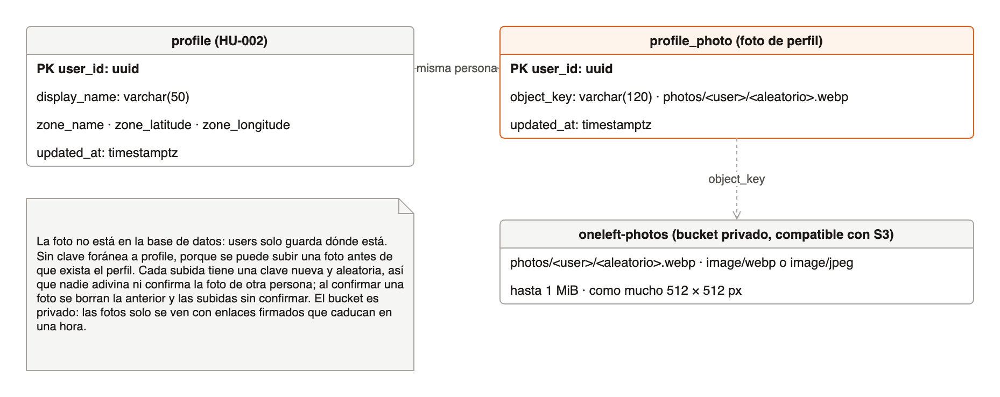
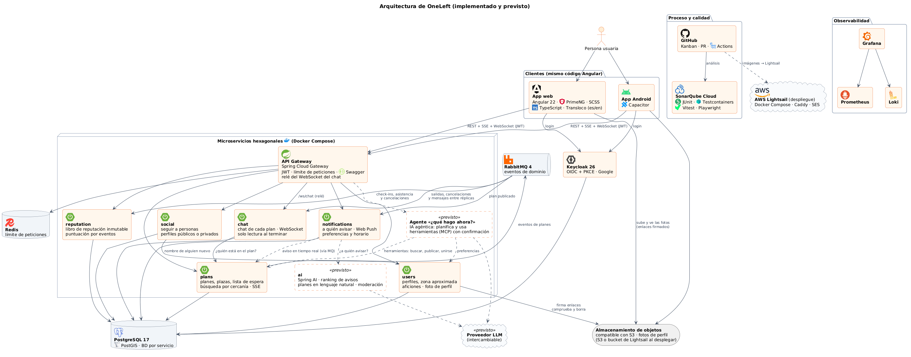
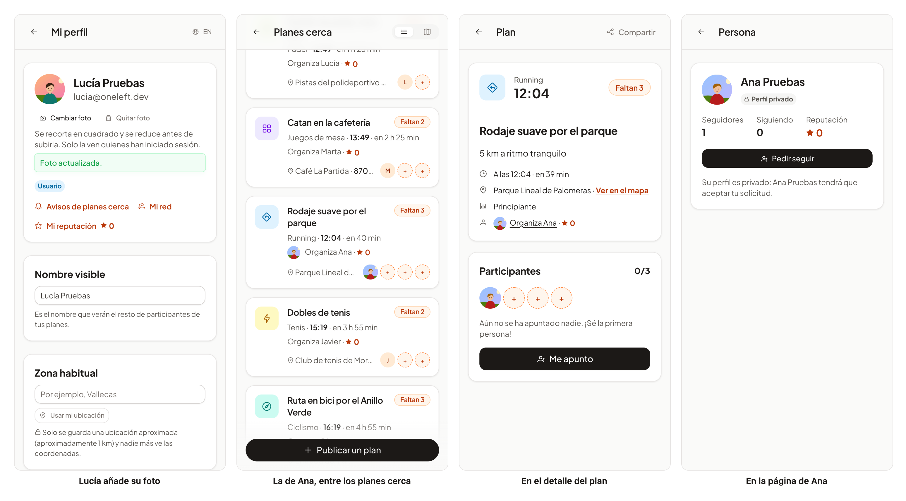

# 40 · Sprint 13: HU-020 Foto de perfil

**Fecha:** 14/10/2026 · **Sprint:** 13 (09–15/10/2026)

## 1. Planificación

| Issue | Tipo | MoSCoW | Puntos | Resultado |
|---|---|---|---|---|
| backend#30 · HU-020 Foto de perfil | Historia | Should | 5 | PR #121 |
| infra#64 · Almacenamiento compatible con S3 en Docker Compose (sub-issue) | Tarea | Should | 2 | PR #65 |
| frontend#120 · La foto de perfil en la web y la app (sub-issue) | Historia | Should | 5 | PR #121 |
| docs#104 · Documentación (sub-issue) | Documentación | Should | 1 | esta entrada |

**Por qué ahora:** es la última dependencia del perfil social (HU-048), después de la reputación
([entrada 38](38-hu009-reputacion.md)) y las insignias ([entrada 39](39-hu044-insignias.md)). Estaba en el sprint 16,
para cuando hubiera despliegue en AWS (infra#5), porque necesita almacenamiento de objetos; se adelantó con un
almacenamiento compatible con S3 en local.

**Objetivo:** que cada persona pueda subir una foto para que el resto la reconozca en sus planes. La subida va con una
URL prefirmada (el backend no recibe el fichero), con redimensionado y límite de tamaño, y la foto se ve en el perfil
y en los planes.

## 2. Decisiones

| Decisión | Motivo |
|---|---|
| Un **almacenamiento compatible con S3 en Docker Compose** (decidido al planificar) | El código es el mismo que con S3 o con un bucket de Lightsail (AWS SDK): al desplegar solo cambian la dirección y las claves |
| **Versity S3 Gateway** en lugar de MinIO | MinIO dejó de publicar sus imágenes (Docker Hub responde 404 y quay.io pide cuenta). Antes de elegirlo se probó lo que hacía falta: el tamaño y el tipo firmados en el enlace (otro tamaño o tipo, 403), la lectura con enlace firmado (sin firma, 403) y el CORS del navegador. Ocupa unos 10 MB de memoria |
| La foto **va del dispositivo al almacenamiento** con un enlace firmado que solo acepta un `PUT` de ese tipo y tamaño durante 5 minutos | Lo pide la historia, y `users` ni recibe ni reenvía ficheros: solo guarda dónde está cada foto |
| **Recorte y reducción en el navegador** (decidido al planificar): el cuadrado del centro, como mucho 512 px, en WebP (JPEG si el navegador no sabe WebP) | La foto original no sale del móvil; la que se sube ronda los 50 KB. Se respeta la orientación que guarda la cámara |
| Límite de **1 MiB, WebP o JPEG**, comprobado al pedir el enlace y otra vez al confirmar, preguntando al almacenamiento qué se subió | El enlace ya impide subir otra cosa; la confirmación no se fía de nadie |
| Las fotos **solo se ven con sesión** (decidido al planificar): bucket privado y enlaces firmados que caducan en una hora | Privacidad por defecto, como el perfil privado de HU-047. A cambio se cachean menos: un enlace caducado vuelve a las iniciales |
| **Una clave nueva y aleatoria** en cada subida, dentro de la carpeta de la persona (`photos/<persona>/<aleatorio>.webp`) | Nadie adivina ni confirma la foto de otra persona, y una foto nueva nunca reutiliza el enlace de la anterior. Al confirmar se borran la anterior y las subidas que nunca se confirmaron |
| **Una petición por lista** (`GET /api/v1/users/photos?ids=…`, hasta 50 personas) | Sin N+1, como las puntuaciones de HU-009. Firmar un enlace es un cálculo local, sin llamar al almacenamiento |
| Dos clientes del almacenamiento: uno para la red interna y otro que firma para la dirección del navegador | La firma incluye el nombre del servidor: dentro de Docker es `storage:7070` y fuera, `localhost:7070` |
| El AWS SDK **solo en el adaptador** (comprobado con ArchUnit) | El dominio y los casos de uso no saben de S3; cambiar de proveedor no los toca |
| Si el almacenamiento no responde, **`users` arranca igual** y solo fallan las fotos (`503`, `photo.unavailable`) | El perfil y el inicio de sesión no dependen de las fotos |
| La foto **junto al nombre** en la cabecera, mi perfil, la página de una persona, el detalle de un plan (organizador, participantes y plazas) y la lista de planes cercanos; sin foto, las iniciales | Es donde se reconoce a la gente con la que se queda. La imagen es decorativa (`alt=""`): el nombre siempre está al lado |

*Figura 138. La subida de una foto con el enlace firmado y cómo se ven las fotos de una lista. Fuente:
[`45-secuencia-foto-de-perfil.puml`](../diagramas/secuencia/src/45-secuencia-foto-de-perfil.puml).*

*Figura 139. La tabla nueva de `users`, que solo guarda dónde está cada foto, y el bucket privado donde está. Fuente:
[`46-modelo-foto-de-perfil.drawio`](../diagramas/datos/src/46-modelo-foto-de-perfil.drawio).*

*Figura 140. La arquitectura implementada, ya con el almacenamiento de objetos: `users` firma los enlaces y la web y
la app suben y ven las fotos directamente. Fuente:
[`30-arquitectura-implementada-y-prevista.puml`](../diagramas/componentes/src/30-arquitectura-implementada-y-prevista.puml).*

## 3. En la app

*Figura 141. Lucía añade su foto desde «Mi perfil»: el navegador la recorta y la sube directamente al almacenamiento.
Ana también ha añadido la suya, y Lucía la ve junto a su nombre en la lista de planes cercanos (en el plan y en su
plaza), en el detalle del plan y en la página de Ana. Quien no tiene foto conserva sus iniciales. Las fotos son
ilustraciones generadas por el script. Stack local real; capturas generadas con
[`tools/capture-photo.mjs`](../tools/capture-photo.mjs), que quita las dos fotos al terminar.*

## 4. Pruebas

- **Dominio** (`PhotoTest`): los formatos, el tamaño, las claves (la de otra persona, rutas que intentan salir de la
  carpeta, claves demasiado largas) y que lo subido sea una foto dentro de los límites.
- **Aplicación** (`PhotoServiceTest`, con dobles en memoria y reloj fijo): el enlace se firma para esa foto y caduca
  en 5 minutos; nada se firma si no es una foto; confirmar guarda la nueva y borra la anterior y las subidas sin
  confirmar; no se confirma lo que no es mío, no se subió o no es válido; quitar la foto, y las fotos de una lista, como
  mucho 50.
- **Adaptador** (`S3PhotoStorageTest`): los enlaces se firman sin servidor, para la dirección pública y con el tipo y
  el tamaño; un almacenamiento que no responde se dice, y el servicio arranca igual.
- **Integración** (`PhotoIntegrationTest`): un almacenamiento real en un contenedor, y la foto subida con `HttpClient`
  como lo hace el navegador. Otro tamaño u otro tipo, 403; sin firma, 403; una foto nueva borra la anterior; cada
  problema con su código, y todo con sesión. Quita las fotos que crea. Además, `HexagonalArchitectureTest`: 75 tests en
  `users`, con la cobertura cumplida.
- **Web:** el avatar (foto, iniciales y enlace caducado), la API, el recorte (el centro, WebP o JPEG, ficheros que no
  son fotos o sin tipo), mi foto, y las fotos en el perfil, la página de una persona, el detalle, las plazas y la lista
  de cercanos: 258 tests. **E2E** (`photo.e2e.ts`, es y en): una imagen real se recorta, se sube en WebP de menos de
  1 MB, se ve en el perfil y en la cabecera y se quita; un PDF se rechaza sin pedir enlace. El servicio y el
  almacenamiento se responden en el navegador, así que no crea datos.
- **Android:** en el emulador se abre el selector de fotos del sistema, la foto se recorta y se sube, y se ve en el
  perfil y en la cabecera.
- **De punta a punta en local:** a través del gateway, la foto de Lucía sube directamente al almacenamiento, Ana la ve
  con su enlace firmado (los mismos bytes), sin sesión se responde 401, y al quitarla no queda ni fila ni objeto.

## 5. Incidencias

- **MinIO ya no se puede descargar.** La primera opción fue MinIO; sus imágenes ya no están publicadas, así que se
  probaron las alternativas con imagen y versión fijas y se eligió Versity S3 Gateway. Con su configuración por
  defecto necesita atributos extendidos en el disco; los metadatos de cada objeto van a una carpeta aparte para que
  funcione en cualquier sistema de ficheros, también en los contenedores de los tests.
- **Una configuración en el sitio equivocado.** El bloque del almacenamiento se insertó buscando `server:`, que también
  aparece al final de `resourceserver:`, y acabó dentro de la configuración de seguridad: todos los tests que arrancan
  la aplicación fallaron. Se corrigió antes de subir nada.
- **Tests que se quedaban esperando.** Las fotos del detalle de un plan se pedían primero con `httpResource`, y con el
  `HttpClient` de pruebas la petición nunca se respondía: los tests esperaban hasta agotar el tiempo. Se piden a través
  de la API de fotos, que los tests simulan como la de la reputación.
- **Una foto rechazada en Android.** El primer intento en el emulador dijo «no es una imagen»: el selector de Android
  puede dar el fichero sin tipo. Ahora un fichero sin tipo se intenta leer, y solo se rechaza si no se puede.
- **Las plazas, sin la foto.** Las primeras capturas mostraron la foto junto al nombre del organizador, pero su plaza
  seguía con la inicial. Las plazas del plan ya muestran la foto de quien la tiene.
- **El entorno local, otra vez sin memoria.** `plans` cayó por falta de memoria y nadie lo notó durante una hora;
  RabbitMQ ocupaba unos 880 MB. Al consultarlo con `rabbitmqctl`, Docker dejó de responder y volvió vacío, sin
  contenedores, imágenes ni volúmenes, como el 13/10. Con permiso se reconstruyó solo lo necesario para las capturas
  (sin `chat`, `notifications` ni observabilidad) y el seed recreó los datos de demostración. El emulador de Android
  ocupaba casi tres núcleos y retrasaba el arranque de Keycloak; se cerró al terminar la prueba en Android.
- **Pendiente para la próxima promoción a `pre`.** El entorno de `pre` y el de los E2E de la CI necesitarán el
  almacenamiento y la configuración de `users`; desplegado, un bucket de S3 o de Lightsail con una regla CORS para el
  origen de la app.
