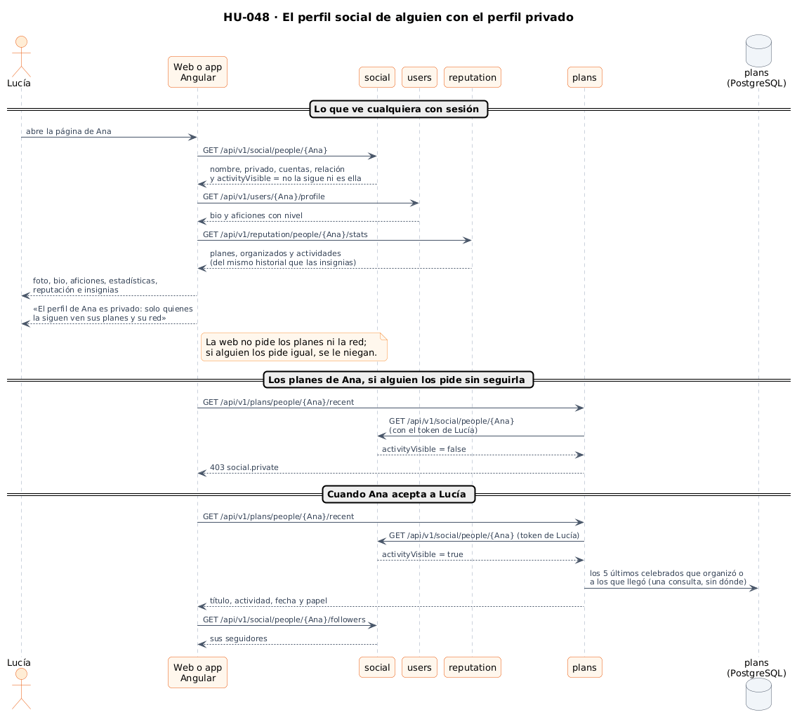
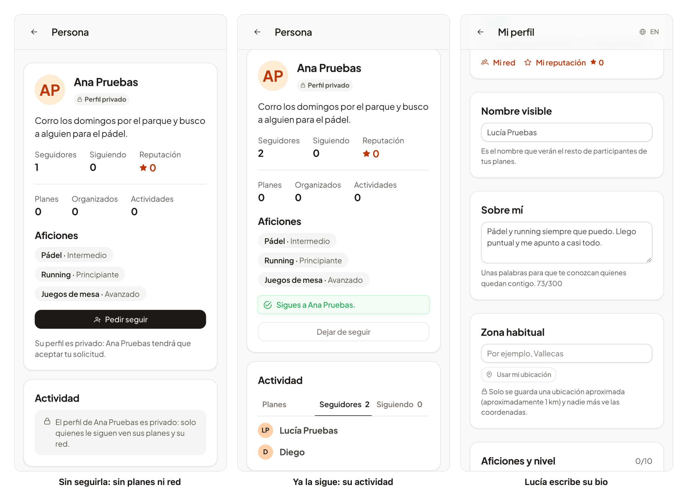

# 41 · Sprint 13: HU-048 Perfil social

**Fecha:** 15/10/2026 · **Sprint:** 13 (09–15/10/2026)

## 1. Planificación

| Issue | Tipo | MoSCoW | Puntos | Resultado |
|---|---|---|---|---|
| backend#67 · HU-048 Perfil social | Historia | Should | 8 | PR #122 |
| infra#66 · plans llega al servicio social (sub-issue) | Tarea | Should | 1 | PR #67 |
| frontend#122 · El perfil social en la web y la app (sub-issue) | Historia | Should | 5 | PR #123 |
| docs#106 · Documentación (sub-issue) | Documentación | Should | 1 | esta entrada |

La historia estaba estimada en 5 puntos. Toca cuatro servicios (`users`, `social`, `plans` y `reputation`), así que se
reestimó a 8 antes de empezar, con sus tres sub-issues aparte.

**Por qué ahora:** sus dependencias ya estaban hechas: la reputación ([entrada 38](38-hu009-reputacion.md)), las
insignias ([entrada 39](39-hu044-insignias.md)) y la foto de perfil ([entrada 40](40-hu020-foto-de-perfil.md)).

**Objetivo:** un perfil social para que otras personas conozcan a alguien antes de quedar. Tiene bio, foto, aficiones
con nivel, estadísticas, insignias, reputación, planes recientes, seguidores y seguidos, y respeta la privacidad del
perfil.

## 2. Decisiones

| Decisión | Motivo |
|---|---|
| Un perfil privado oculta **sus planes recientes y su red** a quien no lo sigue (decidido al planificar). El nombre, la foto, la bio, las aficiones, las estadísticas, la reputación y las insignias los ve cualquiera con sesión | Lo visible ayuda a decidir si quedar con alguien; lo privado es por dónde se mueve y con quién |
| Los **5 últimos planes celebrados** que organizó o a los que llegó, con título, actividad, fecha y papel; **nunca el punto de encuentro** (decidido al planificar) | Los planes futuros dirían dónde va a estar. Tampoco enlazan al detalle del plan, que sí tiene el punto de encuentro |
| La regla vive en **`social`**: se ven si es uno mismo, si el perfil es público o si se le sigue (`activityVisible`) | `social` sabe quién sigue a quién. Los demás servicios le preguntan en lugar de copiar la regla |
| `plans` pregunta a `social` **una vez por petición**, con el token de quien pide (como `social` pregunta a `users`). Si `social` no responde, no muestra nada (`503`) | La privacidad la hace cumplir la API, no solo la pantalla: pedir los planes de un perfil privado sin seguirlo da `403 social.private`. Ante la duda, mejor no enseñar de más |
| Un plan **celebrado** cuenta si terminó y hubo check-in de la persona o, si lo organizó, de cualquiera; una sola consulta que solo trae las columnas que se enseñan | Lo mismo que cuenta para la reputación y las insignias. Sin cargar los planes enteros |
| La **bio** vive en `users`, en el mismo perfil que el nombre y las aficiones: opcional, hasta 300 caracteres, y una vacía la quita | Se edita en «Mi perfil» con el resto de los datos de la persona |
| Las **estadísticas** salen del historial de `reputation`: planes completados, planes organizados que se celebraron y actividades distintas | Son las mismas cifras que llevan a las insignias; no hace falta contarlas otra vez |
| Cada parte se pide **a su servicio** y, si una falla, se enseña el resto | Como la reputación en los planes: una página no se queda en blanco porque falte una pieza |
| Los seguidores y seguidos de otra persona van **por páginas** y con su foto (una petición de fotos por página) | Igual que «Mi red» |

*Figura 142. El perfil social de alguien con el perfil privado: lo que se ve con sesión, los planes que se niegan a
quien no la sigue y lo que cambia cuando acepta. Fuente:
[`47-secuencia-perfil-social.puml`](../diagramas/secuencia/src/47-secuencia-perfil-social.puml).*

*Figura 143. La arquitectura implementada, ya con `plans` preguntando a `social` si se pueden ver los planes de
alguien. Fuente:
[`30-arquitectura-implementada-y-prevista.puml`](../diagramas/componentes/src/30-arquitectura-implementada-y-prevista.puml).*

## 3. En la app

*Figura 144. A la izquierda, Lucía abre el perfil de Ana, que es privado y al que aún no sigue: ve su bio, sus cifras,
sus aficiones con nivel y su reputación, pero no sus planes ni su red. En el centro, Ana ha aceptado su solicitud y
Lucía ya ve su actividad, con sus seguidores. A la derecha, Lucía escribe su propia bio en «Mi perfil». Stack local
real: tras el reinicio del entorno, Ana aún no tiene planes celebrados, así que sus cifras están a cero. Capturas
generadas con [`tools/capture-social-profile.mjs`](../tools/capture-social-profile.mjs), que al terminar deja las
bios como estaban y hace que Lucía deje de seguir a Ana.*

## 4. Pruebas

- **Dominio:** en `social`, `PersonTest` comprueba quién ve los planes y la red de alguien (uno mismo, sus seguidores
  o todos si el perfil es público). En `users`, `ProfileTest` y `ValidationCodesTest`: la bio es opcional, se recorta,
  admite hasta 300 caracteres y tiene su código.
- **Aplicación:** `SocialServiceTest` comprueba la red de un perfil privado, antes y después de aceptar, y la de uno
  público o la propia. `PersonPlansServiceTest`: los planes propios no preguntan a `social`; los de otra persona, solo
  si `social` lo permite; y si no se sabe, no se enseña nada. `ReputationServiceTest`: las estadísticas salen de los
  mismos planes que las insignias.
- **Integración:**
  - `PersonPlansIntegrationTest`: PostgreSQL real y `social` simulado con WireMock. Comprueba los 5 últimos
    celebrados, del más reciente al más antiguo y sin punto de encuentro, y lo que no cuenta. La pregunta a `social`
    va con el token de quien pide, y se cubren `403`, `404` y `503`. Borra sus planes.
  - `SocialIntegrationTest`: `activityVisible` y las listas de un perfil privado.
  - `ReputationIntegrationTest`: las estadísticas tras diez planes.
  - `ProfileControllerTest` y `JpaProfileRepositoryTest`: la bio.
- **Web:** el componente de actividad (aviso de perfil privado, planes, listas con fotos, «Ver más», vacíos y errores),
  el perfil en la página de una persona, la bio en «Mi perfil» y las nuevas llamadas a la API: 267 tests. **E2E**
  (`social-profile.e2e.ts`, es y en): el perfil de alguien a quien sigo y el de un perfil privado al que no sigo. Los
  servicios se responden en el navegador, así que no crea datos.
- **De punta a punta en local:** a través del gateway, Lucía ve el perfil de Ana (privado, con sus tres aficiones) y
  recibe `403 social.private` al pedir sus planes y sus seguidores; Ana sí puede pedir los suyos (aún no tiene
  ninguno celebrado).
- **Android:** no se comprobó en el emulador en esta historia (se decidió dejarlo); la CI genera el APK.

## 5. Incidencias

- **Una pestaña cortada y unas aficiones descolocadas.** Las primeras capturas mostraron, en el móvil, «Planes
  recientes» cortado en la pestaña, y un hueco entre la actividad y el nivel de cada afición (la clase de las
  pastillas reparte su contenido con separación). La pestaña se llama ahora «Planes» y las aficiones tienen su propio
  estilo; se corrigió antes de fusionar.
- **Docker sin salida al registro.** Tras un reinicio de Docker, la construcción de las imágenes se quedaba esperando
  la imagen base y `docker pull` no avanzaba, aunque desde el Mac el registro respondía. Con permiso se reinició Docker
  Desktop: volvió sin contenedores, pero con las imágenes y los volúmenes, y el stack se recreó con `docker compose`
  sin perder datos.
- **Pendiente para la próxima promoción a `pre`.** `plans` necesitará `SOCIAL_URL` en `pre` y en el entorno de los E2E
  de la CI.
