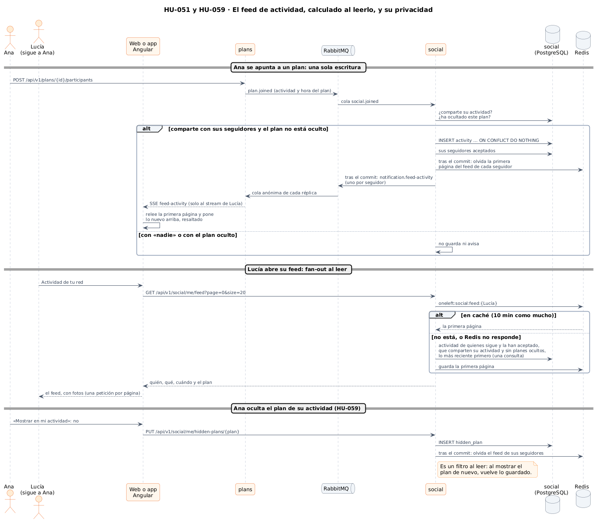
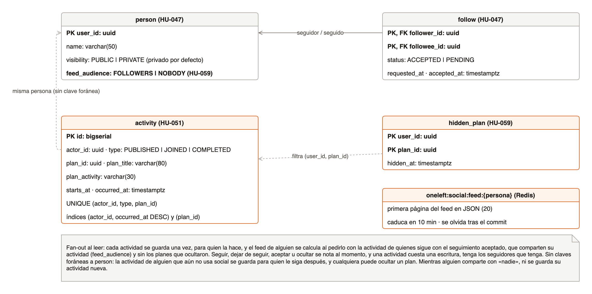
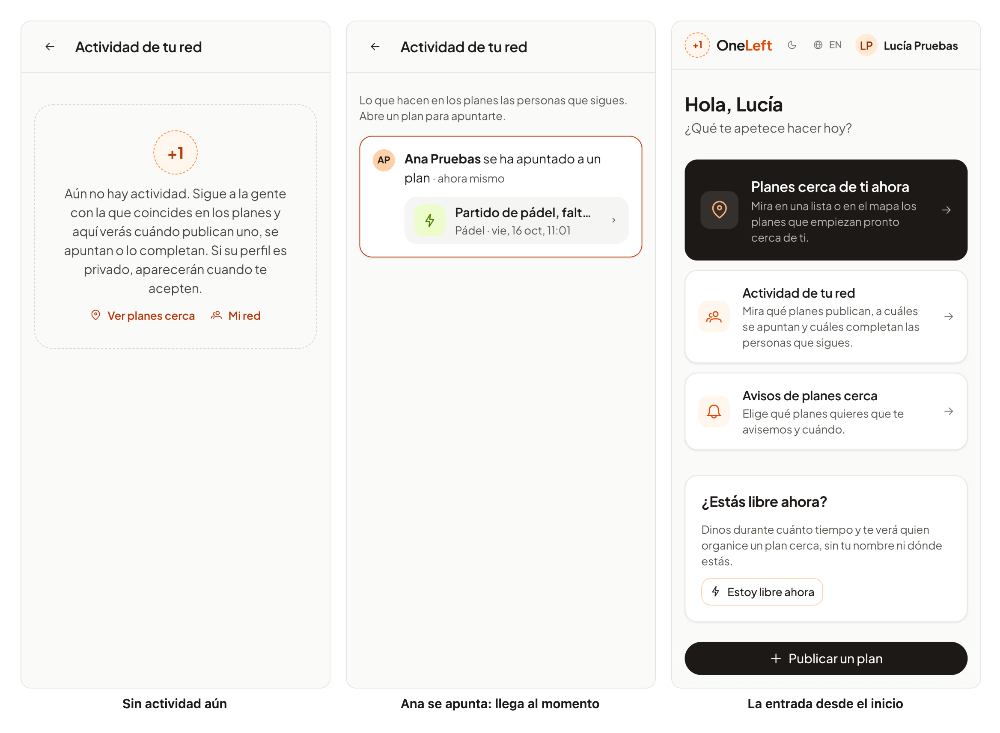
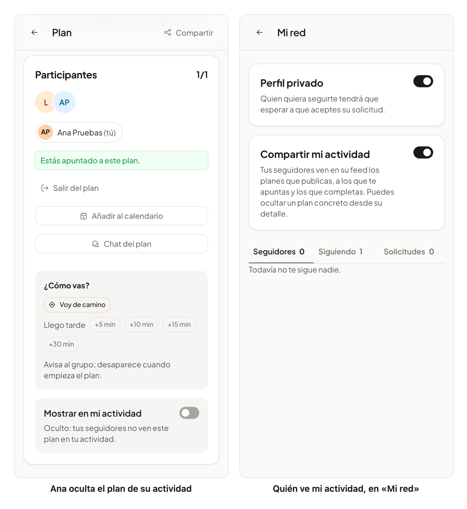

# 42 · Sprint 14: HU-051 Feed de actividad y HU-059 Privacidad social por defecto

**Fecha:** 16/10/2026 · **Sprint:** 14 (16–22/10/2026)

## 1. Planificación

| Issue | Tipo | MoSCoW | Puntos | Resultado |
|---|---|---|---|---|
| backend#70 · HU-051 Feed de actividad | Historia | Should | 8 | PR #124 |
| infra#68 · El servicio social con RabbitMQ y Redis (sub-issue) | Tarea | Should | 1 | PR #69 |
| frontend#125 · El feed en la web y la app (sub-issue) | Historia | Should | 5 | PR #127 |
| backend#75 · HU-059 Privacidad social por defecto | Historia | Should | 3 | PR #125 |
| frontend#126 · La privacidad en la web y la app (sub-issue) | Historia | Should | 2 | PR #128 |
| docs#108 · Documentación de las dos historias (sub-issue) | Documentación | Should | 1 | esta entrada |

Las dos historias van juntas: HU-059 decide quién ve lo que HU-051 enseña. El mismo día se cerraron también dos bugs
del sprint anterior: frontend#119 (los avisos se pintaban sobre la barra de estado de Android) y backend#120 (el aviso
de una insignia podía salir antes de guardarla).

**Objetivo:** un feed con lo que hacen en los planes las personas que sigo (publicar, apuntarse y completar),
paginado y en tiempo real, que respete la privacidad de cada una; y que cada persona pueda elegir quién ve su
actividad y ocultar planes concretos, con valores por defecto respetuosos.

## 2. Decisiones

### Fan-out al escribir frente a fan-out al leer

| | Fan-out al escribir | Fan-out al leer (elegido) |
|---|---|---|
| Qué se guarda | Una copia de cada actividad en el feed de cada seguidor | La actividad una sola vez, para quien la hace |
| Coste de una actividad | Una escritura por seguidor | Una escritura |
| Coste de abrir el feed | Leer mi lista, ya hecha | Una consulta sobre la actividad de quienes sigo |
| Seguir, dejar de seguir o aceptar | Hay que rellenar o borrar feeds | Se nota al momento |
| Privacidad (perfil privado, «nadie», plan oculto) | Hay que repasar las copias ya repartidas | Se aplica al leer, siempre al día |
| Cuándo compensa | Cuentas con millones de seguidores y muchas más lecturas que escrituras | Redes pequeñas o medianas como la de OneLeft |

Se eligió **fan-out al leer con la primera página en Redis** (decidido al planificar): en OneLeft cada persona sigue a
pocas decenas de personas, y la privacidad cambia a menudo (solicitudes, perfiles privados, planes ocultos). La
consulta usa el índice `(actor_id, occurred_at DESC)` por cada persona seguida, y la página más abierta, la primera,
sale de Redis.

| Decisión | Motivo |
|---|---|
| `social` **escucha los eventos de `plans`** (`plan.published`, `plan.joined`, `plan.left`, `plan.cancelled` y `plan.attendance-closed`) en colas duraderas `social.*`, con cola de mensajes muertos | Cada evento se procesa una vez aunque haya varias réplicas, y los de cuando el servicio estaba parado se procesan al volver |
| Una actividad por persona, tipo y plan (`ON CONFLICT DO NOTHING`) | Un evento repetido no cambia nada ni avisa dos veces |
| Salir de un plan borra el «se ha apuntado»; quien entra desde la lista de espera se apunta; un plan cancelado sale de todos los feeds; completarlo es haber llegado (check-in) | El feed cuenta lo que sigue siendo verdad. `plan.left` lleva ahora la actividad y la hora del plan para poder contar quién entra |
| Solo cuenta el **seguimiento aceptado** | Un perfil privado aparece en el feed cuando acepta la solicitud, como el resto de su actividad (HU-048) |
| La primera página, **10 minutos en Redis** como mucho, y se olvida **tras el commit** de cualquier cambio que la afecte | Olvidarla antes del commit dejaría que una lectura intermedia guardara la página vieja. Si Redis no responde, el feed se lee de la base de datos (tiempos de espera de 1 s y Redis fuera del *health check*) |
| La actividad nueva **avisa a cada seguidor** por `notification.feed-activity`, que `plans` reenvía por su stream SSE (como las insignias de HU-044), también tras el commit | Un solo canal de tiempo real para la app. La web relee la primera página y pone arriba lo nuevo, resaltado y anunciado a los lectores de pantalla |
| **Quién ve mi actividad** (HU-059): mis seguidores, por defecto, o nadie (decidido al planificar) | Con el perfil privado por defecto (HU-047), «mis seguidores» son solo los que acepto. Con «nadie», la actividad sale de los feeds al momento y **no se guarda nada nuevo** mientras dure |
| **Ocultar un plan** de mi actividad desde su detalle; es un filtro al leer | Al mostrarlo de nuevo vuelve lo guardado. Mientras está oculto no se guarda ni se avisa nada nuevo de él |
| Sin claves foráneas a `person` en `activity` ni en `hidden_plan` | La actividad de alguien que aún no usa `social` se guarda para quien le siga después, y cualquiera puede ocultar un plan |

*Figura 145. Una actividad nueva, que se guarda una vez y avisa a cada seguidor, el feed calculado al leerlo con la
primera página en Redis, y un plan que se oculta. Fuente:
[`49-secuencia-feed-de-actividad.puml`](../diagramas/secuencia/src/49-secuencia-feed-de-actividad.puml).*

*Figura 146. Las tablas nuevas de `social` (`activity` y `hidden_plan`), el campo `feed_audience` de `person` y la
clave de Redis de cada feed. Fuente: [`50-modelo-feed.drawio`](../diagramas/datos/src/50-modelo-feed.drawio).*

*Figura 147. La arquitectura implementada, ya con `social` escuchando los eventos de los planes, guardando la primera
página de cada feed en Redis y avisando por `plans`. Fuente:
[`30-arquitectura-implementada-y-prevista.puml`](../diagramas/componentes/src/30-arquitectura-implementada-y-prevista.puml).*

## 3. En la app

*Figura 148. A la izquierda, Lucía aún no sigue a nadie: el feed explica cómo llenarlo. En el centro, Lucía sigue a
Ana (que la ha aceptado) y tiene el feed abierto cuando Ana se apunta a un plan cercano: llega al momento, resaltado,
con el plan para abrirlo. A la derecha, la entrada nueva del inicio. Stack local real.*

*Figura 149. A la izquierda, Ana oculta ese plan de su actividad desde su detalle, y sale del feed de Lucía. A la
derecha, «Mi red» de Lucía: el perfil privado y quién ve su actividad, sus seguidores por defecto. Capturas generadas
con [`tools/capture-feed.mjs`](../tools/capture-feed.mjs), que al terminar vuelve a mostrar el plan, saca a Ana de él y
hace que Lucía deje de seguirla.*

## 4. Pruebas

- **Dominio:** `ActivityTest` (datos obligatorios y título), `PersonTest` (quién comparte su actividad).
- **Aplicación** (dobles en memoria con las mismas reglas que la consulta): `FeedServiceTest` comprueba el orden, que
  un perfil privado solo aparece al aceptar, los avisos una sola vez y solo a seguidores aceptados, la caché de la
  primera página y cuándo se olvida, salir y cancelar, compartir con «nadie» y ocultar y volver a mostrar un plan.
  `SocialServiceTest`: seguir, dejar de seguir, aceptar o abrir el perfil olvidan la caché, y el público por defecto.
  En `plans`, `UserEventSubscriptionsTest` y `RabbitPlanEventPublisherTest`: el aviso solo llega al seguidor al que va.
- **Integración** (`FeedIntegrationTest`, en la CI): PostgreSQL, RabbitMQ y Redis reales, y los eventos como los
  publica `plans` (JSON). Un evento repetido no se duplica, lo de un seguimiento pendiente no se ve, los avisos solo
  a los aceptados, la caché se olvida al cancelar, quien entra desde la lista de espera sustituye a quien sale, y
  ocultar, mostrar y «nadie» funcionan al momento. Borra sus personas, actividad, planes ocultos, páginas en caché y
  colas.
- **Web:** la página del feed (lo que llega en tiempo real, «Ver más» sin repetir, vacío, errores y esqueletos),
  «Compartir mi actividad» en «Mi red», «Mostrar en mi actividad» en el detalle del plan y las llamadas nuevas: 287
  tests, con un 96,7 % de cobertura. **E2E** (es y en): `feed.e2e.ts` (desde el inicio al feed, y un plan nuevo que
  llega por el stream) y `social-privacy.e2e.ts` (compartir con nadie y ocultar un plan). Los servicios se responden en
  el navegador, así que no crean datos.
- **De punta a punta en local:** a través del gateway, Ana se apunta a un plan de demostración y aparece en el feed
  de Lucía (en caché la segunda vez) y en su stream; al ocultarlo desaparece y al mostrarlo vuelve; con «nadie»
  desaparece y lo que hace mientras tanto no se guarda; al salir de los planes y dejar de seguirla no queda nada.
- **Android:** no se comprobó en el emulador (se decidió dejarlo); la CI genera el APK.

## 5. Incidencias

- **Tests de integración junto al stack.** Para pasar solo los unitarios se excluyeron los `*IntegrationTest`, pero en
  `plans` hay más clases que arrancan Spring con Testcontainers (`*ControllerTest`, `JpaPlanRepositoryTest`…), y
  empezaron a levantarse contenedores de PostgreSQL, RabbitMQ y Redis al lado del stack. Se paró a tiempo y el stack
  siguió sano; desde entonces los unitarios se eligen por su contenido, y la integración se deja a la CI.
- **Un recorrido que no se deshacía.** La primera versión del script de capturas no encontró a tiempo el botón de
  dejar de seguir y lo pasó por alto sin avisar: Lucía siguió a Ana. Se deshizo por la API y el script espera más y
  falla si no puede deshacerlo.
- **Peticiones lentas en el recorrido.** Tras recargar la página, la web renueva el token antes de pedir nada; con el
  stack, el servidor de desarrollo y dos navegadores a la vez, eso tardó a veces más de 5 s. El servicio respondía en
  menos de 0,1 s; el script espera lo mismo que al iniciar sesión.
- **Pendiente para la próxima promoción a `pre`.** `social` necesitará RabbitMQ y Redis (`RABBITMQ_*` y `REDIS_HOST`)
  en `pre` y en el entorno de los E2E de la CI.
