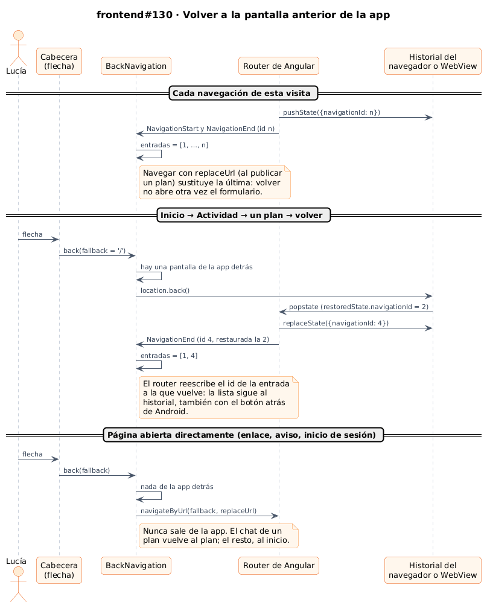
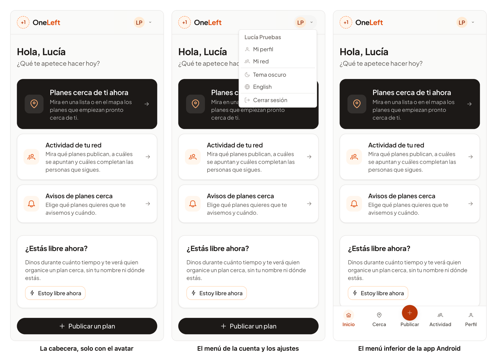

# 43 · Sprint 14: navegación de la app, alias de imports y el entorno local

**Fecha:** 18/10/2026 · **Sprint:** 14 (16–22/10/2026)

## 1. Planificación

| Issue | Tipo | MoSCoW | Puntos | Resultado |
|---|---|---|---|---|
| frontend#129 · Alias con @ para los imports de la web | Tarea | Should | 2 | PR #132 |
| frontend#130 · La flecha de volver lleva al inicio en lugar de a la pantalla anterior | Bug | Should | 1 | PR #133 |
| frontend#131 · HU-072 Menú inferior en la app Android | Historia | Should | 3 | PR #134 |
| frontend#135 · HU-073 Menú de ajustes en la cabecera | Historia | Should | 2 | PR #136 |
| docs#110 · Documentación (esta entrada) | Documentación | Should | 1 | esta entrada |

**Por qué ahora:** salieron al revisar la app en el móvil tras el feed de actividad ([entrada 42](42-hu051-hu059-feed-y-privacidad.md)).
Volver siempre al inicio hacía perder el sitio; en Android faltaba la navegación con el pulgar que tienen otras
apps, y la cabecera no cabía en un móvil (logo, tema, idioma y el avatar con el nombre a la vez). Los imports relativos
(`../../core/…`) se pidieron cambiar por alias antes de seguir creciendo.

**Objetivo:** moverse por la app como en cualquier app del móvil, con una cabecera despejada, y un código que diga
dónde vive cada pieza.

## 2. Decisiones

| Decisión | Motivo |
|---|---|
| **Un alias por carpeta** (decidido al planificar): `@core`, `@shared`, `@components`, `@features`, `@layout`, `@env` y `@testing` | Cortos y con la estructura del proyecto a la vista. Los ficheros de la misma carpeta siguen con `./` |
| Los 440 imports se reescribieron con un script que resuelve cada ruta relativa y solo cambia las que salen de su carpeta; ESLint rechaza `../` dentro de `src/app` | La conversión es mecánica y verificable, y la regla impide volver atrás. Quedan relativos el punto de entrada (`main.ts`) y las traducciones que leen los tests desde `public/` |
| **Volver a la pantalla anterior de la app**, no a la anterior del navegador: `BackNavigation` guarda las entradas del historial de esta visita | Con un enlace compartido, un aviso o tras iniciar sesión no hay nada de la app detrás: entonces va a un destino por defecto (el inicio; el chat de un plan, al plan) y nunca sale de la app |
| La lista sigue el `navigationId` que el router guarda en cada entrada, y lo actualiza cuando el router lo reescribe al volver | Así también funciona hacia atrás y adelante con los botones del navegador y con el botón atrás de Android, que mueven el mismo historial |
| Tras publicar, el plan **sustituye** al formulario en el historial | Volver desde el plan publicado no abre otra vez el formulario vacío |
| **Menú inferior solo en la app Android** (decidido al planificar): Inicio, Cerca, Publicar en el centro, Actividad y Perfil | Es la navegación habitual en el móvil; la web sigue con su cabecera. Publicar, la acción principal, es un círculo relleno en el centro |
| Solo con sesión, y se oculta en el chat, en el formulario de publicar y al iniciar sesión | Ahí se escribe: el teclado y la barra competirían por el mismo sitio |
| Mientras se ve, `<html>` lleva `has-tab-bar`: el final de cada página y las barras de acción fijas le dejan sitio (`$tab-bar-height`), por encima de la barra de navegación del sistema | Nada queda tapado, también con la barra de gestos de Android |
| En la app, la barra fija «Publicar un plan» del inicio y de «Planes cerca» desaparece | Publicar ya está en el menú: no se repite |
| **Menú del avatar** (decidido al planificar): con sesión, la cabecera queda con el logo y el avatar (el nombre, solo desde 40 rem); el avatar abre un menú con mi nombre, «Mi perfil», «Mi red», el tema, el idioma y «Cerrar sesión» | Los ajustes que se usan poco salen de la cabecera. Sin sesión no cambia nada: el tema, el idioma y entrar o registrarse |
| El botón del avatar lleva `aria-haspopup`, `aria-expanded` y `aria-controls`; el menú, los roles de PrimeNG, y Escape lo cierra también con el foco en el avatar | Se maneja igual con teclado y con lector de pantalla |

*Figura 150. Cómo sabe la app qué pantalla hay detrás: las entradas del historial de esta visita, que siguen al
router cuando se vuelve, y el destino por defecto cuando la página se abrió directamente. Fuente:
[`51-secuencia-volver.puml`](../diagramas/secuencia/src/51-secuencia-volver.puml).*

## 3. En la app

*Figura 151. A la izquierda, la cabecera con sesión en la web, ya solo con el logo y el avatar de Lucía. En el centro,
el menú que abre el avatar: su cuenta y los ajustes. A la derecha, el menú inferior de la app Android, con «Inicio»
como sección actual. Este último panel es la misma compilación abierta en el navegador como la abriría la app
(Capacitor dice que la plataforma es Android y la barra de navegación del sistema ocupa 24 px), porque las pruebas en
el emulador quedaron en pausa (ver incidencias). Stack local real; capturas generadas con
[`tools/capture-navigation.mjs`](../tools/capture-navigation.mjs), que solo mira y no cambia nada.*

## 4. Pruebas

- **Alias:** la compilación de producción sigue sustituyendo el entorno a través de `@env` (el paquete no contiene
  `localhost:8080`), y el lint, los tests y el APK de la CI pasan.
- **Volver** (`BackNavigation`): con el router y el historial de Angular (`provideLocationMocks`), volver de una en
  una, una página abierta directamente, un destino por defecto y una pantalla sustituida. **E2E** (`back.e2e.ts`, es y
  en): del inicio al feed y a un plan, y volver de una en una; un plan abierto directamente vuelve al inicio.
- **Menú inferior** (`TabBar`): las cinco secciones y sus enlaces, la actual con `aria-current` (el inicio solo en él
  mismo), nada en la web ni sin sesión, oculto en el chat, al publicar y al iniciar sesión, y de vuelta después. En el
  inicio, sin la barra de publicar dentro de la app. **E2E** (`tab-bar.e2e.ts`): la web sigue sin menú y con la barra
  de publicar. La app de Android no se puede simular en un E2E (cambiaría el inicio de sesión al de la app).
- **Menú del avatar** (`AppHeader`): sin sesión; el botón y sus atributos; el menú con la cuenta y los ajustes; tema,
  idioma y cerrar sesión desde el menú; los enlaces a mi perfil y mi red. **E2E** (`user-menu.e2e.ts`): tema oscuro y
  claro, idioma y Escape desde el menú, repetido tres veces sin fallos; `auth.e2e.ts` abre el perfil desde el menú.
- **Web en total:** 302 tests, con un 96,8 % de cobertura. Los E2E se responden en el navegador o solo leen: no crean
  datos.
- **Android:** el emulador no se pudo usar (ver incidencias); la CI genera el APK con todo.

## 5. Incidencias

- **Una conversión que fue más allá.** La primera pasada del script de los alias comparaba `./src/…` con `src/…` y
  convirtió también los imports de la misma carpeta. Se vio antes de hacer el commit (más cambios de los esperados), se
  deshizo y se repitió con las rutas normalizadas.
- **Keycloak sin conexiones.** El 17/10 el stack se reinició solo y Keycloak quedó *unhealthy*: no conseguía conexiones
  de PostgreSQL (`Acquisition timeout while waiting for new connection`), aunque PostgreSQL estaba casi parado y solo
  había 49 de 100 conexiones abiertas. Los E2E esperaban 60 s cada uno a la página de inicio de sesión antes de fallar,
  y los tests unitarios se pasaban de tiempo por la carga (solos, pasaban). Reiniciar Keycloak no bastó.
- **Docker, vacío por tercera vez.** Al cerrar y abrir Docker Desktop volvió con un disco nuevo: sin imágenes ni
  volúmenes, como el 13 y el 14/10. Las descargas se quedaron paradas hasta reiniciarlo otra vez (desde el Mac el
  registro respondía). Se rehízo el stack mínimo (sin `chat`, `notifications` ni observabilidad), imagen a imagen, y el
  seed recreó los datos de demostración (8 planes y 4 personas). El código no se perdió: estaba en GitHub.
- **Escape en inglés.** El E2E del menú del avatar fallaba solo en inglés al cerrar con Escape: dependía de dónde
  estuviera el foco. El avatar cierra ahora el menú con Escape y el E2E espera a ver el menú antes de pulsarlo.
- **El emulador, sin margen.** Con los 11 contenedores en marcha, el emulador de Android mostraba «System UI / Chrome
  isn't responding» y perdía letras al escribir, incluso de una en una. Las comprobaciones en Android (frontend#57,
  #119 y #122) quedaron en pausa y siguen abiertas. «Continuar con Google» llega desde la app a la página de Google;
  el inicio de sesión con una cuenta real queda pendiente.
- **El script del tablero, perdido.** El área temporal donde vivía el script que actualiza el tablero se limpió al
  cambiar de día. Se rehízo y se versiona ahora en [`tools/board/board.py`](../tools/board/board.py).
