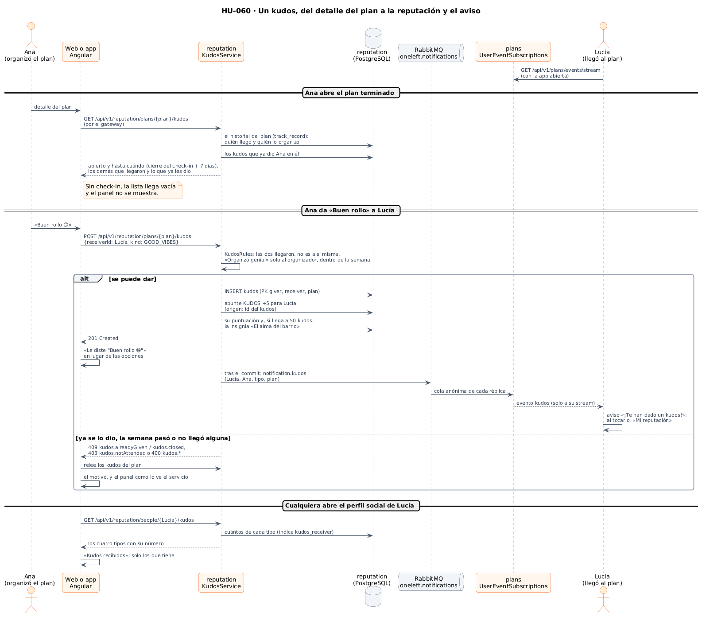
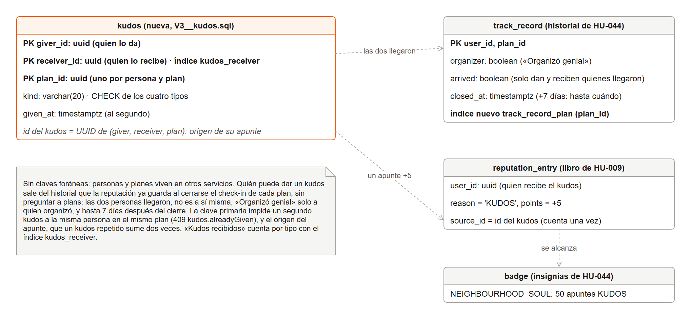
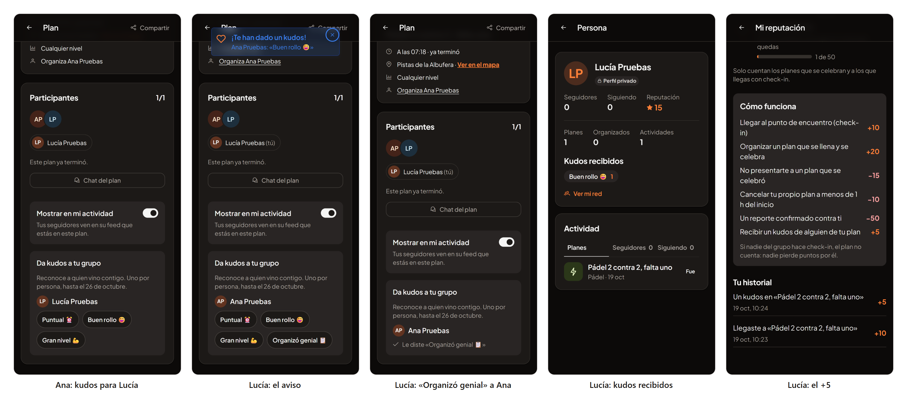

# 44 · Sprint 14: HU-060 Kudos entre participantes

**Fecha:** 18/10/2026 · **Sprint:** 14 (16–22/10/2026)

## 1. Planificación

| Issue | Tipo | MoSCoW | Puntos | Resultado |
|---|---|---|---|---|
| backend#76 · HU-060 Kudos entre participantes | Historia | Should | 3 | PR #126 |
| frontend#137 · Los kudos en la web y la app (sub-issue) | Historia | Should | — | PR #138 |
| docs#112 · Diario, diagramas y capturas de los kudos (sub-issue) | Documentación | Should | 1 | esta entrada |

**Por qué ahora:** es lo que le faltaba a la reputación para reconocer algo más que la asistencia. Las insignias
([entrada 39](39-hu044-insignias.md)) ya contaban los apuntes `KUDOS` del libro para «El alma del barrio», y el perfil
social ([entrada 41](41-hu048-perfil-social.md)) es el sitio donde enseñarlos.

**Objetivo:** que quien llegó a un plan pueda reconocer a los demás que llegaron con un kudos: «Puntual ⏰», «Buen
rollo 😄», «Gran nivel 💪» y, solo al organizador, «Organizó genial 📋». Uno por persona y plan, durante una semana.
Cada kudos suma +5 a la reputación de quien lo recibe, le llega un aviso al momento y se ve en su perfil.

## 2. Decisiones

| Decisión | Motivo |
|---|---|
| Los kudos viven en el servicio **`reputation`**, sin servicio nuevo | Un kudos es un apunte más del libro (+5) y la base de «El alma del barrio»: los mismos datos y las mismas reglas |
| **Quién puede dar kudos sale del historial de asistencia** (`track_record`) que la reputación ya guarda al cerrarse el check-in | Sin preguntar a `plans`: las dos personas llegaron (check-in), sabe quién organizó y cuándo se cerró. Un índice nuevo por plan (`track_record_plan`) lista a su gente |
| **Solo entre quienes llegaron**, nunca a uno mismo, y «Organizó genial» solo a quien organizó (`KudosRules`) | Lo pide la historia: el reconocimiento es de quien estuvo. Sin check-in, la lista llega vacía y el panel no se muestra |
| **Una semana** desde el cierre del check-in de quien lo da | Da tiempo a acordarse sin dejar la puerta abierta para siempre. Pasado el plazo, el panel solo enseña lo que se dio |
| **Uno por persona y plan**, con la clave primaria `(giver_id, receiver_id, plan_id)` | Un segundo intento es un 409 `kudos.alreadyGiven`, no un kudos más. Se puede dar uno distinto a cada persona del grupo |
| El **id del kudos sale de quién, a quién y en qué plan** y es el origen de su apunte | El libro tiene `UNIQUE (user_id, reason, source_id)`: un kudos repetido nunca suma dos veces |
| Cada motivo de rechazo tiene **su código**: `kudos.notAttended` (403), `kudos.closed` y `kudos.alreadyGiven` (409), `kudos.self`, `kudos.notOrganizer` y `kudos.receiverNotAttended` (400) | La web traduce cada uno en español e inglés y después relee el panel para enseñar lo que dice el servicio |
| El aviso sale por **`oneleft.notifications`** (`notification.kudos`) **después del commit**, y `plans` lo reenvía como evento `kudos` por el flujo en tiempo real de quien lo recibe | El mismo camino que las insignias (entrada 39): un kudos que no se guarda nunca se anuncia. Al tocarlo se abre «Mi reputación» |
| En la web, el panel **«Da kudos a tu grupo»** va en el detalle de un plan terminado, con una ficha por tipo que lo da al momento | Un toque y listo. Una vez dado, «Le diste…» sustituye a las fichas |
| En el perfil social, **«Kudos recibidos» solo con los tipos que tiene** y cuántos | El servicio devuelve los cuatro tipos con su número; enseñar ceros no dice nada |

*Figura 152. Un kudos de punta a punta: qué ve Ana en un plan terminado, las reglas al darlo, el apunte en el libro y
el aviso en tiempo real a Lucía; y los kudos recibidos en su perfil. Fuente:
[`52-secuencia-kudos.puml`](../diagramas/secuencia/src/52-secuencia-kudos.puml).*

*Figura 153. La tabla nueva `kudos` de la base de datos `reputation` y lo que usa de las tablas que ya estaban: el
historial de asistencia, el libro y las insignias. Fuente:
[`53-modelo-kudos.drawio`](../diagramas/datos/src/53-modelo-kudos.drawio).*

La arquitectura no cambia: la figura 133 de la [entrada 38](38-hu009-reputacion.md) ya muestra el servicio
`reputation`, los eventos que escucha y los avisos que reenvía `plans`.

## 3. En la app

*Figura 154. Un plan de pádel que organizó Ana y al que llegaron las dos. Primero, Ana ve en el plan terminado las
fichas para Lucía. Después, Lucía tiene el plan abierto cuando Ana le da «Buen rollo» y le llega el aviso. Luego Lucía
le da «Organizó genial» a Ana y ve «Le diste…». Por último, los kudos recibidos en el perfil social de Lucía y el +5 en
su reputación. Stack local real; capturas generadas con [`tools/capture-kudos.mjs`](../tools/capture-kudos.mjs), que
borra al terminar todo lo que crea.*

## 4. Pruebas

- **Dominio** (`KudosRulesTest`): quien llegó da un kudos a otra persona que llegó durante una semana; quien no llegó
  ni da ni recibe; nadie se lo da a sí mismo y «Organizó genial» es solo para el organizador; el id de un kudos es el
  mismo para la misma persona que lo da, la que lo recibe y el plan.
- **Aplicación** (`KudosServiceTest`): un kudos suma 5 a quien lo recibe y se le avisa; uno por persona y plan; quien no
  llegó ni da ni recibe; el panel de un plan dice a quién se le puede dar todavía; y 50 kudos dan «El alma del barrio».
- **Avisos** (`RabbitKudosNoticesTest`): el aviso lleva quién lo dio y qué, y dentro de una transacción espera al
  commit. En `plans`, `RabbitPlanEventPublisherTest` comprueba que llega al flujo de quien lo recibe, y
  `UserEventSubscriptionsTest`, que solo a esa persona.
- **Integración** con RabbitMQ y PostgreSQL reales (`KudosIntegrationTest`): el kudos se apunta en el libro una vez y se
  avisa después de guardarlo; el panel es solo para quien llegó; una semana después ya no se puede dar. Borra lo que
  escribe.
- **Web:** el panel (las fichas de cada persona, dar un kudos, los errores, el plazo cerrado y nada para quien no
  llegó), el detalle del plan, el perfil social, la API, el evento del flujo, el aviso y la regla nueva de la
  reputación: 308 tests, con un 96,8 % de cobertura. **E2E** (`kudos.e2e.ts`, es y en): dar «Organizó genial» al
  organizador de un plan terminado y el aviso de un kudos recibido; `reputation.e2e.ts` cuenta la regla nueva. No crean
  datos.
- **De punta a punta en local:** el recorrido de la figura 154, con el backend de `dev` y la web del PR #138. Lucía
  recibió un kudos una sola vez, con su aviso, y su reputación pasó de 10 (la llegada) a 15. Al terminar, las cinco
  bases de datos quedaron como antes: solo los 8 planes del seed.

## 5. Incidencias

- **El plan no puede esperar tres horas.** Para dar kudos hace falta un plan terminado, con el check-in cerrado. El
  script de capturas mueve el inicio del plan tres horas atrás en la base de datos local y espera a la tarea de cada
  minuto, que lo termina y cierra la asistencia como si se hubiera celebrado. Al acabar, borra el plan y todo lo que
  cuelga de él en `plans`, `reputation`, `social`, `chat` y `notifications`, y recalcula las puntuaciones a partir del
  libro, como hace el propio servicio.
- **El libro no se deja borrar.** La primera limpieza falló: `reputation_entry` solo admite añadir apuntes (trigger
  `reputation_entry_immutable`), y como psql ejecuta todas las sentencias en una sola transacción, se deshizo la
  limpieza entera de `reputation`. Ahora el script borra como los tests del servicio, dentro de una transacción con
  `SET LOCAL oneleft.ledger_erasure = 'on'`. Además, limpia cada base por separado, para que un fallo no deje las demás
  sin limpiar. Los restos del primer intento se borraron a mano con las mismas sentencias.
- **Una puntuación sin apuntes.** Al recalcular, quien se queda sin apuntes daba una suma `NULL`, y `reputation_score`
  no la admite. Primero se borra su fila, como hace `deleteWithoutEntries`, y después se recalculan las demás.
- **Un selector que puppeteer no entiende.** `::-p-text` no funciona dentro de `:has()`, así que la ficha de cada
  persona se busca por su texto con una función en la página.
- **Sin licencia de PrimeUI.** El `.env` del frontend no estaba en este equipo, así que las primeras capturas salieron
  con el aviso de PrimeNG. El 19/10, con la licencia, se repitió el recorrido con el mismo script y la figura 154 es ya
  la definitiva ([entrada 46](46-fusiones-y-pruebas-en-android.md)); su tercera pantalla muestra además el arreglo de
  frontend#139: «ya terminó».
- **«Ya ha empezado» en un plan terminado.** El detalle de un plan terminado dice «A las 12:39 · ya ha empezado» encima
  de «Este plan ya terminó» (tercera captura). No es de esta historia: se apunta como bug aparte
  (frontend#139). La línea de la hora miraba solo el reloj y no el estado del plan; con el arreglo, un plan terminado
  dice «ya terminó» y uno cancelado solo la hora, también en las listas de planes.
- **Un equipo nuevo con Windows.** El stack se montó por primera vez en Windows: Docker Desktop necesitó WSL 2, y los
  zips de los repositorios no se extraían enteros en una carpeta con una ruta muy larga (límite de 260 caracteres), así
  que se trabajó en `C:\Users\<usuario>\oneleft`. Sin Java instalado, los JAR del backend se compilaron con Maven dentro
  de un contenedor (`maven:3.9-eclipse-temurin-21`).
