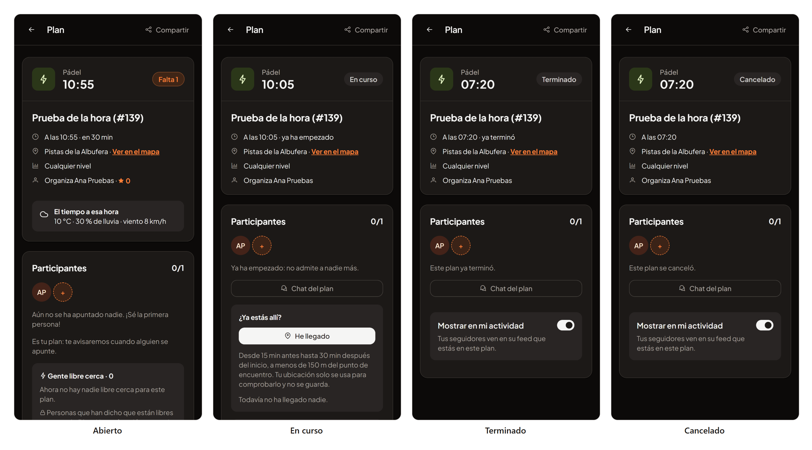

# 45 · Sprint 14: validación de lo que está en curso y la hora de un plan terminado

**Fecha:** 18/10/2026 · **Sprint:** 14 (16–22/10/2026)

## 1. Planificación

| Issue | Tipo | MoSCoW | Puntos | Resultado |
|---|---|---|---|---|
| frontend#139 · La hora de un plan terminado dice «ya ha empezado» | Bug | Should | 1 | Arreglado y probado en local; PR #140 ([entrada 46](46-fusiones-y-pruebas-en-android.md)) |
| backend#76 · HU-060 Kudos entre participantes | Historia | Should | 3 | Validado en local (es y en); falta fusionar frontend PR #138 |
| frontend#137 · HU-060 Kudos en la web y la app | Historia | Should | — | Validado en local (es y en); falta fusionar la PR #138 |
| frontend#122 · HU-048 Perfil social | Historia | Should | — | Bloqueado: falta probarlo en Android |
| frontend#119 · Los avisos tapan la barra de estado en Android | Bug | Should | 1 | Bloqueado: falta probarlo en el emulador |
| frontend#57 · Verificar el inicio de sesión y compartir en un dispositivo | Tarea | Must | — | Bloqueado: falta «Continuar con Google» en Android |

**Por qué ahora:** al cerrar issues del tablero se acordó una regla: **una issue solo se cierra cuando está validada y
probada**. Se reabrieron las que se habían cerrado sin cumplirla (#57, #119, #122, #137, #139 y backend#76) y se
volvió a probar todo lo que estaba en *In Progress*.

**Objetivo:** saber qué está listo de verdad, probarlo en la app y dejar escrito qué falta en cada caso.

## 2. La hora de un plan terminado (frontend#139)

En la entrada 44 (tercera captura de kudos), el detalle de un plan terminado decía «A las 12:39 · ya ha empezado»
encima de «Este plan ya terminó».

| Decisión | Motivo |
|---|---|
| Nueva función `relativeStart(startsAt, status, now)` en `shared/time/plan-time.ts`: primero el estado, después el reloj | `startsIn` solo mira la hora y no sabe que un plan terminó (3 h después de empezar) o se canceló |
| `CANCELLED` → nada; `FINISHED` → `time.finished`; `IN_PROGRESS` → `time.started`; `OPEN`/`FULL` → `startsIn` como antes | Cada estado dice lo suyo y no contradice al aviso del plan |
| La usan el detalle del plan y la tarjeta de las listas (`PlanTicket`) | Las dos tenían el mismo fallo |
| Nueva clave `time.finished`: «ya terminó» / «already finished» | Español e inglés |

**Pruebas:**

- **Unitarias (Vitest):** `plan-time.spec.ts` (los cinco estados), `plan-detail.spec.ts` (la línea de la hora en
  curso, terminado y cancelado) y `plan-ticket.spec.ts` (abierto, en curso, terminado y cancelado): 304 tests en verde,
  y lint sin errores.
- **En la web real (local):** la web con el arreglo (`ng serve`) contra el backend de `dev`. Ana publica un plan, se
  mueve su inicio en la base de datos local y la tarea de cada minuto lo pasa a en curso y a terminado; después se
  cancela. En los dos idiomas:

| Estado | Español | Inglés |
|---|---|---|
| Abierto | A las 22:26 · en 30 min | At 22:28 · in 30 min |
| En curso | A las 21:46 · ya ha empezado | At 21:48 · already started |
| Terminado | A las 18:52 · ya terminó | At 18:54 · already finished |
| Cancelado | A las 18:52 | At 18:54 |

*La hora de un plan de Ana en cada estado, en español. Capturas repetidas el 19/10 con la licencia de PrimeUI y
generadas con [`tools/capture-plan-time.mjs`](../tools/capture-plan-time.mjs), que publica el plan por la API, lo
mueve en la base de datos local y lo borra al terminar.*

Al terminar, el script borra el plan y lo que cuelga de él en cada servicio (también los apuntes de reputación de Ana,
con `oneleft.ledger_erasure`): quedan solo los 8 planes del seed.

## 3. HU-060 Kudos (backend#76 y frontend#137)

Se repitió el recorrido de la entrada 44 (`tools/capture-kudos.mjs`) contra la web en contenedor (`localhost:4300`,
con la PR #138), en español y en inglés:

- En un plan terminado, Ana ve a Lucía con «Puntual», «Buen rollo» y «Gran nivel»; Lucía ve además «Organizó genial»
  para Ana. Una vez dado, el kudos sustituye a las opciones.
- Lucía, con el plan abierto, recibe el aviso al momento: «¡Te han dado un kudos!» / «You got a kudos!».
- Su perfil social muestra los kudos recibidos por tipo, y su reputación pasa de 10 (la llegada) a 15 (+5 del kudos).
- Al acabar, las cinco bases de datos quedan como antes: sin kudos ni apuntes del recorrido.

Los criterios de la web y del backend se cumplen. **Falta** fusionar la PR frontend#138 en `dev` (todos los checks en
verde); hasta entonces las issues siguen abiertas en *In Progress*.

## 4. Lo que necesita Android

En este equipo no hay Android SDK, `adb` ni emulador, así que no se pudo probar:

| Issue | Lo que falta |
|---|---|
| frontend#119 | Comprobar en el emulador, con un aviso real, que el aviso empieza debajo de la barra de estado |
| frontend#122 | «Funciona igual en la app Android» |
| frontend#57 | «Continuar con Google» en Android, con una cuenta de Google real |

Siguen abiertas en *In Progress* hasta probarlas en un emulador o móvil (`npm run android:local`, ver la sección «App
Android» del README del frontend).

## 5. Incidencias

- **Cerrar mueve la tarjeta.** El *workflow* del tablero pasa a *Done* toda issue que se cierra, pero al reabrirla no
  la devuelve. Las que se reabrieron (#57 y #137) se volvieron a poner a mano en *In Progress*. Ahora hay 5 en curso,
  una más que el WIP máximo de 4.
- **Las herramientas de capturas en Windows.** `tools/lib/app.mjs` construye la ruta de las traducciones con
  `URL.pathname`, que en Windows da `C:\C:\...`; se esquivó con `ONELEFT_I18N_DIR`. El navegador por defecto es la ruta
  de Chrome en macOS; en Windows hay que pasar `CHROME`. Y `npm start` del frontend (`scripts/ng-with-license.mjs`)
  falla con `spawn EINVAL`; se arrancó con `npx ng serve`.
- **La licencia de PrimeUI.** Este equipo no tenía el `.env` del frontend, así que las capturas salieron con el aviso
  de PrimeNG. Se repitieron el 19/10 con la licencia ([entrada 46](46-fusiones-y-pruebas-en-android.md)).
- **La fusión de la PR #138** no se hizo desde esta sesión: queda para hacerla a mano, tras revisarla.
