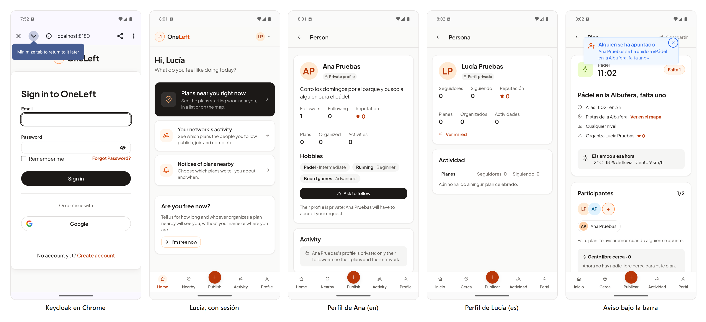

# 46 · Sprint 14: fusión de los kudos y la hora del plan, y las pruebas pendientes en Android

**Fecha:** 19/10/2026 · **Sprint:** 14 (16–22/10/2026)

## 1. Planificación

| Issue | Tipo | MoSCoW | Puntos | Resultado |
|---|---|---|---|---|
| frontend#137 · HU-060 Kudos en la web y la app | Historia | Should | — | PR #138 fusionada en `dev` |
| frontend#139 · La hora de un plan terminado dice «ya ha empezado» | Bug | Should | 1 | PR #140 fusionada en `dev` |
| frontend#122 · HU-048 Perfil social en la web y la app | Historia | Should | — | Probado en el emulador (es y en) |
| frontend#119 · Los avisos tapan la barra de estado en Android | Bug | Should | 1 | Probado en el emulador: corregido |
| frontend#57 · Verificar el inicio de sesión y compartir en un dispositivo | Tarea | Must | — | Email sí; Google sigue pendiente |

**Por qué ahora:** la [entrada 45](45-validacion-en-curso-y-bug-139.md) dejó las dos PR validadas pero sin fusionar,
y tres issues bloqueadas porque solo se podían probar en Android. Con la regla de esa entrada (una issue solo se cierra
validada y probada), faltaba montar el emulador en el equipo de Windows.

**Objetivo:** fusionar las dos PR y probar en un emulador lo que estaba bloqueado.

## 2. Las fusiones

- **PR #138 (kudos):** CI en verde y sin conflictos; fusionada con commit de merge (`9946c4a`), como el resto del repo.
  Cerró frontend#137. Las mejoras que dejó la revisión de la [entrada 44](44-hu060-kudos.md) (el foco y el anuncio al
  dar un kudos, entre otras) quedan para otra PR.
- **PR #140 (la hora del plan):** la otra sesión dejó el arreglo en una copia sin Git. Se creó la rama `issue#139` desde
  `dev`, se copiaron los diez ficheros del arreglo, se rebasó sobre `dev` ya con los kudos (los dos cambios tocan
  `plan-detail` y las traducciones) y se volvieron a pasar los tests: 310, con un 96,8 % de cobertura. CI en verde y
  fusionada (`5c82016`); cerró frontend#139.

## 3. Las pruebas en el emulador

El emulador es un Pixel 7 con Android 36 e imagen con Google Play, acelerado con la Plataforma del hipervisor de
Windows (WHPX), que arranca en unos 50 segundos. La app es el APK de depuración de `dev` (ya con las dos PR), compilado
con la configuración `development` y `adb reverse` de los puertos 8080, 8180 y 7070 al stack de Docker. El emulador
estaba en inglés, así que cada pantalla se ve en los dos idiomas.

Para moverse por la app sin depender de coordenadas, las pruebas se conectan al WebView del APK de depuración por
DevTools (`adb forward tcp:9222 localabstract:webview_devtools_remote_<pid>`) con puppeteer, y las capturas son de la
pantalla entera del emulador (`adb exec-out screencap`), con la barra de estado incluida.

| Issue | Qué se probó | Resultado |
|---|---|---|
| #57 | «Continuar con email»: Keycloak se abre en Chrome (Custom Tabs) y vuelve a la app por `oneleft://callback` con la sesión de Lucía | Funciona |
| #57 | «Continuar con Google» | Sin probar: en este equipo faltan `GOOGLE_CLIENT_ID` y `GOOGLE_CLIENT_SECRET` en el `.env` de la infra, y el inicio de sesión con una cuenta real de Google lo tiene que hacer la persona |
| #122 | La página de Ana vista por Lucía (perfil privado y sin seguirla): bio, aficiones con nivel, estadísticas, reputación, «Pedir seguir» y el aviso de privacidad. El perfil social propio de Lucía con «Ver mi red» | Igual que en la web, en inglés y en español, con el menú inferior de Android |
| #119 | Lucía tiene su plan abierto cuando Ana se apunta: el aviso «Alguien se ha apuntado» llega en tiempo real | El aviso empieza por debajo de la barra de estado, sin tapar el reloj ni los iconos |

Para el aviso, Lucía publica el plan y Ana se apunta por la API, con el cliente confidencial de desarrollo
`oneleft-api` (que admite el flujo de contraseña); al terminar, el plan y lo que cuelga de él se borran de la base de
datos local. Quedan los 8 planes del seed.

*Figura 155. En el emulador de Android: el inicio de sesión de Keycloak en Chrome; Lucía, ya con sesión, en el inicio;
la página de Ana, que tiene el perfil privado, en inglés; el perfil social de Lucía en español; y el aviso de que Ana se
ha apuntado a su plan, por debajo de la barra de estado. Stack local real, con la licencia de PrimeUI.*

## 4. Incidencias

- **Herramientas que faltaban.** El equipo de Windows no tenía GitHub CLI, Java, el SDK de Android ni el emulador. Se
  instalaron GitHub CLI y Temurin 21 con `winget`, y el SDK con `sdkmanager` (plataforma 36, build-tools 36, emulador
  e imagen de sistema), aceptando sus licencias.
- **El hipervisor, desactivado.** El emulador x86_64 necesita la «Plataforma del hipervisor de Windows». Activarla
  pide una PowerShell de administrador y reiniciar; la primera vez se ejecutó sin elevación y falló.
- **`gh auth login` en la terminal de la app.** El primer intento se quedó esperando un Enter que no llegaba; se lanzó
  de nuevo con el Enter por la entrada estándar y el código del navegador.
- **Un `AppData` virtualizado.** La app de escritorio de Claude virtualiza `AppData\Local` para los procesos que
  lanza: el SDK quedó instalado donde lo ven esos procesos, y la pestaña de terminal no encontraba `emulator.exe`. El
  emulador se arrancó desde ellos.
- **El script de compilación no funcionaba en Windows.** `scripts/ng-with-license.mjs` lanzaba `ng.cmd` con `spawn`
  y sin shell, y Node lo rechaza en Windows (`EINVAL`). Se cambió para ejecutar `@angular/cli/bin/ng.js` con el mismo
  Node, lo que funciona en todos los sistemas: frontend#141, PR #142.
- **El primer arranque de Chrome.** Antes del login, el Chrome del emulador pide aceptar sus términos («Use without an
  account»); solo pasa una vez por emulador.
- **La licencia de PrimeUI.** Las primeras pantallas salieron con el aviso de licencia porque el `.env` del frontend
  no estaba en este equipo. Con la licencia se repitieron también las figuras de las entradas 44 (kudos, con su
  script) y 45 (la hora del plan, con un script nuevo: [`tools/capture-plan-time.mjs`](../tools/capture-plan-time.mjs)),
  con la web del contenedor reconstruida desde `dev`.
