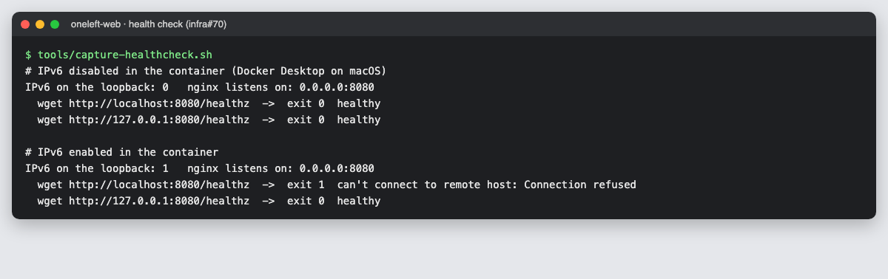

# 48 · Sprint 15: los arreglos pendientes de la entrada 47 y «Continuar con Google» en Android

**Fecha:** 24/10/2026 · **Sprint:** 15 (23–29/10/2026)

## 1. Planificación

| Issue | Tipo | MoSCoW | Puntos | Resultado |
|---|---|---|---|---|
| frontend#145 · Los E2E no arrancan en Windows: ruta de `dist/` mal construida en `e2e/serve.mjs` | Bug | Should | 1 | PR #146 |
| infra#70 · El contenedor `oneleft-web` sale *unhealthy*: su *healthcheck* va por IPv6 | Bug | Should | 1 | PR #71 |
| frontend#57 · [Android] Verificar el inicio de sesión y compartir en un dispositivo (la última casilla) | Tarea | Must | 1 | comprobado en el emulador |
| docs#119 · Documentación (esta entrada) | Documentación | Should | 1 | esta entrada |

**Por qué ahora:** la [entrada 47](47-mejoras-del-panel-de-kudos.md) dejó en sus incidencias dos arreglos sin issue,
vistos al lanzar los E2E en Windows. Y en `In Progress` solo quedaba frontend#57, abierta desde el Sprint 12 porque
faltaba probar «Continuar con Google» en Android ([entrada 43](43-navegacion-de-la-app.md)).

**Objetivo:** que los E2E y el stack local funcionen igual en cualquier equipo, y dejar `In Progress` vacío.

## 2. Decisiones

| Decisión | Motivo |
|---|---|
| `e2e/serve.mjs` convierte la URL de `dist/oneleft/browser/` en ruta con `fileURLToPath` (`node:url`), en lugar de leer `URL.pathname` | En Windows, `pathname` da `/C:/…`, que no es una ruta, y el servidor salía con «No build in …». Además, con una carpeta con espacios fallaba en cualquier sistema (`my%20projects`). Es el mismo arreglo que `tools/lib/app.mjs` ([entrada 45](45-validacion-en-curso-y-bug-139.md)) |
| El *healthcheck* de `oneleft-web` llama a `http://127.0.0.1:8080/healthz` en lugar de a `localhost`, con un comentario que explica por qué | Dentro del contenedor, el `wget` de BusyBox prueba primero `::1` si el contenedor tiene IPv6, y no reintenta por IPv4; nginx solo escucha en IPv4 (`listen 8080;`) |
| nginx no se cambia para escuchar también en `[::]:8080` | Así no arrancaría donde IPv6 está desactivado. El *healthcheck* es lo único que entra por `localhost` dentro del contenedor; desde fuera se llega por el puerto publicado |
| Para la prueba de Google en el emulador se pararon `reputation`, `social`, `storage` y `mailpit` (decidido al planificar) y se volvieron a arrancar después, sin reconstruir nada | El inicio de sesión solo necesita Keycloak, `users`, `plans` y el *gateway*, y el emulador no se podía usar con los 11 contenedores ([entrada 43](43-navegacion-de-la-app.md)) |

## 3. Pruebas

- **`serve.mjs` (frontend#145):** en macOS, con la compilación de desarrollo, `/` y `/plans/123` devuelven
  `index.html`; un `.js`, `styles.css` y `/i18n/es.json` llegan con su tipo; `/..%2F..%2Fpackage.json` y un fichero que
  no existe vuelven a `index.html`. Con `fileURLToPath(url, { windows: true })`, una URL de `C:` da `C:\Users\…\browser\`
  donde `pathname` daba `/C:/…`. En la CI, la PR #146 llevó la etiqueta `e2e`: los **76 E2E** pasaron (6,8 min) con el
  nuevo servidor. No había un Windows a mano para lanzarlos allí.
- **El *healthcheck* (infra#70):** con la imagen de la web (`nginxinc/nginx-unprivileged:1.29-alpine`) y su
  `nginx.conf` montado como en el `Dockerfile`, sin IPv6 en el contenedor (lo normal en Docker Desktop para macOS)
  pasan las dos comprobaciones; con IPv6, `localhost` da *Connection refused* y `127.0.0.1` pasa (figura 156). Por eso
  solo se vio en un equipo. `docker compose --profile frontend config` sigue siendo válido. El contenedor real de la web
  no se arrancó, para no tocar el stack.
- **«Continuar con Google» (frontend#57):** con el APK de `dev` (`ONELEFT_ANDROID_TARGET=local`) en el emulador
  `Pixel_10_Pro_XL`, «Continue with Google» abre `accounts.google.com` en Custom Tabs («Sign in to continue to
  OneLeft»). La usuaria escribió ahí su cuenta de Google y Android volvió a la app por `oneleft://callback` con la
  sesión iniciada: el saludo con su nombre y el menú inferior de la app. En Keycloak, la sesión empezó a las 22:04:52
  con `identity_provider = google` y el cliente `oneleft-web`, dos segundos antes del *deep link*. Con eso se marcó la
  última casilla y se cerró la issue. No hay captura: la cuenta es real y las capturas se hacen solo con las personas
  de demostración.

*Figura 156. El healthcheck de `oneleft-web` contra la imagen y la configuración de nginx de la web. Sin IPv6 en
el contenedor, `localhost` y `127.0.0.1` responden; con IPv6, `localhost` va a `::1`, donde nginx no escucha, y solo
`127.0.0.1` responde. Captura generada con [`tools/capture-healthcheck.sh`](../tools/capture-healthcheck.sh).*

## 4. Incidencias

- **El emulador, otra vez justo de memoria.** Aun con cuatro servicios parados, al abrir la app salió «System UI isn't
  responding» y el primer toque se perdió. Con «Esperar» siguió funcionando. Antes de abrirlo se paró el *daemon* de
  Gradle de la compilación del APK.
- **La cuenta de Google ya existía en Keycloak.** Estaba vinculada desde el 17/10, así que la prueba no creó usuarios
  nuevos en la base de datos local.

## 5. Resultado

El 24/10/2026, con la CI en verde, se fusionaron en `dev` la PR #71 de infra (`fbb9032`), que cerró infra#70, y la
PR #146 del frontend (`e041ae2`), que cerró frontend#145. frontend#57 se cerró tras la prueba en el emulador. Las
tres están en Done, y `In Progress` queda solo con esta entrada.
