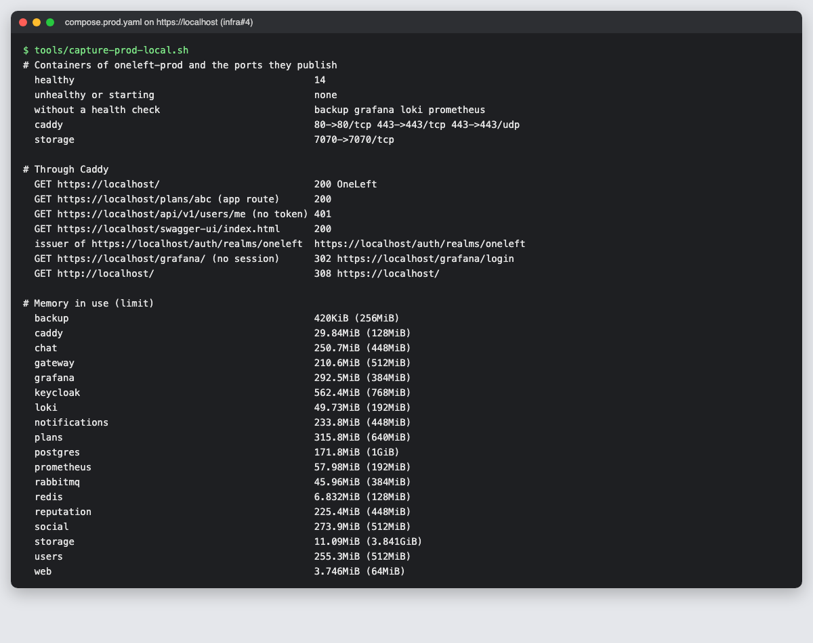

# 49 · Sprint 15: el Compose de producción y su prueba en local

**Fecha:** 24/10/2026 · **Sprint:** 15 (23–29/10/2026)

## 1. Planificación

| Issue | Tipo | MoSCoW | Puntos | Resultado |
|---|---|---|---|---|
| infra#4 · Docker Compose de producción con HTTPS (Caddy) | Tarea | Must | 5 | PR #72 |
| docs#122 · Documentación (esta entrada) | Documentación | Should | 1 | esta entrada |

**Por qué ahora:** al replanificar el Sprint 15 era el único Must de desarrollo, y sin él no se puede desplegar en
AWS Lightsail (infra#5, Must, Sprint 16) ni hacer las pruebas de carga (HU-015). El diseño estaba en el
anteproyecto: una instancia por entorno con Docker Compose y Caddy como entrada única
([diagrama 07](../diagramas/despliegue/07-despliegue-aws.png)).

**Objetivo:** una definición de los entornos `pre` y `pro` que se pueda poner en marcha en la instancia con un
`.env` y dos órdenes, y que se pruebe antes en local tal cual.

## 2. Decisiones

| Decisión | Motivo |
|---|---|
| **Un Compose propio para los entornos desplegados** (`docker/compose.prod.yaml`), con el nombre de proyecto `oneleft-prod` | Las imágenes, los puertos, Keycloak y los secretos no tienen nada que ver con el entorno de desarrollo. Con otro nombre de proyecto, sus volúmenes no se mezclan con los de desarrollo |
| **Caddy como única entrada** (80 y 443): `/auth` a Keycloak; `/api`, `/share` y la descripción OpenAPI al gateway; `/grafana` a Grafana; el resto a la web | Todo en el mismo origen: el navegador no necesita CORS y la misma imagen de la web vale para cualquier dominio (no lleva ningún host compilado). Caddy obtiene y renueva solo el certificado de Let's Encrypt |
| Ningún otro puerto sale de la instancia | PostgreSQL, Redis, RabbitMQ, Keycloak y los servicios solo se ven dentro de la red de Compose |
| **Keycloak en modo producción** (`start`) bajo `/auth`, detrás del proxy (`KC_PROXY_HEADERS=xforwarded`) | El emisor de los tokens es `https://<dominio>/auth/realms/oneleft`; los servicios descargan las claves por la red interna, como en local |
| **El realm de producción se genera** a partir del de desarrollo (`keycloak/render-prod-realm.py`), sin personas de prueba ni el cliente `oneleft-api`, y con `https://${ONELEFT_DOMAIN}/*` y `oneleft://*` como URL de vuelta. La CI comprueba que está al día | El realm de desarrollo trae contraseñas conocidas y un cliente con su secreto en el repositorio: importarlo tal cual dejaría entrar a cualquiera. Generarlo evita mantener dos copias de un JSON de 1.500 líneas |
| **Un límite de memoria para cada contenedor** y un `-Xmx` por debajo para cada JVM: 6,1 GB en total, y 768 MB más con la observabilidad | En local, sin límites, un servicio que crecía dejaba sin memoria a los demás (entradas 13 y 14). Así cada uno sabe cuánto tiene y el sistema conserva margen |
| El gateway toma la IP del cliente de `X-Forwarded-For` (`SERVER_FORWARD_HEADERS_STRATEGY=native`) | Detrás de Caddy, todas las peticiones sin sesión llegarían con la IP del proxy y compartirían el mismo límite de peticiones |
| **Copia diaria de PostgreSQL** con un contenedor propio (`backup/`): `pg_dumpall` comprimido a un bucket de Lightsail a `BACKUP_TIME`, y borrado de las copias de más de `BACKUP_KEEP_DAYS` días | Incluye todas las bases de datos y sus roles, Keycloak también. Se restaura con el mismo contenedor, que tiene `aws` y `psql`. `backup now` hace una copia en el momento |
| **Los secretos, en el `.env` de la instancia** a partir de `.env.prod.example`; Git ignora cualquier otro `.env.*` | Nada secreto en el repositorio. Las contraseñas, largas y aleatorias |
| **`compose.prod.local.yaml`** prueba la misma definición en `https://localhost`: imágenes compiladas en el equipo, la autoridad local de Caddy y un servidor S3 en lugar de los buckets | Así se prueba lo mismo que irá a la instancia. Las imágenes de GHCR son privadas, y la prueba no necesita un token |
| **Una CI para infra**, que hasta ahora solo tenía el lint: valida los dos Compose, el Caddyfile (`caddy validate`), que el realm de producción está al día y el script y la imagen de la copia (shellcheck) | Un error en la configuración se ve en la PR, no al desplegar |

Cómo se usa, el presupuesto de memoria por contenedor y cómo se restaura una copia están en
[`oneleft-infra/docker/PRODUCCION.md`](https://github.com/chabelly-lbetancourt/oneleft-infra/blob/dev/docker/PRODUCCION.md).

## 3. Pruebas

La prueba se hizo en este equipo con el stack de desarrollo parado (los dos no caben a la vez), con las imágenes de
`dev` compiladas como `prod-local` y la web compilada con la configuración de producción:

- **Arranque:** los 15 contenedores, *healthy* con `up --wait`. Solo Caddy publica puertos (más el 7070 del servidor
  S3 de la prueba).
- **Por `https://localhost`:**
  - la web y sus rutas responden;
  - el API sin token, 401;
  - Swagger UI, 200;
  - `http://` redirige a `https://` (308);
  - el emisor de Keycloak es `https://localhost/auth/realms/oneleft`;
  - la cabecera `Server` va oculta.
- **El realm:** una vez importado, solo está el cliente `oneleft-web`, con `https://localhost/*` y `oneleft://*`, y
  ninguna persona.
- **Inicio de sesión:** para la prueba se añadió a Lucía por el API de administración. Entró con Chrome *headless*:
  web → Keycloak en `/auth` → de vuelta en la app con «Hola, Lucía». Su perfil cargó por el API (`/users/me`,
  `/plans/mine` y el flujo de eventos) con 200.
- **La copia:**
  - `backup now` subió una copia de 73 KB y borró una copia falsa de enero;
  - la copia se restauró en un PostGIS vacío: las 10 bases de datos, las 2 personas de Keycloak, las 11 tablas de
    `plans` y PostGIS 3.5.3;
  - `docker compose stop backup` tarda 1 s.
- **Observabilidad:** Prometheus ve sus 10 objetivos; Grafana responde en `/grafana` y pide su inicio de sesión.
- **Memoria:** todos por debajo de su límite, unos 2,5 GB en total en reposo (figura 157). Keycloak es el más justo
  (561 de 768 MB), a vigilar en las pruebas de carga (HU-015).
- **Limpieza:** al terminar, `down -v` borró todos los contenedores y volúmenes de la prueba, y las imágenes
  `prod-local`. El stack de desarrollo se volvió a arrancar tal como estaba, con sus 11 contenedores *healthy*.

*Figura 157. El Compose de producción en este equipo, visto a través de Caddy: los contenedores sanos y los
únicos puertos publicados, las rutas de la web, el API, Keycloak y Grafana, la redirección a HTTPS y la memoria de
cada contenedor frente a su límite. Captura generada con
[`tools/capture-prod-local.sh`](../tools/capture-prod-local.sh).*

Queda sin probar aquí lo que solo existe en AWS: el certificado real de Let's Encrypt, los buckets de Lightsail y
Amazon SES. Es el despliegue (infra#5).

## 4. Incidencias

- **Grafana, sin memoria.** Con 192 MB se reiniciaba (4 veces en un minuto, siempre en el límite). Se le dieron
  384 MB, y Prometheus y Loki pasaron de 256 a 192 MB: usaban unos 55.
- **Un cliente con secreto en el realm.** La primera versión del realm de producción conservaba `oneleft-api`, el
  cliente de las pruebas con su secreto en el repositorio. Se vio al preparar la prueba de inicio de sesión: ahora el
  script lo quita, y la prueba comprueba que no queda ningún secreto literal.
- **El límite de GitHub.** Al recalcular el estado de las épicas, el script del tablero leía el tablero entero en cada
  llamada y agotó por un rato el límite de GraphQL. Ahora
  [`tools/board/board.py`](../tools/board/board.py) busca solo la tarjeta de cada issue.
- **zsh no separa las variables.** Un comando guardado en una variable (`C="docker compose …"`) no se ejecutaba en
  zsh: se cambió por una función.
