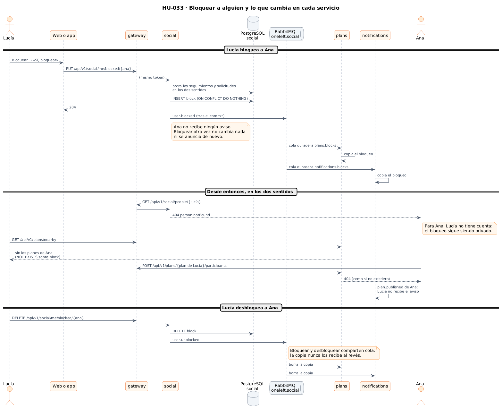
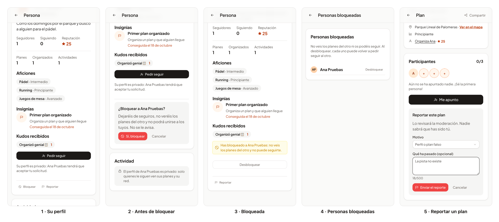

# 50 · Sprint 15: HU-033, bloquear y reportar a personas y planes

**Fecha:** 25/10/2026 · **Sprint:** 15 (23–29/10/2026)

## 1. Planificación

| Issue | Tipo | MoSCoW | Puntos | Resultado |
|---|---|---|---|---|
| backend#50 · HU-033 Bloquear y reportar usuarios | Historia | Should | 8 | PR #127 (social, plans y notifications) |
| frontend#147 · HU-033 en la web y la app (sub-issue) | Historia | Should | 3 | PR #148 |
| docs#123 · Documentación (esta entrada) | Documentación | Should | 1 | esta entrada |

**Por qué ahora:** venía del Sprint 14 y, al replanificar el 15, se puso por delante de la moderación (HU-011) y del
panel de administración (HU-013), que trabajarán con estos reportes. Además, en una app que pone en contacto a
desconocidos, poder cortar con alguien es básico antes de desplegar.

**Objetivo:** que cualquiera pueda dejar de coincidir con alguien sin que esa persona lo sepa, y avisar a la
moderación de una persona o un plan, con el motivo.

## 2. Decisiones

| Decisión | Motivo |
|---|---|
| **Los bloqueos viven en social**, junto a los seguimientos: bloquear termina los seguimientos y las solicitudes entre los dos, en los dos sentidos | Es una relación entre personas, como seguir. Sin seguimientos, ninguno de los dos feeds muestra al otro (HU-051), sin tocar el feed |
| **El bloqueo es privado**: para la persona bloqueada, mi perfil responde «no existe» (404 `person.notFound`), también al intentar seguirme. Yo la veo como bloqueada, sin sus planes aunque su perfil sea público | Un 403 o un aviso le diría que la he bloqueado. Quien bloquea sí necesita ver a quién bloqueó para poder desbloquearle |
| **Plans y notifications guardan su propia copia** de los bloqueos a partir de los eventos `user.blocked` y `user.unblocked` (exchange `oneleft.social`), en una cola duradera cada uno | La búsqueda de planes cercanos y los avisos se calculan para muchas personas a la vez: preguntar a social por cada una sería lento y dejaría de funcionar si social cae. Con la copia, plans lo resuelve en el mismo SQL (`NOT EXISTS`) |
| Bloquear y desbloquear **comparten cola** en cada servicio | Si fueran por colas distintas, un desbloqueo podría llegar antes que su bloqueo y la copia se quedaría bloqueada para siempre |
| En plans, **en los dos sentidos**: los planes cercanos y su tiempo real, el detalle de un plan y unirse responden «no existe»; las personas libres cerca (HU-035) dejan fuera a ambos | «No ves sus planes ni él los tuyos». Quien ya estaba en el plan antes de bloquear sigue viéndolo: es su plan también |
| **Los reportes también viven en social**, con su motivo (acoso, contenido inapropiado, peligro, falso, spam u otro) y un comentario de hasta 500 caracteres, obligatorio con «Otro motivo» | El mismo servicio que conoce a las personas. Repetir el mismo reporte mientras está abierto devuelve el mismo, así nadie inunda la moderación |
| Cada reporte se anuncia como `report.created` en `oneleft.reports`; los abiertos se listan para el rol `admin` | Es lo que usarán la moderación (HU-011) y el panel de administración (HU-013). La moderación responderá con `report.confirmed`, que reputación ya escucha desde HU-009 (−50 puntos) |
| Para un plan, el reporte lleva quién lo organiza **según lo muestra la app** | Social no conoce los planes; la moderación lo comprueba antes de confirmar el reporte |
| En la web, **«Bloquear» y «Reportar» son acciones discretas** al final del perfil, y «Reportar este plan» al final del detalle. Bloquear pregunta antes, en la misma página y con el foco en la pregunta, diciendo qué significa y que no se le avisa | Es algo poco frecuente y delicado: ni debe estorbar ni hacerse sin querer. Sin un diálogo modal no hay que gestionar una trampa de foco |
| **Personas bloqueadas**, en el menú del avatar | Desbloquear tiene que estar a mano sin buscar a la persona |

*Figura 158. Qué pasa al bloquear a alguien: social borra los seguimientos y guarda el bloqueo; plans y
notifications reciben `user.blocked` y guardan su copia; desde entonces, en los dos sentidos, el perfil «no existe»,
los planes desaparecen de la búsqueda, unirse responde 404 y no llegan avisos. Desbloquear sigue el mismo camino.
Fuente: [`53-secuencia-bloquear.puml`](../diagramas/secuencia/src/53-secuencia-bloquear.puml).*

## 3. En la app

*Figura 159. Lucía, en el móvil. (1) El perfil de Ana, con «Bloquear» y «Reportar» al final. (2) Antes de bloquear,
la pregunta y lo que significa. (3) Ana bloqueada: el aviso, «Desbloquear» y ya sin su actividad. (4) Personas
bloqueadas, desde el menú del avatar. (5) El formulario para reportar un plan de Ana, relleno y sin enviar. Stack
local real; captura generada con [`tools/capture-safety.mjs`](../tools/capture-safety.mjs), que desbloquea a Ana al
terminar y no envía el reporte.*

## 4. Pruebas

- **Backend, unitarias** (con *fakes* en memoria):
  - social, 46: `BlockServiceTest`, `ReportServiceTest`, los roles de `KeycloakJwt` y el perfil «inexistente» o
    bloqueado en `SocialServiceTest`;
  - plans, 134: el detalle, unirse, las personas libres y el tiempo real con bloqueos, y el *listener*;
  - notifications, 55: los avisos de planes cercanos y de alertas guardadas no llegan a quien está bloqueado.
- **Backend, integración** (en la CI, con Testcontainers):
  - `SafetyIntegrationTest` (social): el API REST, PostgreSQL y los eventos leídos de una cola temporal;
  - `JpaPlanRepositoryTest` (plans): la búsqueda cercana con bloqueos en los dos sentidos.

  Los dos borran lo que crean: personas, bloqueos, reportes y la cola.
- **Web:** 326 tests, con `ReportForm`, `BlockedPeople`, bloquear y reportar en `PersonPage`, reportar en
  `PlanDetail`, el menú y las llamadas del API. **E2E** `safety.e2e.ts`, en español e inglés: bloquear tras
  confirmar y desbloquear desde la lista, y reportar un plan. El servicio social se responde en el navegador: el test
  no crea nada, y la CI usa un backend `:pre` que aún no tiene HU-033.
- **De extremo a extremo en el stack local**, con social y plans recompilados, por el gateway con Lucía y Ana: 18
  comprobaciones, todas bien:
  - Lucía bloquea a Ana; plans copia el bloqueo y los seguimientos entre ellas desaparecen;
  - ninguna ve los planes de la otra cerca; el plan de Ana responde 404 a Lucía, y unirse también;
  - para Ana, Lucía «no existe»; Lucía ve a Ana como `BLOCKED` y en su lista;
  - el reporte del plan se guarda, Lucía no puede listar los reportes (403) y la administradora sí;
  - al desbloquear, todo vuelve.

  Al terminar no quedó ningún bloqueo ni reporte de la prueba.
- **Sin probar en vivo:** el filtro de notifications, porque ese servicio no está en el stack mínimo de este equipo.
  Lo cubren sus tests.

## 5. Incidencias

- **Dos migraciones con la versión 10.** Plans ya tenía `V10__plan_attendance.sql`, pero al listar las migraciones con
  `ls | tail` el orden alfabético deja `V10` antes que `V2` y no se vio. Flyway no arrancaba en la CI; la nueva pasó a
  `V11__blocks.sql`.
- **La migración vieja, en el JAR local.** Al recompilar plans en local para la prueba seguía fallando: el
  `V10__blocks.sql` renombrado seguía en `target/classes`. Hizo falta `mvn clean package`.
- **Una escritura sin transacción.** El test de plans escribía en la copia de los bloqueos directamente con el
  repositorio, y una consulta `@Modifying` necesita transacción. Ahora escribe con el caso de uso, como el
  *listener*, que también queda probado así.
- **La cola del test de social.** Primero era exclusiva y se borraba sola entre dos lecturas; después, no duradera, y
  RabbitMQ 4 ya no permite colas no duraderas compartidas (`transient_nonexcl_queues`). Quedó duradera y se borra al
  final de cada test.
- **Los E2E y los iconos.** El nombre accesible de los botones de PrimeNG incluye el carácter del icono, así que
  buscar «Bloquear» exacto no lo encontraba; se busca por su clase. El menú del avatar solo está en la cabecera del
  inicio, no en las páginas interiores, que tienen la flecha de volver.
