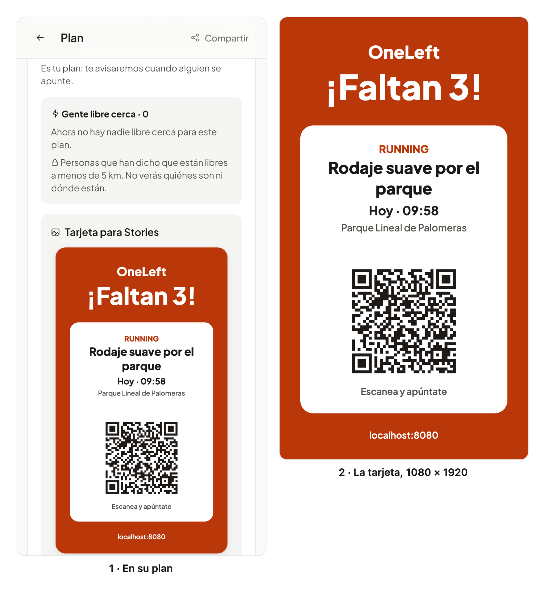

# 51 · Sprint 15: HU-056, la tarjeta del plan para Stories

**Fecha:** 29/10/2026 · **Sprint:** 15 (23–29/10/2026)

## 1. Planificación

| Issue | Tipo | MoSCoW | Puntos | Resultado |
|---|---|---|---|---|
| frontend#32 · HU-056 Tarjeta para Stories | Historia | Should | 3 | PR #149 |
| docs#126 · Documentación (esta entrada) | Documentación | Should | 1 | esta entrada |

**Por qué ahora:** era de las historias de crecimiento más baratas: el organizador de un plan al que le falta gente
lo comparte en Instagram, WhatsApp o TikTok con una imagen que se entiende sola. Venía del Sprint 14.

**Objetivo:** una imagen vertical con lo esencial del plan y un QR que abra la app, hecha en el propio móvil, sin
cuenta de desarrollador de Meta ni servidor de imágenes.

## 2. Decisiones

| Decisión | Motivo |
|---|---|
| **La tarjeta se dibuja en un `canvas` del dispositivo**, de 1080 × 1920: la marca, «¡Falta 1!» o «¡Faltan 3!», la actividad, el título (dos líneas como mucho), cuándo («Hoy · 19:30»), dónde y el QR | Es el formato de una Story (9:16). Sin servidor: nada del plan sale del móvil salvo lo que el propio usuario comparte |
| **El QR lleva el enlace de compartir del plan** (`/share/plans/{id}`), el mismo de HU-024 | Quien lo escanea ve la vista previa del plan y la app se abre en él. No hay nada nuevo que mantener |
| **Colores propios de la tarjeta** (`--ol-story-*`), iguales en el tema claro y el oscuro | Es una imagen, no una pantalla: el QR tiene que ser siempre oscuro sobre blanco, o no se lee |
| **`qrcode` solo da la matriz del código**; la dibuja el propio `canvas` con los colores de la tarjeta. Se carga al crear una tarjeta | El paquete inicial se queda en 725 kB. Dibujar los módulos nosotros evita depender de su render y permite probar el dibujo con un contexto falso |
| **Vista previa antes de compartir**, solo para quien organiza el plan, mientras está abierto, con plazas libres y sin empezar | Se ve lo que se va a publicar. Con el plan lleno o empezado, la tarjeta diría algo falso |
| **Compartir**: la Web Share API con el fichero en el navegador; en la app de Android, la hoja nativa a través de un fichero en la caché (plugin `@capacitor/filesystem`). Sin soporte de ficheros, «Descargar» | La hoja de Android solo recibe ficheros por una ruta; la caché la vacía el sistema cuando necesita sitio |

## 3. En la app

*Figura 160. Ana, organizadora de un plan al que le faltan tres. A la izquierda, el detalle del plan con la tarjeta ya
creada y su vista previa; a la derecha, la imagen que se comparte, de 1080 × 1920. En «¡Faltan 3!» y en la hora se ve
lo que el plan necesita, y el QR abre el plan. Stack local real; capturas generadas con
[`tools/capture-story.mjs`](../tools/capture-story.mjs), que solo crea la tarjeta y no la comparte.*

## 4. Pruebas

- **Unitarias (web: 337 tests, 96,9 % de cobertura; la tarjeta, 100 %):**
  - el dibujo, con un contexto falso que registra lo que pinta: los textos, el color de fondo y cada módulo oscuro del QR dentro de la imagen;
  - el reparto del título en líneas, con puntos suspensivos;
  - el PNG de 1080 × 1920 con los módulos del enlace;
  - el componente: textos, plural, Web Share, descarga, hoja de Android, error y cierre;
  - el detalle del plan: solo para el organizador mientras hay plazas.
- **E2E** (`story.e2e.ts`, en español e inglés): el organizador crea la tarjeta, ve la vista previa y la descarga; el test comprueba que el fichero es un PNG de 1080 × 1920. El plan se responde en el navegador: no crea nada.
- **Contra el stack local**, con Ana y uno de sus planes:
  - la tarjeta usa las fuentes de la app;
  - su QR se decodificó con jsQR a `http://localhost:8080/share/plans/<id>`, que enseña la vista previa del plan y abre la app en él.

## 5. Incidencias

- **Funcionaba en local y fallaba en la CI.** `qrcode` es CommonJS: en el servidor de desarrollo y en los tests sus funciones salen como exportaciones con nombre, pero la compilación solo da la exportación por defecto, así que `create` no existía y la tarjeta no se creaba. Lo descubrió el E2E de la CI, que usa la compilación; se arregló tomando `create` de la exportación por defecto si la hay.
- **El emulador de Android no sirvió.** Con Docker y el emulador a la vez, el Mac se quedó sin memoria y se cerró todo; con el emulador a 2 GB y sin ventana, sí arrancó, pero pierde letras al escribir y no se pudo iniciar sesión. **La hoja de compartir de Android queda sin probar**, y con ella la casilla correspondiente de la historia: se probará en un móvil con el APK de la CI.
- **Las capturas se perdieron.** Al cerrarse la aplicación se vació la carpeta temporal donde estaban, y hubo que repetirlas.
