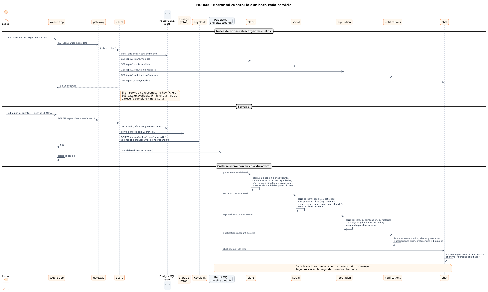
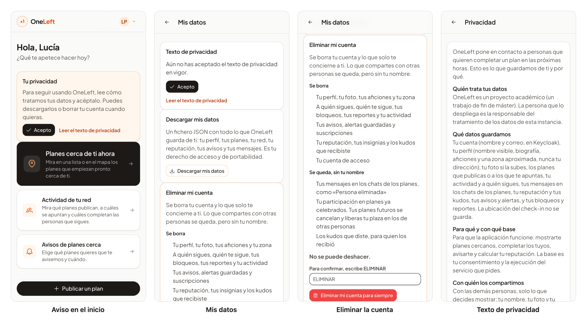

# 52 · Sprint 16: HU-045, exportar y borrar mis datos (RGPD)

**Fecha:** 29/10/2026 · **Sprint:** 16 (30/10–05/11/2026)

## 1. Planificación

| Issue | Tipo | MoSCoW | Puntos | Resultado |
|---|---|---|---|---|
| backend#61 · HU-045 Exportar y borrar mis datos | Historia | Should | 8 | PR #128 |
| infra#73 · Cliente `oneleft-accounts` y `users` con RabbitMQ | Tarea | Should | 2 | PR #74 |
| frontend#150 · «Mis datos», borrado y consentimiento | Historia | Should | 3 | PR #151 |
| docs#128 · Documentación (esta entrada) | Documentación | Should | 1 | esta entrada |

**Por qué ahora:** es la historia que cierra el RGPD: derecho de acceso y portabilidad (descargar) y de supresión
(borrar). Toca todos los servicios, así que convenía hacerla cuando ya estaban todos.

**Objetivo:** una persona descarga todo lo que OneLeft guarda de ella en un único JSON y puede borrar su cuenta, con
el efecto en cada servicio, en las fotos y en Keycloak.

## 2. Decisiones

| Decisión | Motivo |
|---|---|
| **Cada servicio publica lo suyo** en `GET /api/v1/<servicio>/me/data`; `users` los agrega en `GET /api/v1/users/me/data` | Cada servicio es dueño de sus tablas. `users` hace una llamada por servicio con el mismo token |
| **Si un servicio no responde, no hay fichero** (503 `data.unavailable`) | Un fichero a medias parecería completo y no lo sería |
| **El borrado es un evento** `user.deleted` en el exchange `oneleft.accounts`; cada servicio tiene su cola **duradera** `<servicio>.account-deleted` | Un servicio parado no pierde el borrado: lo recibe al volver |
| **Puerto `PersonalData`** por servicio (`of(userId)` exporta tablas por nombre, `erase(userId)` borra) con adaptador JDBC | El dominio no depende de SQL; exportar y borrar viven juntos y no se desincronizan |
| **Borrar es repetible**: la segunda vez no encuentra nada | RabbitMQ puede entregar dos veces |
| **Lo compartido se queda, anonimizado**: mensajes de chat y participación en planes celebrados como «Persona eliminada»; los kudos que dio pierden su autor (`gen_random_uuid()`) | Borrarlos dañaría a las demás personas (conversaciones y reputación ajenas) |
| **Planes**: libera su plaza en los futuros y cancela los futuros que organizaba | Nadie debe acudir a un plan cuyo organizador ya no existe |
| **El libro de reputación se borra** con una excepción explícita del trigger que lo hace inmutable (`set_config('oneleft.ledger_erasure')`) | El libro es de solo añadir, salvo para este caso |
| **Keycloak**: cliente `oneleft-accounts` (client credentials) cuya cuenta de servicio solo puede gestionar usuarios | Mínimo privilegio. En producción, su secreto es obligatorio y no tiene valor por defecto |
| **Orden**: datos locales → fotos en el almacén → Keycloak → evento tras el commit | Cada paso se puede repetir si el siguiente falla |
| **Consentimiento versionado** (`2026-10-25`): se pide al entrar si falta o cambió la versión | Permite pedirlo de nuevo cuando cambie el texto |

*Figura 161. Descargar los datos y borrar la cuenta: qué hace cada servicio.
Fuente: [`54-secuencia-borrar-cuenta.puml`](../diagramas/secuencia/src/54-secuencia-borrar-cuenta.puml).*

## 3. En la app

*Figura 162. Lucía: el aviso de privacidad en el inicio, «Mis datos» con la descarga, la pantalla de borrado
(explica qué se borra y qué se queda sin su nombre y pide escribir ELIMINAR) y el texto de privacidad. Stack local
real; capturas generadas con [`tools/capture-account.mjs`](../tools/capture-account.mjs), que no acepta, descarga ni
borra nada.*

## 4. Pruebas

- **Por servicio** (plans, social, reputation, notifications, chat): un test de integración con BD real siembra datos,
  entrega `user.deleted` **dos veces** al listener y comprueba tablas y anonimización; después limpia.
- **users**: `AccountServiceTest`, `ConsentServiceTest`, `KeycloakIdentitiesTest`, `ServicesRestDataTest` (incluido el
  503) y `AccountIntegrationTest` con RabbitMQ en Testcontainers.
- **Web (350 tests, 96,9 % de cobertura)**: consentimiento, «Mis datos», privacidad, cliente de la API y menú; E2E
  `account.e2e.ts` en las cuatro combinaciones de idioma y tema, con la API respondida en el navegador (no borra nada).
- **De extremo a extremo en el stack local**, con una **cuenta desechable** creada en Keycloak:
  1. crea perfil, persona social, seguimiento, plaza en un plan y consentimiento;
  2. con notifications y chat parados, la descarga responde 503 `data.unavailable`;
  3. `DELETE /api/v1/users/me/account` responde 204: la cuenta desaparece de Keycloak y de `users`, social borra su parte
     por el evento, el plan recupera la plaza y la persona ya no puede iniciar sesión;
  4. no queda ningún residuo.

## 5. Incidencias

- **Migración duplicada en plans:** HU-033 y esta historia crearon una `V10`; se renombró a `V11`.
- **Colas de test:** una cola exclusiva se borraba al cerrar; y RabbitMQ 4 no admite colas no duraderas compartidas, así que son duraderas.
- **`UsersApplicationTest` fallaba** (health 503) sin broker: ahora arranca un contenedor RabbitMQ.
- **Realm importado solo la primera vez:** el cliente nuevo no existía en un Keycloak ya creado; se añadió `keycloak/sync-accounts-client.sh`.
- **Sin outbox:** si el servicio cae entre el commit y la publicación del evento, los demás servicios no borran. Es una limitación conocida y documentada; borrar es repetible, así que se puede reenviar.
- **La descarga completa no se probó en vivo** por memoria (notifications y chat no caben junto al resto): queda cubierta por los tests de cada servicio y de `ServicesRestDataTest`.
