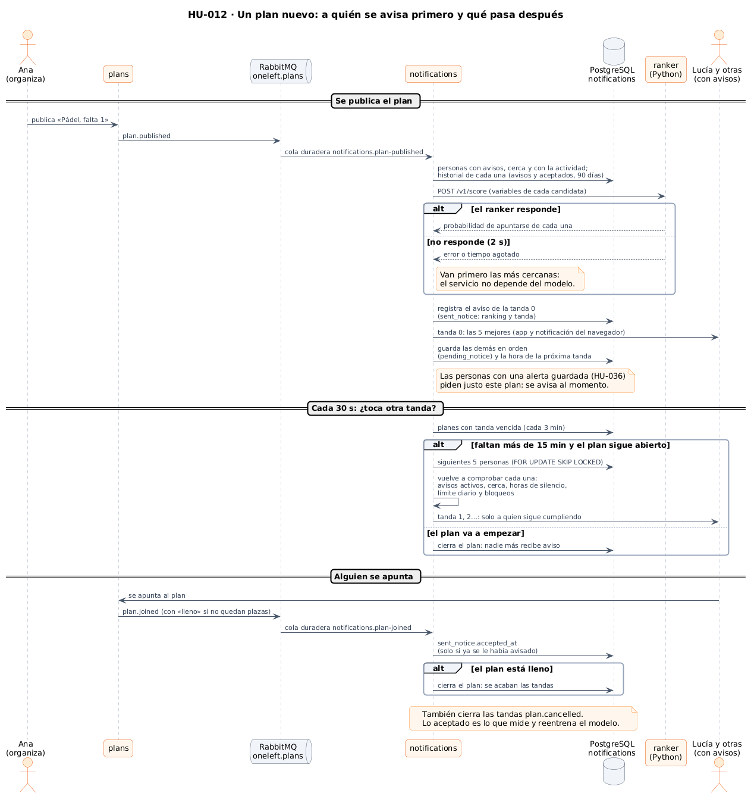

# 53 · Sprint 16: HU-012, avisar primero a quien más probabilidad tiene de apuntarse

**Fecha:** 29/10/2026 · **Sprint:** 16 (30/10–05/11/2026)

## 1. Planificación

| Issue | Tipo | MoSCoW | Puntos | Resultado |
|---|---|---|---|---|
| backend#15 · HU-012 Elegir a quién notificar con IA | Historia | Should | 13 | esta entrada |
| backend#131 · Servicio `ranker`: modelo y simulador | Tarea | Should | 3 | PR #133 |
| backend#132 · Ordenar, avisar por tandas y aprender en `notifications` | Tarea | Should | 5 | PR #134 |
| infra#75 · `ranker` en Compose | Tarea | Should | 2 | PR #76 |
| docs#130 · Documentación (esta entrada) | Documentación | Should | 2 | esta entrada |

**Por qué ahora:** el aviso de planes cercanos (HU-006) avisaba a todo el mundo a la vez, por cercanía. Con muchas
personas eso molesta a quien no iba a apuntarse y gasta su límite diario de avisos. Esta historia usa el modelo de IA
del proyecto: ordena a las personas por la probabilidad de apuntarse y avisa por tandas.

**Objetivo:** completar el plan avisando a menos gente y antes, sin que `notifications` dependa del modelo.

## 2. Decisiones

| Decisión | Motivo |
|---|---|
| **Servicio aparte en Python** (`ranker`: FastAPI + scikit-learn), imagen propia | Elegido para la memoria: es el entorno donde se entrena y evalúa un modelo. Va dentro de `oneleft-backend/ranker/` (no es un módulo de Maven) con su CI. 256 MB; en el servidor de 8 GB el total pasa de 6,1 a 6,4 GB |
| **`notifications` llama al `ranker` por HTTP con tiempos cortos** (1 s para conectar, 2 s para leer) y, si falla o no hay dirección, **avisa primero a las más cercanas** | Los avisos no pueden depender de un servicio extra. `ranker` no es dependencia en Compose |
| **Variables** que `notifications` calcula (11): distancia y distancia relativa a su radio, minutos hasta el inicio, hora y día de la semana, si la actividad está en su lista, si viene de una alerta, tasa de aceptación reciente suavizada `(aceptados+1)/(avisos+4)`, avisos recibidos y avisos de hoy, y plazas libres | Todas salen de lo que `notifications` ya tiene; no hace falta preguntar a otros servicios |
| **Por tandas**: 5 personas cada 3 minutos mientras queden plazas y falten más de 15 minutos | Una tanda pequeña deja ver si basta con las mejores. Los tres valores se configuran (`NOTICES_*`) |
| **Cada tanda vuelve a comprobar** avisos activos, cercanía, horas de silencio, límite diario y bloqueos | Entre la publicación y la tanda 3 pasan minutos, y las reglas de HU-006 y HU-033 no se pueden saltar |
| **Las alertas guardadas (HU-036) siguen avisando al momento** | Quien creó la alerta pidió exactamente ese plan |
| **Lo que se acepta se aprende**: `plan.joined` marca `sent_notice.accepted_at` si ya se había avisado a esa persona; cada aviso guarda cómo se eligió (`model`, `distance`, `fallback`, `alert`) y en qué tanda | Es lo que mide el modelo en producción y con lo que se reentrenará. Con `NOTICES_STRATEGY=distance` se puede comparar con la regla antigua |
| **Un plan lleno o cancelado cierra sus tandas**; el reparto usa `FOR UPDATE SKIP LOCKED` | Nadie recibe un aviso de un plan sin plazas, y dos réplicas no avisan a las mismas personas |

*Figura 163. Qué pasa desde que se publica un plan: la puntuación, la primera tanda, las siguientes y lo que se aprende
cuando alguien se apunta. Fuente: [`55-secuencia-avisos-por-tandas.puml`](../diagramas/secuencia/src/55-secuencia-avisos-por-tandas.puml).*

## 3. El modelo y su evaluación

**No hay historial real antes del lanzamiento**, así que el modelo (*gradient boosting*, 150 árboles de profundidad 3)
se entrena al construir la imagen con un historial **sintético y reproducible** (40 000 avisos, semilla fija) cuya
generación está en [`ranker/synthetic.py`](https://github.com/chabelly-lbetancourt/oneleft-backend/blob/dev/ranker/ranker/synthetic.py).
La probabilidad de aceptar depende de la distancia, pero también del interés declarado, de lo cerca que empieza el plan,
del fin de semana y de la tarde, de los avisos ya recibidos hoy y de una propensión propia de cada persona que solo se
ve en parte en su tasa pasada.

| Sobre el 20 % reservado | Modelo | Solo distancia |
|---|---|---|
| AUC (qué bien ordena) | **0,815** | 0,674 |
| Puntuación de Brier del modelo (calibración) | 0,098 | — |
| Tasa de aceptación del historial | 13,7 % | — |

**Simulador** (`python -m ranker.evaluate`): 2 000 planes con 20–80 candidatas y 1–4 plazas; las dos estrategias avisan
por tandas hasta completar el plan y solo se diferencian en a quién avisan primero. El mismo sorteo decide si cada
candidata acepta, así que se comparan con las mismas personas.

| Tanda | Estrategia | Planes completados | Minutos hasta completarlo | Aceptación | Avisos por plan |
|---|---|---|---|---|---|
| 5 cada 3 min | regla de distancia | 92,5 % | 3,94 | 20,8 % | 11,2 |
| 5 cada 3 min | **modelo** | 92,5 % | **2,02** | **29,0 %** | **8,0** |
| 3 cada 5 min | regla de distancia | 92,2 % | 12,44 | 20,7 % | 11,2 |
| 3 cada 5 min | **modelo** | 92,4 % | **6,85** | **29,0 %** | **8,0** |
| 10 cada 2 min | regla de distancia | 92,5 % | 0,95 | 20,8 % | 11,2 |
| 10 cada 2 min | **modelo** | 92,5 % | **0,41** | **29,0 %** | **8,0** |

Con las tres configuraciones el modelo completa el plan **en la mitad de tiempo**, con **un 28 % menos de avisos** y
con más aceptación. Los planes que se llenan son los mismos (los que no, no tienen candidatas suficientes).

**Lo que esta comparación no demuestra:** el simulador usa el mismo mecanismo con el que se generó el historial, así que
enseña que ordenar funciona cuando aceptar depende de más cosas que la distancia, **no cuánto se ganará con personas
reales**. Por eso se guardan los resultados reales y la estrategia de cada aviso: tras unas semanas de uso se podrá
comparar de verdad y reentrenar con ellos.

## 4. Pruebas

- **`ranker`** (pytest, 13 casos): historial reproducible, candidatas de un plan con el mismo inicio y plazas, el modelo ordena mejor que la distancia (AUC y Brier), la API (salud, orden de las puntuaciones, lista vacía, valores no válidos → 422) y el simulador (una tanda que llena el plan, un plan que no se llena y que el modelo supera a la regla).
- **`notifications`**, unitarias (11 nuevas): las mejores primero y las demás esperan; qué ve el modelo de cada persona (historial); sin modelo, las más cercanas; la regla de distancia no lo consulta; si caben todas no se programa nada; las tandas salen a su hora hasta agotar la lista; un plan lleno o cancelado no recibe más; un «apuntarse» solo cuenta si se había avisado; ninguna tanda en el último cuarto de hora; cada persona se comprueba de nuevo (avisos desactivados, bloqueo, horas de silencio, límite). Además, `RankerClientTest` (variables, error 500, sin dirección, valores por defecto).
- **Integración con PostgreSQL y RabbitMQ** (en la CI): el orden de las personas y cada tanda, cerrar un plan, programar de nuevo, el historial (enviados, aceptados, de hoy) y que el borrado de la cuenta (HU-045) también elimina lo nuevo.
- **Imagen**: construida y probada en local (`/health`, una puntuación real y 144 MiB de memoria).
- **SQL contra PostgreSQL local**, con la migración V1–V4 y las consultas dentro de una transacción con *rollback*.

## 5. Incidencias

- **El primer historial sintético era irreal:** con la ordenada inicial del primer intento solo aceptaba el 4 %, y el 45 % de los planes simulados no se completaba. Se recalibró hasta el 13,7 % para que las cifras tuvieran sentido; es una decisión que figura en el código.
- **Puerto ocupado:** el `ranker` iba a escuchar en el 8086, que es el de `reputation`; pasó al **8087**.
- **Nombre de *bean* repetido:** el cliente HTTP (`@Bean rankerClient`) chocaba con el componente `RankerClient`. Los tests unitarios no cargan el contexto, así que lo descubrió la CI al arrancar los tests de integración; se renombró el *bean*.
- **No se probó en vivo con `notifications` y `ranker` en el stack local:** el stack ocupa 2,9 GB de los 3,8 GB de Docker y arrancar otro servicio más, y los contenedores de los tests, arriesgaba un cierre por memoria. Quedó cubierto por las pruebas de integración de la CI y por la validación de SQL contra la base local.
