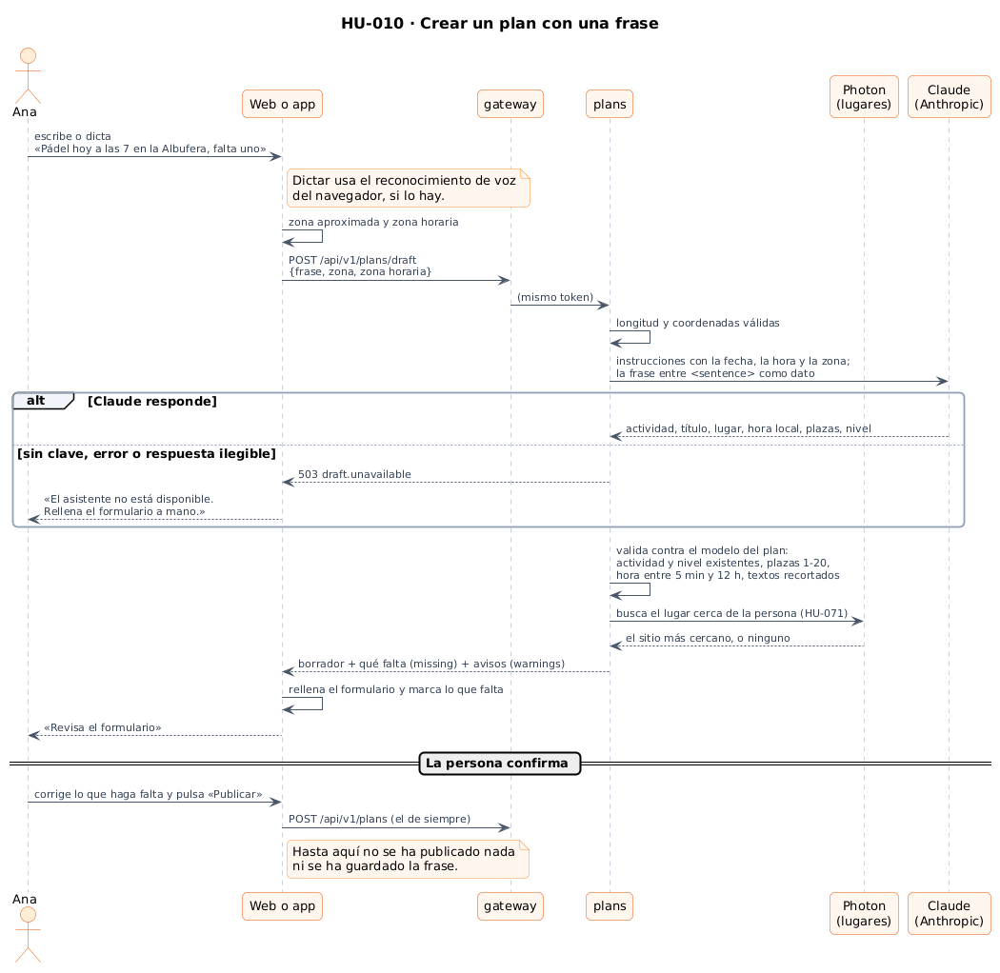
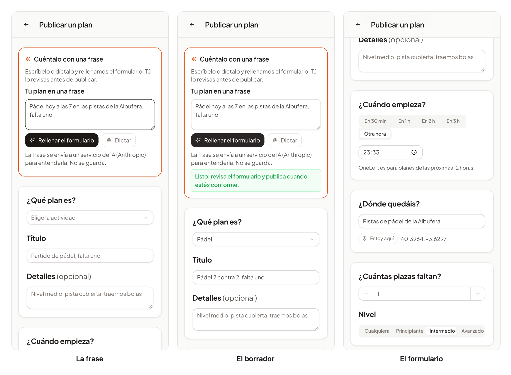

# 54 · Sprint 16: HU-010, crear un plan con una frase

**Fecha:** 30/10/2026 · **Sprint:** 16 (30/10–05/11/2026)

## 1. Planificación

| Issue | Tipo | MoSCoW | Puntos | Resultado |
|---|---|---|---|---|
| backend#13 · HU-010 Crear un plan en lenguaje natural | Historia | Should | 8 | esta entrada |
| backend#135 · Borrador de un plan con un LLM en `plans` | Tarea | Should | 3 | PR #136 |
| frontend#152 · Escribir o dictar el plan | Tarea | Should | 3 | PR #153 |
| infra#77 · Clave y modelo de Anthropic en Compose | Tarea | Should | 1 | PR #78 |
| docs#132 · Documentación (esta entrada) | Documentación | Should | 1 | esta entrada |

**Por qué ahora:** publicar un plan exige rellenar seis campos; con una frase («pádel hoy a las 7 en la Albufera, falta
uno») se publica en segundos. Es la segunda historia de IA del proyecto, después de HU-012.

**Objetivo:** que la persona escriba o dicte una frase, vea el formulario relleno y **confirme** antes de publicar.

## 2. Decisiones

| Decisión | Motivo |
|---|---|
| **Claude (Anthropic) con Spring AI 2.0.2**, detrás de un puerto `PlanInterpreter` | Elegido para el proyecto (el Mac no tiene memoria para un modelo local). El dominio no conoce al proveedor: se puede cambiar el adaptador |
| **El modelo solo sugiere**: `PlanDraftService` valida cada campo con las reglas del plan (actividad y nivel que existan, plazas de 1 a 20, hora entre 5 minutos y 12 horas, textos recortados) y lista en `missing` lo que no encaja | Un modelo de lenguaje se equivoca; lo que llega al formulario ya cumple las reglas del servicio |
| **El lugar se busca con la búsqueda de lugares (HU-071)**, nunca se aceptan coordenadas del modelo | Un modelo inventaría coordenadas. Se elige el sitio más cercano a la persona |
| **No se publica nada**: el borrador rellena el formulario de siempre y la persona pulsa «Publicar» | Es el criterio «el usuario confirma antes de publicar», y evita publicar algo mal entendido |
| **La hora relativa la resuelve el modelo con la fecha, la hora y la zona de la persona** (la zona horaria la manda el navegador) | `plans` trabaja en UTC; «mañana a las 7» es la hora de quien lo dice |
| **La frase es dato, no instrucción**: va entre `<sentence>` y el sistema dice que ignore órdenes dentro; el modelo no tiene herramientas ni acceso a nada | Contra la inyección de instrucciones. Lo peor que puede pasar es un borrador raro que la persona ve antes de publicar |
| **Sin clave, el servicio arranca igual** y el borrador responde `503 draft.unavailable`; el modelo solo se activa con `ANTHROPIC_API_KEY` | La clave nunca está en el repositorio y las demás funciones no dependen de ella |
| **La frase no se guarda**; la propia tarjeta dice que se envía a Anthropic y el texto de privacidad tiene una sección nueva | Es un dato que sale de la instancia a un tercero: debe saberse en el momento de usarlo |
| **Dictado con el reconocimiento de voz del navegador**; donde no lo hay, no se muestra el botón (y sirve el dictado del teclado) | Sin servicios de voz de pago. En la app de Android (WebView) no existe |

*Figura 164. Qué ocurre desde que se escribe la frase hasta que la persona publica.
Fuente: [`56-secuencia-plan-con-una-frase.puml`](../diagramas/secuencia/src/56-secuencia-plan-con-una-frase.puml).*

## 3. En la app

*Figura 165. Lucía escribe la frase (izquierda), la web rellena el formulario (centro) y ella lo revisa (derecha): la
actividad, el título, el punto de encuentro con sus coordenadas, «Otra hora», una plaza y el nivel intermedio. Stack
local con la respuesta del servicio **simulada en el navegador** (no hay clave de Anthropic); capturas generadas con
[`tools/capture-draft.mjs`](../tools/capture-draft.mjs), que no envía nada ni publica.*

## 4. Pruebas

- **`plans`, unitarias:** `PlanDraftServiceTest` (12): un borrador completo, lo que no dice la frase, actividad o nivel inexistentes, mayúsculas, hora fuera de las 12 horas o demasiado pronto, hora ilegible, lugar no encontrado o demasiado corto, textos recortados y título demasiado corto, plazas y mínimo, error del modelo y validación de la petición. `AnthropicPlanInterpreterTest` (4): sin clave, la frase va como dato, fallo o respuesta vacía y el contenido de las instrucciones.
- **Configuración de Spring AI** (`AiGatingTest`, 3): con `chat=none` el servicio arranca sin modelo, con el ajuste vacío de Compose también, y con clave y ajuste se crea el modelo de Anthropic.
- **`plans`, integración** (en la CI): el endpoint devuelve el borrador, lo que falta, `503` con su código, validaciones y `401` sin sesión, con el modelo y la búsqueda de lugares sustituidos.
- **Web:** 367 tests unitarios y 97 % de cobertura (tarjeta, dictado, cliente de la API, rellenar el formulario con y sin lo que falta, avisos de hora y lugar, mínimo de participantes, asistente no disponible y falta de ubicación) y **4 E2E** (español e inglés): escribir la frase, ver el formulario relleno sin publicar nada, y el aviso de asistente no disponible.
- **Compose:** con y sin `ANTHROPIC_API_KEY` el valor de `SPRING_AI_MODEL_CHAT` es `anthropic` o vacío.

## 5. Incidencias

- **El arranque sin clave fallaba.** Con `spring.ai.model.chat=none` el configurador del cliente de chat sigue pidiendo un modelo y el servicio no arrancaba. Lo vi con un test de configuración, antes de la CI; hay que desactivar también `spring.ai.chat.client.enabled`.
- **Un `ngModel` dentro del formulario.** La tarjeta estaba dentro del `<form [formGroup]>` y Angular intentaba registrar su campo en el formulario padre (`NG01354`). La saqué del formulario.
- **Un servidor ajeno en el puerto 4200** (una práctica de otra asignatura) hacía fallar todos los E2E: los tests con sesión tenían el puerto fijo. Ahora `signIn` respeta `ONELEFT_APP_URL` y se ejecutaron en el 4300.
- **Intermitencias en los tests de la web con cobertura** cuando el equipo estaba cargado (planes con «dentro de 60 minutos»); sin carga pasaron los 69 ficheros.
- **No se probó contra la API real de Anthropic:** no hay clave en el entorno de desarrollo. La calidad de las frases reales queda sin medir; los tests usan un modelo simulado y la comprobación manual con clave está pendiente.
- **No se subió la versión del consentimiento** de HU-045 aunque el texto de privacidad cambia: la frase solo se envía cuando la persona pulsa el botón y la tarjeta lo avisa. Cambiar la versión haría que todo el mundo tuviera que aceptar de nuevo.
- **Memoria de `plans` en el servidor:** Spring AI añade clases al servicio (límite de 640 MB). Hay que mirar su consumo al desplegar.
