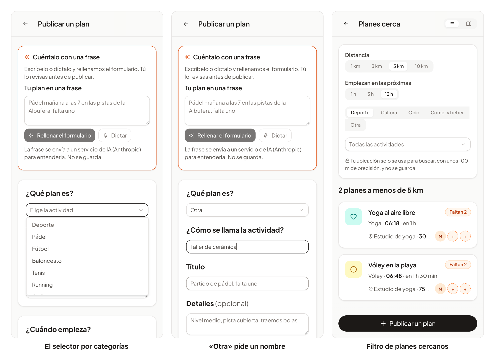

# 55 · HU-068: más categorías de actividad

**Fecha:** 05/11/2026 · **Sprint:** 16 (30/10–05/11/2026) en el calendario; las tarjetas de HU-068 están planificadas en
los sprints 17 y 18 en el tablero (se adelantó)

## 1. Planificación

| Issue | Tipo | MoSCoW | Puntos | Resultado |
|---|---|---|---|---|
| backend#98 · HU-068 Más categorías de actividad | Historia | Should | 3 | PR #137 |
| frontend#61 · Selector de actividades por categoría | Historia | Should | 3 | PR #154 y #155 (corrección del E2E) |
| frontend#156 · Etiqueta duplicada en el nombre de «Otra» (bug) | Bug | Should | 1 | PR #157 |
| docs#134 · Documentación (esta entrada) | Documentación | Should | 1 | esta entrada |

**Por qué ahora:** con solo 10 actividades (pádel, fútbol, cine…) quedaban fuera planes cotidianos a los que también les
falta gente (un café, una quedada de idiomas, yoga). HU-069 y HU-070 (acompañante y preferencias de participantes) se
apoyan en este catálogo.

**Objetivo:** que cualquier plan quepa en una categoría, con un selector claro, sin romper los planes, avisos y perfiles
que ya existen.

## 2. Decisiones

| Decisión | Motivo |
|---|---|
| **29 actividades en cinco categorías** (deporte 16, cultura 4, ocio 5, comer y beber 3 y «otra») | Es el catálogo de la historia; los códigos tienen como máximo 20 caracteres porque la columna más estrecha (avisos y modo libre) es `varchar(20)` |
| **Las actividades se guardan como texto sin restricciones: añadir códigos no necesita migración de datos** | Los planes, avisos y perfiles existentes siguen siendo válidos; solo hubo que añadir una columna |
| **Categoría y «al aire libre» se definen una vez, en el enum `Activity` de `plans`** | Es lo que usará HU-026 (el tiempo) y lo que usa el filtro por categoría; cada servicio mantiene su copia del catálogo (los códigos son el contrato) |
| **«Otra» lleva un nombre propio de hasta 30 caracteres** (`activity_other`, migración V12): obligatorio, sin espacios sobrantes ni caracteres de control, y se descarta si la actividad no es «Otra» | Sin nombre, un plan «Otra» no diría nada |
| **«Otra» solo vale para un plan**: no se puede tener como afición, aviso ni alerta, ni como interés del modo libre; el asistente de HU-010 tampoco puede elegirla | Nadie se interesa por «cualquier otra cosa»; el servicio de avisos sí la conoce para poder leer el evento de un plan «Otra» |
| **Los avisos del sistema nombran a «Otra» como «Otra actividad»**; el nombre propio solo sale en la ficha del plan, el ticket, la tarjeta de Stories y la página de compartir | El evento `plan.published` no lleva el nombre; ampliarlo se dejó para después |
| **Planes cercanos admite `category`, que se suma a `activity`** (también en el tiempo real) | Se puede filtrar «todo lo de cultura» y además «el yoga» |
| **La moderación del nombre (HU-011) no existe aún**: validación básica ahora | Se anotará un `TODO` con su issue cuando se decida cuál es |
| **Un perfil sigue teniendo como máximo 10 aficiones** aunque haya 28 | La historia no pedía cambiarlo |

## 3. En la app

*Figura 166. Lucía: el selector de «Publicar un plan» agrupado por categoría (izquierda), «Otra» pidiendo el nombre de
la actividad (centro) y planes cercanos filtrados por la categoría «Deporte» (derecha). Stack local real, con la API
de planes **respondida en el navegador** para no crear datos; capturas generadas con
[`tools/capture-activities.mjs`](../tools/capture-activities.mjs).*

## 4. Pruebas

- **Backend, unitarias:** catálogo y categorías (cada actividad en una sola categoría, códigos de ≤ 20 caracteres, lista exacta de actividades al aire libre), nombre de «Otra» (obligatorio, recortado, 30 caracteres, sin control, descartado en las demás y conservado en cada cambio de estado del plan), «Otra» rechazada como interés (modo libre, avisos y alertas), nombres de todas las actividades en español e inglés para los avisos y la página de compartir (con el nombre de «Otra» escapado) y el asistente sin «Otra».
- **Backend, integración** (en la CI): publicar «Otra» con y sin nombre, filtrar por categoría y por actividad a la vez y el catálogo de `users` (28 actividades, sin «Otra»).
- **Web:** 375 tests (97 % de cobertura): catálogo, agrupación con textos traducidos, selector por categorías, campo del nombre de «Otra» (aparece, es obligatorio y se olvida al cambiar de actividad), filtro por categoría con su parámetro `category` en la lista y en el tiempo real.
- **E2E** (`e2e/activities.e2e.ts`, con la API respondida en el navegador para no crear datos): publicar una actividad nueva, publicar «Otra» con su nombre y encontrar el plan filtrando por categoría. **Ejecutado contra el stack local (Keycloak, `users` y gateway reales): 4 de 4 en verde, en español e inglés**, tras corregir un selector (ver incidencias).

## 5. Incidencias

- **Tests antiguos que suponían 10 actividades**: `ForecastTest` (lista de actividades al aire libre), `ProfileTest` (diez aficiones) y `ProfileControllerTest` (catálogo de `users`); este último solo lo vio la CI.
- **Un fallo de la CI ajeno al cambio**: `story-share.spec` (HU-056) asigna `navigator.share`, que otro spec había definido como solo lectura; solo falla según cómo reparte la CI los specs y lo destapó el cambio de reparto. Ahora redefine las propiedades.
- **Un spec nuevo que navegaba de verdad** (error sin gestionar `NG04002`): ahora simula la navegación.
- **La CI de la web se detuvo en el primer fallo y la del backend en el primer módulo que falló**, así que los problemas aparecieron en tres rondas.
- **El E2E no se pudo ejecutar el primer día**: el stack tardaba más de 6 minutos en arrancar (Keycloak 391 s), los health checks de 5 s se agotaban y Keycloak llegó a morir por falta de memoria (OOM). Se pudo con el stack aligerado (sin `social`, `reputation` ni `plans`), con un solo *worker* y un tiempo máximo mayor por caso.
- **El E2E tenía un fallo propio**: «Otra» es a la vez una categoría y una actividad, y el selector resolvía a dos opciones. Ahora elige la última con ese nombre.
- **Las capturas destaparon un defecto**: el campo del nombre de «Otra» tenía la misma etiqueta («¿Qué plan es?») que el selector. Bug frontend#156: ahora pregunta «¿Cómo se llama la actividad?».
- **La implementación contra PostgreSQL real**: la migración V12 se ejecutó en la CI (tests de integración con Flyway), no en un stack local con datos.

## 6. Pendiente

- Anotar el `TODO(#N)` de la moderación de «Otra» cuando se elija la issue de HU-011.
- Valorar nombrar a «Otra» en los avisos (ampliar `plan.published`) y agrupar por categoría los botones de aficiones y alertas.
- **Orden de despliegue:** primero `users`, `plans` y `notifications`, después la web.
