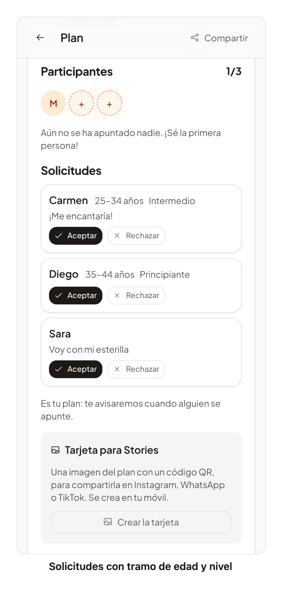

# 56 · HU-069: elegir quién me acompaña

**Fecha:** 11/11/2026 · **Sprint:** 17 (06/11–12/11/2026)

## 1. Planificación

| Issue | Tipo | MoSCoW | Puntos | Resultado |
|---|---|---|---|---|
| backend#99 · HU-069 Elegir quién me acompaña | Historia | Should | 3 | PR #138 |
| frontend#62 · Solicitar plaza y elegir acompañante | Historia | Should | 3 | PR #158 |
| docs · Documentación (esta entrada) | Documentación | Should | 1 | esta entrada |

**Por qué:** unirse (HU-005) era inmediato: en un plan de dos personas, quien pulsaba primero se quedaba con la plaza. Con esta historia el organizador elige con quién queda.

## 2. Decisiones

| Decisión | Motivo |
|---|---|
| **`requiresApproval` en el plan**; la opción se activa al publicar con `chooseCompanion` (falso si falta) | El valor por defecto «activada con una plaza» es de la interfaz; si lo fuera de la API, los planes de una plaza que ya publican otros clientes y los tests dejarían de poder unirse |
| **Las solicitudes viven en el agregado `Plan`** (pendiente, aceptada, rechazada, retirada), con la misma versión que el resto | Aceptar y completar el plan es una sola operación atómica; el **bloqueo optimista** de unirse (HU-005) impide aceptar a más gente que plazas libres |
| **«Caducada» no se guarda**: una solicitud pendiente está caducada cuando el plan ya ha empezado | No hace falta ninguna tarea que las caduque, y no se pueden aceptar ni retirar |
| **Si el plan se completa, el resto de solicitudes pendientes se rechazan solas**, con un aviso aparte («el plan se ha completado con otra persona») | Es lo pedido, y la persona entiende que no es algo personal |
| **Quien fue rechazado no puede volver a pedir; quien retiró su solicitud, sí** | Evita insistir a quien ha dicho que no |
| **Sin lista de espera** en estos planes; si alguien sale, la plaza se reabre a solicitudes | Es lo pedido: no se promociona a nadie sin que el organizador elija |
| **En el plan, `join` y la lista de espera responden `plan.approvalRequired`** | Si el cliente usa el flujo antiguo recibe un código claro |
| **Solo el organizador ve y decide las solicitudes** (`403 plan.notOrganizer`); las solicitudes solo llevan nombre y mensaje (≤ 140 caracteres, sin caracteres de control) | Sin datos de contacto ni ubicación |
| **Eventos `plan.join-requested` y `plan.request-decided`** por RabbitMQ y SSE (colas anónimas por réplica, como `plan.joined`) | El organizador ve la solicitud en tiempo real y quien pidió oye la decisión |
| **Las solicitudes entran en la exportación y el borrado de datos** (HU-045) | Son datos personales |

## 3. En la app

*Figura 168. Lucía, organizadora de un plan en el que se elige a quién acompaña: cada solicitud muestra el nombre, el
tramo de edad y el nivel en la actividad de quien pide (HU-070) y su mensaje, con «Aceptar» y «Rechazar»; Sara no ha
indicado su fecha de nacimiento ni tiene ese nivel. La API de planes está **respondida en el navegador**; captura
generada con [`tools/capture-audience.mjs`](../tools/capture-audience.mjs).*

## 4. Pruebas

- **Backend:** 18 unitarios nuevos (reglas del plan: pedir, aceptar, rechazar, retirar, caducar, plaza que se reabre, quién puede decidir; servicio con eventos, bloqueo y concurrencia) y `JoinRequestControllerTest` de integración con PostgreSQL (la CI lo ejecutó en verde).
- **Web:** 392 tests (97 % de cobertura): los dos componentes nuevos, la API, la opción al publicar y los avisos. **E2E** (`e2e/requests.e2e.ts`, API de planes respondida en el navegador): 4 de 4 en verde en español e inglés; una persona pide plaza con un mensaje y el organizador acepta.

## 5. Incidencias

- **El E2E empezaba en la página del plan, que es pública (HU-024)**, así que nunca pedía el login: hay que iniciar sesión antes (por `/profile`) como hacen los demás.
- **Tests intermitentes por la carga de la máquina** (24 con timeout de 5 s con el stack local arrancado): con el stack parado pasaron los 72 ficheros.
- **Un nombre de tipo chocaba con la anotación `@RequestBody`** de Spring en el controlador (`RequestBody` → `RequestMessage`).

## 6. Pendiente

- ~~El nivel y la franja de edad del solicitante~~ **resuelto con HU-070** (backend#142 y #143, frontend#160 y #161): backend#99 y frontend#62 se cerraron.
- Captura del estado de la solicitud desde quien pide plaza.
- Que el organizador vea la foto y la reputación de quien pide (hoy solo el nombre).
