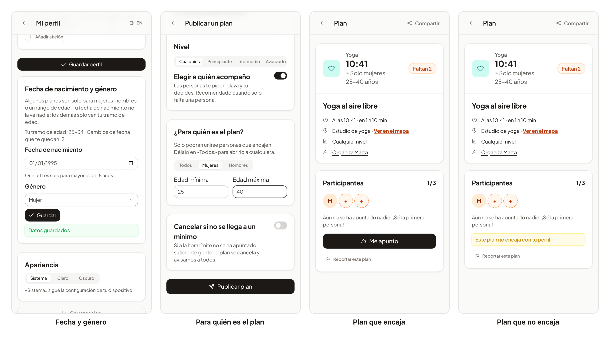

# 57 · HU-070: fecha de nacimiento, género y público del plan

**Fecha:** 11/11/2026 · **Sprint:** 17 (06/11–12/11/2026)

## 1. Planificación

| Issue | Tipo | MoSCoW | Puntos | Resultado |
|---|---|---|---|---|
| backend#100 · HU-070 Planes por género y edad | Historia | Should | 3 | PR #139, #142 (y #143 con el nivel) |
| frontend#63 · Fecha de nacimiento, género y público del plan | Historia | Should | 3 | PR #159, #160 |
| docs · Documentación (esta entrada) | Documentación | Should | 1 | esta entrada |

**Por qué:** hay planes pensados solo para mujeres, para hombres o para un rango de edad. El organizador lo indica al publicar y el sistema lo comprueba, no solo la interfaz.

## 2. Decisiones

| Decisión | Motivo |
|---|---|
| **`users` es dueño de la fecha de nacimiento y el género**; la fecha no sale nunca de `users` | Es un dato personal; los demás servicios solo necesitan género y edad |
| **`plans` pregunta a `users` con el token de la propia persona** (`GET /me/demographics/audience`) | Una persona solo puede preguntar por sí misma; no hay un endpoint para consultar a otras |
| **Público del plan:** género (todos, mujeres, hombres) y edad mínima y máxima opcionales; por defecto, todos | Los planes que ya existen y los que no indican nada no cambian ni llaman a `users` |
| **«No binario» y «prefiero no decirlo» solo encajan en planes para todos** | Un plan «solo mujeres» o «solo hombres» no se puede cumplir de otra forma |
| **Solo mayores de 18 años; la fecha se puede cambiar un par de veces** | OneLeft es para adultos y se evita falsear la edad cambiando la fecha |
| **Los demás ven el tramo de edad** (18–24, 25–34, 35–44, 45–54, 55–64, 65+), nunca la fecha | Es lo que el organizador necesita para decidir |
| **Unirse y pedir plaza se comprueban en el backend**: `plan.audienceMismatch`, `demographics.required`, `demographics.unavailable` (409) | Si `users` no responde, nadie entra por error |
| **Cercanos:** la búsqueda filtra en SQL con género y edad de quien busca; si se desconoce, solo ven los planes para todos. El flujo en tiempo real aplica la misma regla (el evento `plan.published` lleva el público) | La lista en tiempo real y al recargar deben coincidir |
| **La solicitud de plaza guarda el tramo de edad del momento** (V15), si se conoce | El organizador lo ve en su bandeja sin preguntar a `users` |
| **Web:** la comprobación del cliente solo evita mostrar el botón a quien no encaja; decide el servicio | La interfaz nunca es la barrera |

## 3. En la app

*Figura 167. Lucía. De izquierda a derecha: la tarjeta «Fecha de nacimiento y género» del perfil, ya guardada y con su
tramo de edad; el selector «¿Para quién es el plan?» al publicar (mujeres, de 25 a 40 años); un plan para mujeres de 25 a
40 que se le ofrece a ella, y el mismo plan cuando su perfil no encaja, sin botón y con el motivo. Stack local real con
la API de planes y de datos demográficos **respondida en el navegador**, para no crear planes ni guardar ninguna fecha de
nacimiento; capturas generadas con [`tools/capture-audience.mjs`](../tools/capture-audience.mjs).*

## 4. Pruebas

- **Backend:** unitarios del modelo (público, miembro, búsqueda cercana), de los servicios (comprobación, solicitudes con tramo de edad) y de integración con PostgreSQL de `users` y `plans` (en la CI).
- **Web:** 406 tests unitarios: tarjeta del perfil, selector al publicar, público en el ticket y el detalle, y el tramo de edad y el nivel en la bandeja. La CI de las PR y la de `dev` pasaron en verde. **E2E** (`e2e/audience.e2e.ts`, con la API respondida en el navegador): 3 de 3 en verde, en español e inglés, contra Keycloak, `users` y gateway reales; en la CI de la PR el E2E de Playwright sale como `skipping`.

## 5. Incidencias

- **El mock de `UsersApi` del perfil no tenía `demographics`**: la tarjeta nueva rompió 20 tests de `profile.spec` hasta añadirlo.
- **La carga de la máquina** obligó a parar el stack para pasar los tests unitarios y a alargar las esperas del E2E (configuración temporal, no versionada). Con el build equivocado (producción en lugar de desarrollo) el inicio de sesión apuntaba a otro Keycloak y las seis pruebas fallaban en `signIn`.
- **El campo de edad máxima se salía de la tarjeta** al publicar y «25–40 años» se partía en dos líneas: se vio en las capturas y se corrigió.
- **Una fusión sin esperar a la CI:** la PR del E2E se fusionó con `branches-and-commits` en rojo (el commit de fusión `merge dev into issue#63` no seguía el formato). La CI de `dev` después pasó en verde y el commit no se reescribió (rama compartida).
- **El aviso «Invalid PrimeUI License»** sale en los builds locales sin la variable `PRIMEUI_LICENSE`; el script de capturas lo retira antes de capturar.

## 6. Pendiente

- **Los avisos HU-006 por público:** resuelto en la [entrada 58](58-hu006-avisos-por-publico.md) y el [ADR 0001](../arquitectura/adr/0001-avisos-por-publico-modelo-de-lectura.md).
- Cerrar backend#100 y pasar las tarjetas a Done, con el tiempo anotado por mí.
